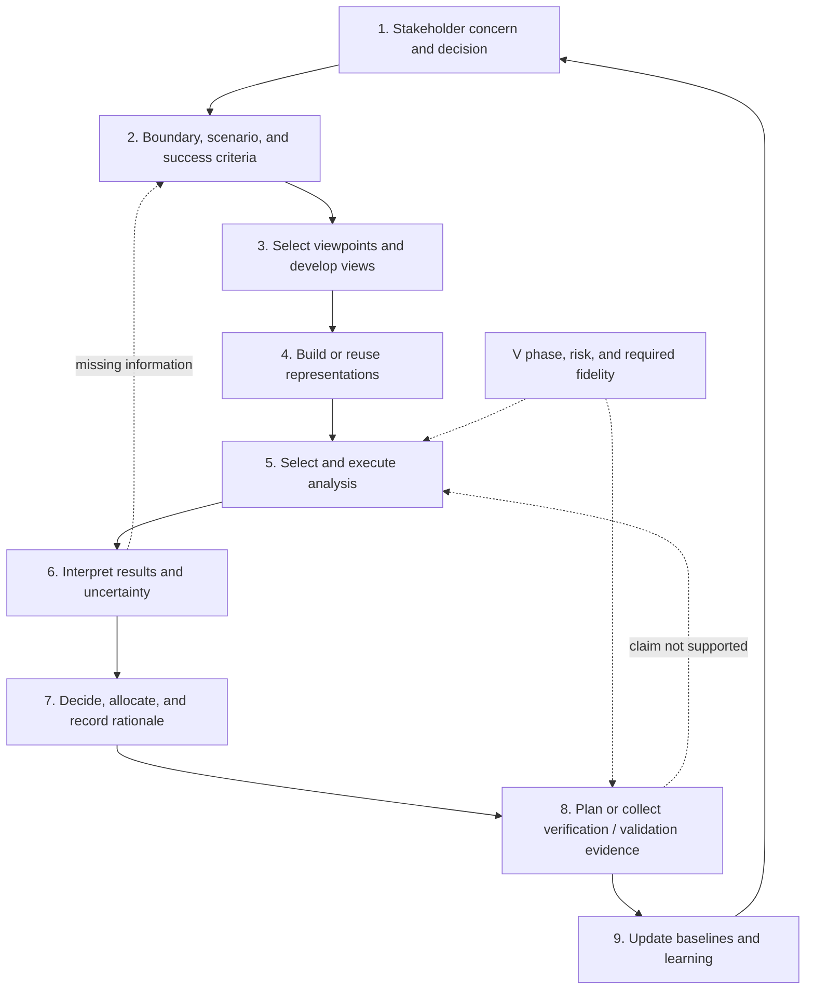
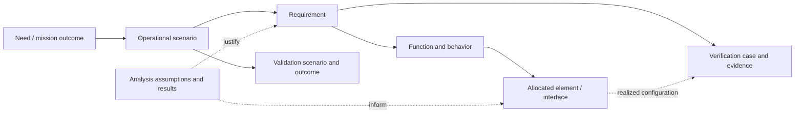
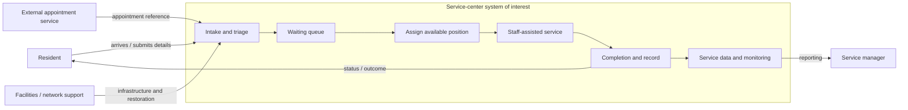
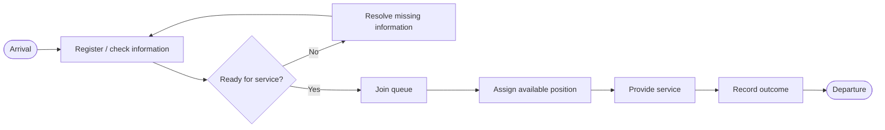
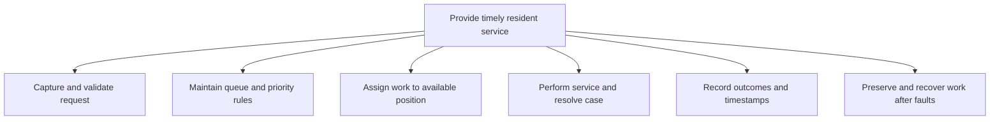
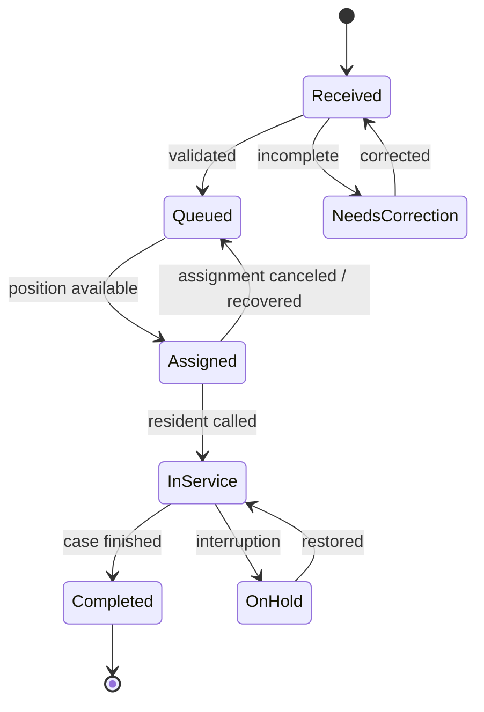
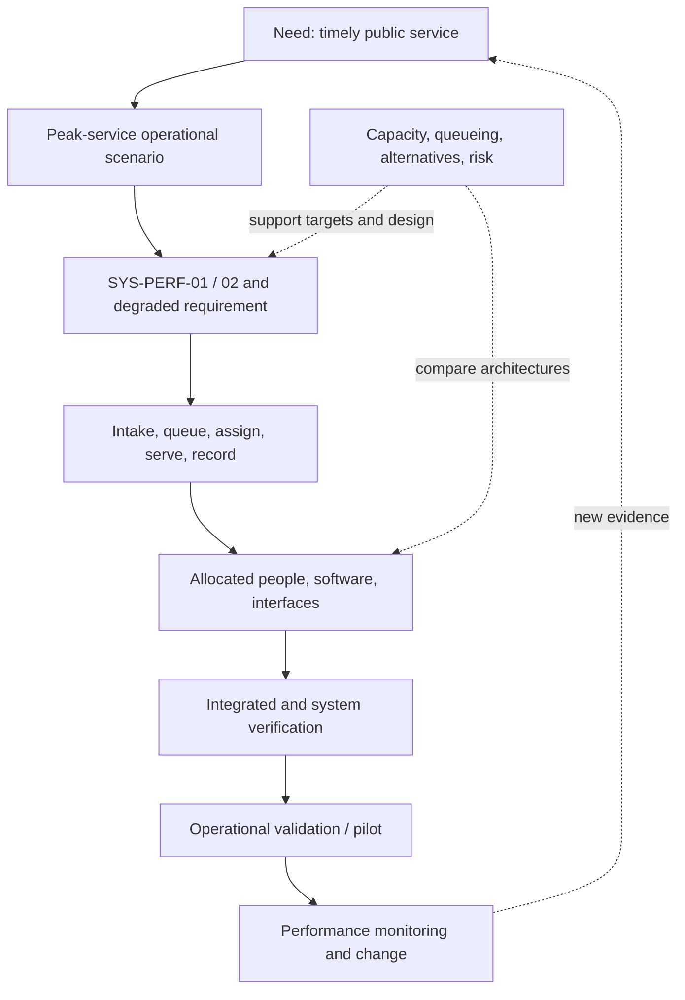

# Systems Engineering Master Learning Guide
## Lifecycle • Views • Models & Diagrams • Analysis Methods • Decisions • Evidence

> **Purpose.** Learn systems engineering as a connected process: start with a question or stakeholder concern; identify the useful view(s), models, and diagrams; select an appropriate analysis at the right point of the systems engineering V; and carry forward decisions, traceability, and evidence. The full view, model, and analysis references are collected in the appendices for detailed study. A method can support more than one view, model, or lifecycle phase.

## Contents

1. [Part I — Foundations and mental models](#guide-foundations)
2. [Part II — The integrated V lifecycle](#guide-lifecycle)
3. [Part III — Views and viewpoints reference navigator](#guide-views)
4. [Part IV — Model and diagram family navigator](#guide-models)
5. [Part V — Analysis methods reference navigator](#guide-analyses)
6. [Part VI — Question-driven selection guide](#guide-questions)
7. [Part VII — Worked end-to-end learning example](#guide-example)
8. [Appendix A — Views and models: detailed reference](#appendix-views)
9. [Appendix B — Analyses and methods: detailed reference](#appendix-analysis)

**Reading paths:**
- **Study from start:** Parts I → II → III–V → VII.
- **Start from a question:** Part VI → linked views, models, methods, and phases.
- **Look up a specific diagram or method:** Parts IV or V → its complete original section in the appropriate appendix.

---

<a id="guide-foundations"></a>
## Part I — Foundations and mental models

Systems engineering is a way of **turning stakeholder concerns into justified decisions and defensible evidence**. The engineer is rarely asked merely to draw a diagram or calculate a number. The underlying task is to determine what matters, understand the system well enough to make a choice, and show why the choice is reasonable under defined conditions.

This guide connects three complementary questions:

1. **What do we need to understand?** Use stakeholder concerns, viewpoints, and views to identify the relevant aspect of the system.
2. **How should we represent it?** Use models and diagrams to make boundaries, structures, behaviors, dependencies, and assumptions explicit.
3. **How should we evaluate it?** Use analytical methods to compare alternatives, estimate performance, expose uncertainty, derive requirements, or establish evidence at the appropriate lifecycle stage.

The engineering V supplies the context: **when a question must be answered, what decisions depend on the answer, and how strong the supporting evidence needs to be**. The rest of this part develops that connection rather than treating the terms as separate vocabulary.

### 1.1 Start with the concern, not the tool

Consider a stakeholder asking, *“Will this service keep working when demand peaks?”* There are several distinct questions hidden inside it:

- **Mission:** What consequence does poor service have for the user or organization?
- **Operational:** What does a peak period look like, and what do people do during it?
- **Functional:** Which activities must the system perform to admit, route, process, and complete requests?
- **Structural:** Which people, facilities, software, and connections supply the required capacity?
- **Behavioral:** What happens when requests arrive together, a server fails, or work must be retried?
- **Performance:** How much capacity and margin are needed to meet an acceptable waiting-time target?
- **Verification and validation:** How will we establish both technical compliance and usefulness in actual operation?

Those are different **views of one concern**, not seven unrelated deliverables. The appropriate starting point depends on the decision: mission framing may need a capability gap, architecture selection may need a queueing model, and final acceptance may need controlled test results and user evaluation.

**Learning rule:** State the decision and the conditions of interest before selecting a notation, model, or method. A model that does not help answer a real question may add detail without increasing understanding.

### 1.2 Six concepts that must remain distinct

| Concept | What it means in practice | Typical example | Important distinction |
| --- | --- | --- | --- |
| **Concern / engineering question** | A stakeholder's uncertainty, interest, constraint, or decision | Can peak demand be served within an acceptable delay? | It is the reason for the work, not a model name. |
| **Viewpoint** | Conventions for developing and interpreting a view in relation to concerns, stakeholders, notations, methods, and model kinds | An operational viewpoint that emphasizes performers and activity exchanges | It specifies *how to look*, not one particular picture. |
| **View** | Selected architecture content addressing one or more concerns | An operational view showing arrival, triage, service, and escalation | A view may draw on several models and representations. |
| **Model / diagram** | A structured abstraction of a system aspect or relationship | Context diagram, activity model, requirement hierarchy, interface matrix | A diagram is a presentation of information, not automatically a calibrated predictor. |
| **Analysis method** | A repeatable way to evaluate a question or claim | Demand analysis, queueing, FMEA, trade study, hypothesis test | A method can use and produce models, tables, and diagrams. |
| **Decision / evidence** | A conclusion plus its reviewable basis, including scope, assumptions, results, uncertainty, and acceptance criteria | Select six service positions, subject to a peak-load test | An unsupported numerical answer is not yet decision-quality evidence. |

The distinction between **viewpoint, view, and model kind** follows the architecture-description approach explained in the [views and viewpoints reference](#src-sv-part-i--views-and-viewpoints) and its [ISO/IEC/IEEE 42010 discussion](#src-sv-isoiecieee-42010-framing). The distinction between a method and its evidence follows the [minimum analysis discipline](#src-an-2-minimum-analysis-discipline).

A single queueing model might be represented in an Operational View to explain user delays, an Analysis / Performance View to support sizing, and a Verification View to define an expected response under test. Conversely, an Operational View might use an activity diagram, a staffing model, a scenario narrative, and a workload table together. **Neither relationship is one-to-one.**

### 1.3 The integrated reasoning loop: a worked mental model

The following loop is the central organizing idea of this handbook. It is deliberately a **feedback system**, not a checklist that must always be followed in a fixed order.



#### Step 1 — Define the decision and the person who needs it

Write the question in a way that allows action. “Investigate capacity” is a topic; “Decide whether the proposed architecture can meet peak demand with acceptable delay” is a decision. Identify who owns the decision, which stakeholder outcomes it affects, and what would change if the answer were different. Distinguish a *need* (“users must receive timely service”) from a *solution proposal* (“buy more servers”).

**Output:** a decision statement, stakeholder concern, and candidate measures of success. The [Enterprise / Mission View](#src-sv-11-enterprise--mission--strategic-view) and [Capability View](#src-sv-14-capability-view) are often useful here.

#### Step 2 — Make the boundary and scenario explicit

Define the system of interest, external actors, operating modes, loads, environmental conditions, constraints, and what is excluded. A capacity answer for average weekday traffic is not automatically an answer for peak demand or degraded operation. A boundary that excludes operators, partner systems, or rework can invalidate an otherwise elegant model.

**Output:** a context or boundary model, a set of operational scenarios, assumptions, and measurable acceptance conditions. Start with the [Stakeholder / Context View](#src-sv-12-stakeholder--context-view) and [Operational View](#src-sv-13-operational-view).

#### Step 3 — Choose views that expose the relevant mechanisms

Ask which aspects must be visible to answer the question. If delays result from workflow and staffing, examine operational processes and resource contention. If delays result from software exchanges, add Information, Service, Interface, and Behavioral Views. If failure or harm matters, include Safety / Security / Assurance. View selection is driven by **concerns, not by a universal mandatory diagram set**.

**Output:** a short view plan: concern → view → what that view must reveal. Part III provides an organized [view selection navigator](#guide-views).

#### Step 4 — Build the least complicated useful representation

Represent the system at the abstraction necessary for the decision. A context diagram establishes who is connected; an activity diagram exposes handoffs; a state machine exposes modes and transitions; a block diagram exposes composition; a parametric or queueing model supports quantitative predictions. Reuse existing representations if their assumptions, configuration, and fidelity match the question. Explicitly note what the model omits.

**Output:** models with named elements, units, assumptions, sources, and relationships. The [model family navigator](#guide-models) lists representations, while Appendix A retains individual diagram types.

#### Step 5 — Select the analytical method and appropriate rigor

Different questions need different methods. **Capacity analysis** tests whether effective supply can meet demand; **queueing analysis** explains delay caused by variability; **trade-space analysis** compares competing alternatives; **FMEA** identifies failure modes; **verification analysis** determines whether the evidence actually closes a requirement. The method may involve calculation, structured reasoning, simulation, experiment, inspection, testing, or observed operations.

Select the method according to the question, data quality, consequence of error, available resources, and lifecycle maturity. A simple upper-bound calculation may suffice to reject an obviously infeasible concept but will not necessarily support final acceptance.

**Output:** method selection, analysis plan, justified assumptions, and the criteria by which results will be interpreted. See [analysis maturity](#src-an-1-interpreting-analysis-maturity-across-the-lifecycle) and the [method catalog](#guide-analyses).

#### Step 6 — Interpret results rather than merely reporting them

A model output is meaningful only with its conditions. Ask whether the model was checked, which variables dominate the result, what range of outcomes is credible, whether alternatives were compared on equal terms, and which scenarios are not covered. Distinguish **variation in the real system**, **uncertainty about inputs**, and **uncertainty about whether the model itself is appropriate**. A predicted average wait of two minutes can coexist with unacceptable long-tail waits.

**Output:** results with uncertainty, limitations, sensitivity, and unresolved risks. The [risk and uncertainty method](#src-an-26-risk-opportunity-uncertainty-sensitivity-and-monte-carlo-analysis) gives a fuller treatment.

#### Step 7 — Make and record the engineering decision

Translate findings into a specific action: select or reject a concept, allocate a requirement, change an interface, add margin, plan a test, or seek more data. Record the reason, rejected alternatives, decision owner, configuration, and conditions that could reverse the decision. A trade study is useful only if it changes or supports an explicit choice.

**Output:** a decision record plus updates to requirements, architecture, resource budgets, risk controls, and traceability.

#### Step 8 — Identify what evidence would establish the claim

Ask *which claim* must be supported. A predictive model can support design selection; verification requires suitable objective evidence that the **realized system** meets its specified requirement; validation asks whether the system satisfies the **intended use and stakeholder need**. The evidence can include inspection, analysis, demonstration, test, and operational evaluation, but its adequacy depends on the requirement and context.

**Output:** planned verification methods, test/analysis conditions, acceptance criteria, and evidence ownership. See the [Verification, Validation, and Test View](#src-sv-113-verification-validation-and-test-view) and [evidence-closure analysis](#src-an-42-verification-planning-coverage-evidence-sufficiency-and-closure-analysis).

#### Step 9 — Update the baseline and repeat when needed

Integration defects, field data, stakeholder feedback, and new constraints can invalidate earlier assumptions. When a model changes, examine linked requirements, allocations, interfaces, tests, and decisions. A credible engineering process revisits earlier work without pretending the development V runs only once.

**Output:** refreshed model baselines, trace links, residual issues, new questions, and learning carried into the next iteration.

### 1.4 A small example of the loop in action

Suppose a service facility processes requests during a peak hour. Demand is expected to be **24 arrivals/hour**, while each staffed position completes about **6 requests/hour**. These figures are *hypothetical teaching inputs*, not field observations.

1. **Concern:** Can users receive service promptly at peak demand?
2. **Boundary:** Include the arrival queue, staffed service positions, and the completion step. Exclude upstream travel time, but record that exclusion.
3. **Views:** Use an [Operational View](#src-sv-13-operational-view) for the workflow, a [Physical / Structural View](#src-sv-19-physical--structural-view) for positions and support resources, and an [Analysis / Performance View](#src-sv-114-analysis--performance--simulation-view) for wait-time claims.
4. **Representations:** Draw an arrival → queue → service → completion workflow; write a staffing/capacity table; develop a queueing model.
5. **Initial analysis:** Four positions provide a nominal capacity equal to the expected arrival rate:

   $$
   4 \times 6 = 24\ \text{completions/hour}
   $$

   That **does not establish acceptable waiting time**: variability and interruptions can cause the queue to grow. Further queueing and scenario analysis is warranted.
6. **Decision and evidence:** Compare more capacity with process improvements; then derive a measurable waiting-time requirement and plan representative tests or operational trials.

This example will be developed step by step—including numerical predictions, architecture tradeoffs, test cases, and lessons learned—in [Part VII](#guide-example).

### 1.5 Understanding the V as paired definition and evidence

The **left side** of the V moves from why the system is needed toward how it is defined: mission, capabilities, Concept of Operations, requirements, architecture, and detailed design. The **bottom** realizes the chosen solution through building, procurement, configuration, and implementation. The **right side** integrates realized elements and assembles objective evidence through component verification, interface/integration verification, system verification, and operational validation. Operations, improvement, and retirement extend beyond the development V.

| Definition or commitment | Question raised on the left side | Related evidence or learning on the right side |
| --- | --- | --- |
| Stakeholder needs and operational concept | What outcome and use conditions matter? | Validation scenarios involving representative users and operations |
| System requirements | What measurable conditions must be satisfied? | System verification against controlled requirements |
| Architecture and interfaces | Which elements and interactions realize the system? | Integration and interface verification |
| Allocated subsystem and component requirements | What must each element achieve? | Component and unit verification |
| Implementation and configuration | What exactly has been built or deployed? | As-built evidence, configuration records, and controlled tests |

The pairings describe **logical relationships, not a one-to-one schedule**. Verification must be planned while requirements and architecture are created. Validation considerations should influence the ConOps and requirements before implementation. Tests can reveal problems in the mission concept, and operational experience can trigger a new development iteration. The original [V-phase method guide](#src-an-part-i--how-to-use-analyses-across-the-v) explains the maturity expectations for each phase.

### 1.6 How analytical maturity changes across the V

An analysis name does not define its evidentiary strength. For the same capacity question:

| Maturity | What you are trying to establish | Example evidence | What not to claim |
| --- | --- | --- | --- |
| **Exploratory** | Is there a plausible performance gap? | Rough demand range and nominal resource rates | That the final design is adequate |
| **Comparative** | Which candidate is worth developing? | Common scenarios, alternative models, sensitivity | That subjective scoring is objective truth |
| **Allocative** | Which requirement or budget should each element receive? | Traceable system target and component budgets | That a target is feasible merely because it was assigned |
| **Predictive** | How is the proposed design expected to behave? | Calibrated model, scenarios, margins, uncertainty | That a prediction equals realized compliance |
| **Confirmatory** | Does the built system meet the requirement? | Controlled measurements, analysis, inspection, demonstration, anomaly handling | That one favorable test covers every operating condition |
| **Operational** | Does the fielded system sustain the intended benefit? | Trends, incidents, observed workload, user outcomes | That the original assumptions remain valid indefinitely |

The practical lesson is to **increase fidelity when the decision requires it**, not merely when a modeling tool makes greater detail available. See the complete [analysis-maturity reference](#src-an-1-interpreting-analysis-maturity-across-the-lifecycle).

### 1.7 Traceability is the connective tissue

Traceability allows an engineer to answer not just *“What did we build?”* but *“Why is this feature here, what requirement does it address, what evidence supports it, and what breaks if it changes?”*



A trace link is a **relationship with meaning**, not merely a hyperlink. Examples include: a requirement **derives from** a need; a function **satisfies** a requirement; an element **performs** a function; a test **verifies** a requirement; a risk **threatens** a design claim. Different relations should not be used interchangeably.

When something changes, trace both ways. If demand doubles, revisit the demand model, performance requirement, architecture sizing, interface limits, test load, support capacity, and operational acceptance scenario. The [Allocation / Traceability View](#src-sv-111-allocation--traceability-view) and [traceability model catalog](#src-sv-13-allocation-traceability-and-consistency-models) provide the detailed types of relationships.

### 1.8 Verification, validation, and model credibility

These ideas are related but not interchangeable:

- **Model checking and credibility:** Does the analytical representation have appropriate equations, data, calibration, assumptions, and fidelity for this use? A checked queueing calculation can still be an inappropriate model for a highly bursty, priority-driven process.
- **Verification:** Does the realized system meet an identified requirement under specified conditions? Evidence is tied to the controlled requirement, as-built configuration, procedure, measurement uncertainty, and acceptance rule.
- **Validation:** Does the system satisfy its intended use and stakeholder outcomes in a representative operational context? A system can pass a response-time test and still fail users because the workflow is inaccessible or creates unnecessary rework.

An analytical model can contribute to verification when the method and model are appropriately justified, but **prediction alone is not automatically closure evidence**. The distinction is developed further in [verification planning and evidence sufficiency](#src-an-42-verification-planning-coverage-evidence-sufficiency-and-closure-analysis) and [validation and operational evaluation](#src-an-43-validation-operational-evaluation-pilot-and-benefit-realization-analysis).

### 1.9 Choose views, models, and methods by the kind of question

| If you need to know… | First useful views | Often useful representations | Often useful analyses |
| --- | --- | --- | --- |
| **Why change anything?** | [Strategic](#src-sv-11-enterprise--mission--strategic-view), [Capability](#src-sv-14-capability-view) | Goal tree, capability gap map, value stream | [Gap](#src-an-16-mission-needs-capability-and-gap-analysis), [root cause](#src-an-19-root-cause-pareto-and-causal-analysis) |
| **How will people actually use it?** | [Operational](#src-sv-13-operational-view), [Context](#src-sv-12-stakeholder--context-view) | Scenario, swimlane, context diagram | [Workload](#src-an-20-demand-workload-and-forecasting-analysis), [human factors](#src-an-35-human-factors-workload-staffing-and-human-system-integration-analysis) |
| **What must it do and what is it made of?** | [Functional](#src-sv-15-functional--logical-view), [Physical](#src-sv-19-physical--structural-view) | Functional decomposition, block diagram, allocation matrix | [Functional allocation](#src-an-27-functional-analysis-and-allocation), [performance budgets](#src-an-30-performance-budgeting-margins-and-robustness-analysis) |
| **How do elements interact or fail?** | [Interface](#src-sv-110-interface-view), [Behavioral](#src-sv-16-behavioral--dynamic-view), [Safety / Security](#src-sv-115-safety--security--assurance-view) | Sequence/state models, ICD, fault tree | [Interface](#src-an-29-interface-dependency-and-integration-analysis), [FMEA](#src-an-32-fmea-and-fmeca), [threat analysis](#src-an-34-security-threat-vulnerability-and-resilience-analysis) |
| **Will the design meet a performance target?** | [Analysis / Performance](#src-sv-114-analysis--performance--simulation-view), [Requirements](#src-sv-112-requirements--needs-view) | Queueing, trade space, budget, simulation | [Capacity](#src-an-21-capacity-throughput-utilization-and-constraint-analysis), [queueing](#src-an-22-queueing-and-waiting-time-analysis), [uncertainty](#src-an-26-risk-opportunity-uncertainty-sensitivity-and-monte-carlo-analysis) |
| **What evidence is enough?** | [Verification / Validation](#src-sv-113-verification-validation-and-test-view), [Traceability](#src-sv-111-allocation--traceability-view) | VCRM, test cases, evidence matrix | [Verification closure](#src-an-42-verification-planning-coverage-evidence-sufficiency-and-closure-analysis), [operational validation](#src-an-43-validation-operational-evaluation-pilot-and-benefit-realization-analysis) |

This table is a starting point, not a replacement for the [question-driven selection guide](#guide-questions) or the full reference catalogs.

### 1.10 A minimum standard for defensible analyses

Before treating an analysis as decision evidence, a reviewer should be able to identify:

1. **Claim and purpose:** which decision, requirement, risk, or uncertainty is being supported.
2. **Boundary and configuration:** the system version, interfaces, scenarios, environmental conditions, and exclusions.
3. **Inputs and assumptions:** data sources, units, distributions or ranges, limitations, and who owns open assumptions.
4. **Method:** why this analytical technique fits the claim, and what alternatives were considered.
5. **Model credibility:** how equations, implementation, data, calibration, and predictions were checked as appropriate.
6. **Decision rule:** threshold, acceptance criteria, comparison basis, and what would reverse the conclusion.
7. **Uncertainty and sensitivity:** which variables dominate, where results may not generalize, and residual risk.
8. **Reviewable record:** results, configuration/version, reviewer, anomalies, decisions, and follow-on actions.

A simple analysis does not require a huge report, but it **does require enough context to be challenged and reused correctly**. Use the [standard analysis report template](#src-an-49-standard-analysis-report-template) and the [minimum analysis discipline checklist](#src-an-2-minimum-analysis-discipline) when documenting consequential work.

### 1.11 How to study and apply the rest of this guide

For a systematic learning path:

1. **Follow the V:** In [Part II](#guide-lifecycle), study how each phase changes the decision, expected representations, analytical rigor, and evidence.
2. **Study the perspectives:** In [Part III](#guide-views), learn to recognize which view answers which stakeholder concern and how views overlap.
3. **Learn the tools:** In [Part IV](#guide-models), inspect model and diagram families; in [Part V](#guide-analyses), follow an analysis from purpose to method, inputs, outputs, and limitations.
4. **Practice selection:** Use [Part VI](#guide-questions) to begin with an engineering question rather than the name of a tool.
5. **Watch the connections:** Work through [Part VII](#guide-example) to see how scenarios, models, calculations, requirements, architecture, verification, and validation are connected across the lifecycle.
6. **Go deeper:** The appendices retain the full reference descriptions, detailed question sets, model-type tables, original lifecycle guidance, and analytical procedures.

**Mental model to retain:** A **concern** tells you *why* to investigate; a **view** tells you *what aspect to examine*; a **model** tells you *how to represent it*; an **analysis** tells you *how to reason about or test it*; the **V** tells you *when and at what level of rigor*; and **traceability and evidence** tell you *why a decision remains defensible*.

---

<a id="guide-lifecycle"></a>
## Part II — Integrated systems engineering V lifecycle

The V provides the **lifecycle context** for engineering decisions. Each phase below is organized around a guiding question and a sequence of practical activities. Within each activity, the linked **views** show what to examine, **models and diagrams** show how to represent it, and **analyses** show how to evaluate it. The sections end with the complete list of evidence and outputs identified for that phase.

These are **relevant choices, not mandatory deliverables or a fixed one-way sequence**. A view can support many phases, and analyses should be revisited as available evidence and required fidelity change.

### 1. Problem, opportunity, and mission analysis

> **Guiding question:** Is the shortfall real, consequential, and worth addressing?

Decide whether intervention is warranted, define the outcome that matters, and distinguish symptoms from the underlying mission or business problem. Frame the mission and measurable gap before selecting a solution.

#### Work through the phase

1. **Frame the mission and boundary.** Establish the mission outcome, affected stakeholders, system-of-interest boundary, and observable capability gap.
   - **Views:** [Enterprise / Mission / Strategic View](#src-sv-11-enterprise--mission--strategic-view); [Stakeholder / Context View](#src-sv-12-stakeholder--context-view).
   - **Models and diagrams:** [Enterprise / mission models](#src-sv-2-enterprise-mission-and-strategic-models); [Context / environment models](#src-sv-3-stakeholder-context-and-environment-models).
   - **Analytical methods:** [Mission / capability gap analysis](#src-an-16-mission-needs-capability-and-gap-analysis); [Stakeholder / boundary analysis](#src-an-17-stakeholder-context-and-boundary-analysis).

2. **Measure the current situation.** Describe the present workflow and determine whether process constraints, demand, resource limits, or waiting drive the shortfall.
   - **Views:** [Operational View](#src-sv-13-operational-view).
   - **Models and diagrams:** [Operational architecture models](#src-sv-4-operational-architecture-models); [Human / organization models](#src-sv-18-human-organizational-and-personnel-models).
   - **Analytical methods:** [Current-state process and bottleneck analysis](#src-an-18-current-state-process-value-stream-and-bottleneck-analysis); [Root-cause and Pareto analysis](#src-an-19-root-cause-pareto-and-causal-analysis); [Demand and workload forecasting](#src-an-20-demand-workload-and-forecasting-analysis); [Capacity / throughput analysis](#src-an-21-capacity-throughput-utilization-and-constraint-analysis); [Queueing analysis](#src-an-22-queueing-and-waiting-time-analysis).

3. **Evaluate the consequence of the gap.** Relate the observed shortfall to required capabilities and record assumptions, uncertainties, and risks before proposing a solution.
   - **Views:** [Capability View](#src-sv-14-capability-view).
   - **Models and diagrams:** [Capability models](#src-sv-5-capability-models).
   - **Analytical methods:** [Risk / uncertainty / sensitivity analysis](#src-an-26-risk-opportunity-uncertainty-sensitivity-and-monte-carlo-analysis).

#### Outputs and evidence to carry forward

- Approved problem or opportunity statement
- System-of-interest boundary and context
- Stakeholder map and concern set
- Current-state workflow and baseline measures
- Capability gaps and initial measures of effectiveness
- Assumption, issue, risk, and data-quality log

**Next handoff:** Use the problem statement, baseline measures, and gap evidence to compare candidate interventions rather than assuming a design is already needed.

For the underlying phase-specific guidance, see [3. Problem, opportunity, and mission analysis](#src-an-3-problem-opportunity-and-mission-analysis).

---

### 2. Feasibility and concept exploration

> **Guiding question:** Which concepts are feasible and defensibly preferable?

Generate credible solution concepts, eliminate infeasible options, and justify a preferred direction before detailed requirements and design commitments make change expensive. Compare concepts using common scenarios, assumptions, decision criteria, and uncertainty.

#### Work through the phase

1. **Establish feasible concepts.** Define credible options and their required capabilities before selecting a preferred design.
   - **Views:** [Enterprise / Mission / Strategic View](#src-sv-11-enterprise--mission--strategic-view); [Capability View](#src-sv-14-capability-view); [Functional / Logical View](#src-sv-15-functional--logical-view).
   - **Models and diagrams:** [Enterprise / mission models](#src-sv-2-enterprise-mission-and-strategic-models); [Capability models](#src-sv-5-capability-models).
   - **Analytical methods:** [Feasibility analysis](#src-an-23-feasibility-analysis); [Analysis of alternatives / trade-space / MCDA](#src-an-24-analysis-of-alternatives-trade-space-and-multi-criteria-decision-analysis).

2. **Compare cost, performance, and physical realizability.** Use comparable assumptions and scenarios to screen resource implications, reliability, and economic viability.
   - **Views:** [Physical / Structural View](#src-sv-19-physical--structural-view); [Analysis / Performance View](#src-sv-114-analysis--performance--simulation-view).
   - **Models and diagrams:** [Physical / resource models](#src-sv-10-physical-structural-and-resource-architecture-models); [Performance / trade-study models](#src-sv-15-performance-analysis-and-trade-study-models).
   - **Analytical methods:** [Cost-benefit / lifecycle-cost analysis](#src-an-25-cost-benefit-business-case-and-lifecycle-cost-analysis); [Reliability / availability / maintainability / supportability](#src-an-31-reliability-availability-maintainability-and-supportability-analysis).

3. **Challenge the recommendation.** Assess safety, security, uncertainty, and decision consequences; document why alternatives were rejected.
   - **Views:** [Safety / Security / Assurance View](#src-sv-115-safety--security--assurance-view); [Project / Lifecycle / Evolution View](#src-sv-117-project--lifecycle--evolution-view).
   - **Models and diagrams:** [Safety / security / assurance models](#src-sv-16-safety-security-resilience-and-assurance-models); [Project / governance models](#src-sv-20-project-program-and-governance-models).
   - **Analytical methods:** [Risk / uncertainty / sensitivity analysis](#src-an-26-risk-opportunity-uncertainty-sensitivity-and-monte-carlo-analysis); [Fault-tree / hazard / safety-control analysis](#src-an-33-fault-tree-event-tree-hazard-and-safety-control-analysis); [Security threat / resilience analysis](#src-an-34-security-threat-vulnerability-and-resilience-analysis).

#### Outputs and evidence to carry forward

- Concept descriptions and common evaluation baseline
- Feasibility findings and eliminated alternatives
- Trade-space and sensitivity results
- Preferred concept with decision rationale
- Initial lifecycle cost, schedule, and risk ranges
- Key technology, policy, and evidence maturation plans

**Next handoff:** Carry the selected concept, rejected alternatives, assumptions, and key risks into operational concept and requirements work.

For the underlying phase-specific guidance, see [4. Feasibility and concept exploration](#src-an-4-feasibility-and-concept-exploration).

---

### 3. Stakeholder needs and Concept of Operations

> **Guiding question:** How will people and organizations use the future capability?

Describe how people and organizations will use the future system, under what conditions, and what observable outcomes will constitute operational success. Develop operational threads for normal, peak, degraded, emergency, and recovery scenarios.

#### Work through the phase

1. **Identify users and operating context.** Clarify stakeholders, required capabilities, roles, external dependencies, and the intended conditions of use.
   - **Views:** [Stakeholder / Context View](#src-sv-12-stakeholder--context-view); [Capability View](#src-sv-14-capability-view).
   - **Models and diagrams:** [Context / environment models](#src-sv-3-stakeholder-context-and-environment-models); [Capability models](#src-sv-5-capability-models); [Human / organization models](#src-sv-18-human-organizational-and-personnel-models).
   - **Analytical methods:** [Mission / capability gap analysis](#src-an-16-mission-needs-capability-and-gap-analysis); [Stakeholder / boundary analysis](#src-an-17-stakeholder-context-and-boundary-analysis); [Human factors / staffing analysis](#src-an-35-human-factors-workload-staffing-and-human-system-integration-analysis).

2. **Describe operational missions and scenarios.** Represent normal, peak, degraded, emergency, recovery, and maintenance scenarios, including event and behavior sequences.
   - **Views:** [Operational View](#src-sv-13-operational-view); [Behavioral / Dynamic View](#src-sv-16-behavioral--dynamic-view).
   - **Models and diagrams:** [Operational architecture models](#src-sv-4-operational-architecture-models); [Behavioral / dynamic models](#src-sv-7-behavioral-and-dynamic-models).
   - **Analytical methods:** [Functional analysis / allocation](#src-an-27-functional-analysis-and-allocation).

3. **Quantify the operational envelope.** Estimate workload, throughput, demand peaks, and delays in the operating concept, including implications for operators and support.
   - **Views:** [Deployment / Operational Support View](#src-sv-116-deployment--installation--operational-support-view).
   - **Analytical methods:** [Demand and workload forecasting](#src-an-20-demand-workload-and-forecasting-analysis); [Capacity / throughput analysis](#src-an-21-capacity-throughput-utilization-and-constraint-analysis); [Queueing analysis](#src-an-22-queueing-and-waiting-time-analysis).

#### Outputs and evidence to carry forward

- ConOps or OpsCon
- Operational scenarios and mission threads
- User, operator, maintainer, and support roles
- Operational states and degraded modes
- Candidate measures of effectiveness and acceptance conditions
- Operational data and workload assumptions

**Next handoff:** Use the ConOps, roles, modes, and operational measures as the basis for verifiable stakeholder and system requirements.

For the underlying phase-specific guidance, see [5. Stakeholder needs and Concept of Operations](#src-an-5-stakeholder-needs-and-concept-of-operations).

---

### 4. System requirements definition

> **Guiding question:** What must the system demonstrably satisfy?

Translate stakeholder needs and operational scenarios into necessary, feasible, unambiguous, traceable, and verifiable requirements. Derive testable, traceable requirements from needs, scenarios, risks, and feasible performance envelopes.

#### Work through the phase

1. **Derive necessary, measurable requirements.** Translate needs and operational scenarios into feasible requirements and allocate functions without choosing implementation prematurely.
   - **Views:** [Requirements / Needs View](#src-sv-112-requirements--needs-view); [Functional / Logical View](#src-sv-15-functional--logical-view).
   - **Models and diagrams:** [Functional architecture models](#src-sv-6-functional-architecture-models); [Requirements / specification models](#src-sv-12-requirements-and-specification-models).
   - **Analytical methods:** [Functional analysis / allocation](#src-an-27-functional-analysis-and-allocation); [Requirements analysis / traceability](#src-an-28-requirements-analysis-quality-allocation-and-traceability).

2. **Define boundaries and allocations.** Establish interface constraints, requirement-to-element relationships, trace links, and resource/performance envelopes.
   - **Views:** [Interface View](#src-sv-110-interface-view); [Allocation / Traceability View](#src-sv-111-allocation--traceability-view); [Analysis / Performance View](#src-sv-114-analysis--performance--simulation-view).
   - **Models and diagrams:** [Interface / integration models](#src-sv-11-interface-and-integration-models); [Allocation / traceability models](#src-sv-13-allocation-traceability-and-consistency-models); [Performance / trade-study models](#src-sv-15-performance-analysis-and-trade-study-models).
   - **Analytical methods:** [Interface / integration analysis](#src-an-29-interface-dependency-and-integration-analysis); [Performance budgets / margins / robustness](#src-an-30-performance-budgeting-margins-and-robustness-analysis).

3. **Design the verification approach early.** Determine how each requirement could be demonstrated with objective evidence and identify untestable or under-specified requirements.
   - **Views:** [Verification, Validation, and Test View](#src-sv-113-verification-validation-and-test-view).
   - **Models and diagrams:** [Verification / validation / test models](#src-sv-14-verification-validation-and-test-models).
   - **Analytical methods:** [Verification coverage / evidence-closure analysis](#src-an-42-verification-planning-coverage-evidence-sufficiency-and-closure-analysis).

#### Outputs and evidence to carry forward

- Baselined stakeholder and system requirements
- Measures, thresholds, objectives, tolerances, and margins
- Interface requirements and external constraints
- Bidirectional traceability
- Verification cross-reference basis
- Unresolved conflicts, assumptions, and feasibility risks

**Next handoff:** Use the controlled requirement baseline and verification intentions to guide architecture choices and allocate performance budgets.

For the underlying phase-specific guidance, see [6. System requirements definition](#src-an-6-system-requirements-definition).

---

### 5. Architecture and high-level design

> **Guiding question:** Which architecture best satisfies requirements and constraints?

Select and justify a logical and physical structure that can satisfy the requirements with acceptable performance, risk, cost, adaptability, and lifecycle burden. Allocate functions and budgets, expose interfaces, and test architectural alternatives.

#### Work through the phase

1. **Develop and compare logical structures.** Allocate the required functions and behaviors and explore alternative architectures before committing to one.
   - **Views:** [Functional / Logical View](#src-sv-15-functional--logical-view); [Behavioral / Dynamic View](#src-sv-16-behavioral--dynamic-view); [Allocation / Traceability View](#src-sv-111-allocation--traceability-view).
   - **Models and diagrams:** [Functional architecture models](#src-sv-6-functional-architecture-models); [Behavioral / dynamic models](#src-sv-7-behavioral-and-dynamic-models); [Allocation / traceability models](#src-sv-13-allocation-traceability-and-consistency-models).
   - **Analytical methods:** [Analysis of alternatives / trade-space / MCDA](#src-an-24-analysis-of-alternatives-trade-space-and-multi-criteria-decision-analysis); [Functional analysis / allocation](#src-an-27-functional-analysis-and-allocation).

2. **Realize and connect the architecture.** Define physical elements, services, information flows, interfaces, resource budgets, and performance limitations.
   - **Views:** [Physical / Structural View](#src-sv-19-physical--structural-view); [Service View](#src-sv-18-service-view); [Information / Data View](#src-sv-17-information--data-view); [Interface View](#src-sv-110-interface-view).
   - **Models and diagrams:** [Information / data models](#src-sv-8-information-and-data-architecture-models); [Service architecture models](#src-sv-9-service-architecture-models); [Physical / resource models](#src-sv-10-physical-structural-and-resource-architecture-models); [Interface / integration models](#src-sv-11-interface-and-integration-models); [Performance / trade-study models](#src-sv-15-performance-analysis-and-trade-study-models).
   - **Analytical methods:** [Interface / integration analysis](#src-an-29-interface-dependency-and-integration-analysis); [Performance budgets / margins / robustness](#src-an-30-performance-budgeting-margins-and-robustness-analysis); [Discrete-event / agent-based / system-dynamics simulation](#src-an-36-discrete-event-agent-based-system-dynamics-and-hybrid-simulation); [Optimization / scheduling / network analysis](#src-an-37-optimization-allocation-scheduling-routing-and-network-analysis).

3. **Test architectural robustness.** Challenge the proposed structure for reliability, safety, security, and failure containment.
   - **Views:** [Analysis / Performance View](#src-sv-114-analysis--performance--simulation-view); [Safety / Security / Assurance View](#src-sv-115-safety--security--assurance-view).
   - **Models and diagrams:** [Safety / security / assurance models](#src-sv-16-safety-security-resilience-and-assurance-models).
   - **Analytical methods:** [Reliability / availability / maintainability / supportability](#src-an-31-reliability-availability-maintainability-and-supportability-analysis); [Fault-tree / hazard / safety-control analysis](#src-an-33-fault-tree-event-tree-hazard-and-safety-control-analysis); [Security threat / resilience analysis](#src-an-34-security-threat-vulnerability-and-resilience-analysis).

#### Outputs and evidence to carry forward

- Selected logical and physical architecture
- Function-to-element allocation baseline
- Interface and dependency baseline
- Performance, resource, reliability, and safety budgets
- Architecture decision records and trade results
- High-risk interfaces, technologies, and verification needs

**Next handoff:** Advance the selected structure and interface baseline into detailed specifications, resource allocations, and verification planning.

For the underlying phase-specific guidance, see [7. Architecture and high-level design](#src-an-7-architecture-and-high-level-design).

---

### 6. Subsystem and detailed design

> **Guiding question:** Can each defined element be built, configured, maintained, and tested?

Refine the architecture into buildable, procurable, configurable, maintainable, and testable components and processes. Close detailed budgets, tolerances, and failure controls against the design baseline.

#### Work through the phase

1. **Specify buildable elements.** Refine component structure, software behavior, interfaces, and detailed specifications against a controlled baseline.
   - **Views:** [Physical / Structural View](#src-sv-19-physical--structural-view); [Interface View](#src-sv-110-interface-view); [Behavioral / Dynamic View](#src-sv-16-behavioral--dynamic-view); [Requirements / Needs View](#src-sv-112-requirements--needs-view).
   - **Models and diagrams:** [Behavioral / dynamic models](#src-sv-7-behavioral-and-dynamic-models); [Physical / resource models](#src-sv-10-physical-structural-and-resource-architecture-models); [Interface / integration models](#src-sv-11-interface-and-integration-models); [Requirements / specification models](#src-sv-12-requirements-and-specification-models); [Software architecture models](#src-sv-17-software-architecture-models).
   - **Analytical methods:** [Interface / integration analysis](#src-an-29-interface-dependency-and-integration-analysis); [Performance budgets / margins / robustness](#src-an-30-performance-budgeting-margins-and-robustness-analysis).

2. **Engineer failure prevention and tolerance.** Identify failure modes, hazards, threats, resource margins, and appropriate design controls.
   - **Views:** [Safety / Security / Assurance View](#src-sv-115-safety--security--assurance-view); [Analysis / Performance View](#src-sv-114-analysis--performance--simulation-view).
   - **Models and diagrams:** [Performance / trade-study models](#src-sv-15-performance-analysis-and-trade-study-models); [Safety / security / assurance models](#src-sv-16-safety-security-resilience-and-assurance-models).
   - **Analytical methods:** [FMEA / FMECA](#src-an-32-fmea-and-fmeca); [Fault-tree / hazard / safety-control analysis](#src-an-33-fault-tree-event-tree-hazard-and-safety-control-analysis); [Security threat / resilience analysis](#src-an-34-security-threat-vulnerability-and-resilience-analysis).

3. **Prepare repeatable realization and testing.** Assess process variability and measurement capability; use designed experiments to expose critical design sensitivities.
   - **Views:** [Verification, Validation, and Test View](#src-sv-113-verification-validation-and-test-view).
   - **Analytical methods:** [Statistical process control / measurement analysis](#src-an-39-statistical-process-control-process-capability-and-measurement-system-analysis); [Design of experiments / statistical verification](#src-an-40-design-of-experiments-hypothesis-testing-and-statistical-verification).

#### Outputs and evidence to carry forward

- Detailed design and interface packages
- Component specifications and tolerances
- Updated failure, hazard, threat, and control analyses
- Manufacturing, software, service, and test process definitions
- Unit verification procedures and expected-result models
- Released configuration baseline

**Next handoff:** Release a controlled design baseline that can be realized, measured, integrated, and checked against its allocated requirements.

For the underlying phase-specific guidance, see [8. Subsystem and detailed design](#src-an-8-subsystem-and-detailed-design).

---

### 7. Implementation, build, procure, and configure

> **Guiding question:** Can conforming elements be realized and delivered repeatably?

Realize the defined elements repeatably while controlling variation, supplier performance, schedule, cost, quality, and configuration. Control production and procurement variability, supplier readiness, and configuration.

#### Work through the phase

1. **Control the realized configuration.** Translate design definitions into conforming physical elements, software builds, services, and their as-built/as-configured records.
   - **Views:** [Physical / Structural View](#src-sv-19-physical--structural-view); [Allocation / Traceability View](#src-sv-111-allocation--traceability-view).
   - **Models and diagrams:** [Physical / resource models](#src-sv-10-physical-structural-and-resource-architecture-models); [Software architecture models](#src-sv-17-software-architecture-models).

2. **Plan resources, throughput, and delivery.** Estimate production capacity, sequence work, and address supply-chain, inventory, and deployment constraints.
   - **Views:** [Deployment / Operational Support View](#src-sv-116-deployment--installation--operational-support-view).
   - **Models and diagrams:** [Deployment / sustainment models](#src-sv-19-deployment-operations-sustainment-and-lifecycle-models).
   - **Analytical methods:** [Capacity / throughput analysis](#src-an-21-capacity-throughput-utilization-and-constraint-analysis); [Optimization / scheduling / network analysis](#src-an-37-optimization-allocation-scheduling-routing-and-network-analysis); [Inventory / spares / logistics analysis](#src-an-38-inventory-spare-parts-supply-network-and-logistics-analysis).

3. **Measure production readiness.** Track capability, variation, quality, supplier readiness, schedule, and governance decisions.
   - **Views:** [Project / Lifecycle / Evolution View](#src-sv-117-project--lifecycle--evolution-view).
   - **Models and diagrams:** [Project / governance models](#src-sv-20-project-program-and-governance-models).
   - **Analytical methods:** [Statistical process control / measurement analysis](#src-an-39-statistical-process-control-process-capability-and-measurement-system-analysis).

#### Outputs and evidence to carry forward

- Conforming realized components or configured services
- Qualified suppliers and validated processes
- Production and deployment readiness evidence
- Yield, capability, throughput, and schedule status
- Nonconformance and corrective-action records
- As-built and as-configured baselines

**Next handoff:** Hand off the actual configuration, quality records, and conforming elements to component-level verification.

For the underlying phase-specific guidance, see [9. Implementation, build, procure, and configure](#src-an-9-implementation-build-procure-and-configure).

---

### 8. Unit and component verification

> **Guiding question:** Does each lowest-level element meet its allocated requirements?

Demonstrate that each lowest-level realized element satisfies its allocated requirements before integration obscures defects and makes diagnosis expensive. Plan controlled component-level verification with traceable data and acceptance rules.

#### Work through the phase

1. **Link each requirement to an observable result.** Define unit-level acceptance criteria, cases, test conditions, and traceable evidence before execution.
   - **Views:** [Verification, Validation, and Test View](#src-sv-113-verification-validation-and-test-view); [Behavioral / Dynamic View](#src-sv-16-behavioral--dynamic-view).
   - **Models and diagrams:** [Behavioral / dynamic models](#src-sv-7-behavioral-and-dynamic-models); [Requirements / specification models](#src-sv-12-requirements-and-specification-models); [Verification / validation / test models](#src-sv-14-verification-validation-and-test-models).
   - **Analytical methods:** [Verification coverage / evidence-closure analysis](#src-an-42-verification-planning-coverage-evidence-sufficiency-and-closure-analysis).

2. **Measure component compliance.** Quantify performance margins and apply calibrated instruments, sampling, and appropriate statistical test designs.
   - **Views:** [Analysis / Performance View](#src-sv-114-analysis--performance--simulation-view).
   - **Models and diagrams:** [Performance / trade-study models](#src-sv-15-performance-analysis-and-trade-study-models).
   - **Analytical methods:** [Performance budgets / margins / robustness](#src-an-30-performance-budgeting-margins-and-robustness-analysis); [Statistical process control / measurement analysis](#src-an-39-statistical-process-control-process-capability-and-measurement-system-analysis); [Design of experiments / statistical verification](#src-an-40-design-of-experiments-hypothesis-testing-and-statistical-verification).

3. **Examine failures and life behavior.** Assess reliability evidence, abnormal conditions, and residual safety or security concerns prior to integration.
   - **Views:** [Safety / Security / Assurance View](#src-sv-115-safety--security--assurance-view).
   - **Models and diagrams:** [Safety / security / assurance models](#src-sv-16-safety-security-resilience-and-assurance-models).
   - **Analytical methods:** [Reliability demonstration / life-data analysis](#src-an-41-reliability-demonstration-life-data-and-accelerated-testing-analysis).

#### Outputs and evidence to carry forward

- Requirement-linked unit evidence
- Test and analysis reports
- Calibrated measurement and uncertainty records
- Nonconformances, failure analyses, and corrective actions
- Verified component baseline and integration release status

**Next handoff:** Release verified components for integration together with anomalies, uncertainty, and relevant configuration records.

For the underlying phase-specific guidance, see [10. Unit and component verification](#src-an-10-unit-and-component-verification).

---

### 9. Integration and integration verification

> **Guiding question:** Do combined elements interact correctly, including under fault conditions?

Combine elements in a risk-informed sequence and confirm that interfaces, interactions, timing, data, controls, and emergent behaviors work as intended. Integrate high-risk interfaces early and update predictions using observed behavior.

#### Work through the phase

1. **Integrate interfaces in a risk-informed order.** Define interface contracts, data and service dependencies, integration sequences, and connected structures.
   - **Views:** [Interface View](#src-sv-110-interface-view); [Information / Data View](#src-sv-17-information--data-view); [Physical / Structural View](#src-sv-19-physical--structural-view).
   - **Models and diagrams:** [Information / data models](#src-sv-8-information-and-data-architecture-models); [Service architecture models](#src-sv-9-service-architecture-models); [Physical / resource models](#src-sv-10-physical-structural-and-resource-architecture-models); [Interface / integration models](#src-sv-11-interface-and-integration-models); [Software architecture models](#src-sv-17-software-architecture-models).
   - **Analytical methods:** [Interface / integration analysis](#src-an-29-interface-dependency-and-integration-analysis).

2. **Investigate dynamic behavior.** Check timing, control, failure handling, interaction effects, and whether margins remain valid as components are joined.
   - **Views:** [Behavioral / Dynamic View](#src-sv-16-behavioral--dynamic-view).
   - **Models and diagrams:** [Behavioral / dynamic models](#src-sv-7-behavioral-and-dynamic-models).
   - **Analytical methods:** [Performance budgets / margins / robustness](#src-an-30-performance-budgeting-margins-and-robustness-analysis); [FMEA / FMECA](#src-an-32-fmea-and-fmeca).

3. **Close integration evidence.** Record faults, anomalies, configuration alignment, security exposure, and evidence that integrated increments are ready for higher-level testing.
   - **Views:** [Verification, Validation, and Test View](#src-sv-113-verification-validation-and-test-view); [Safety / Security / Assurance View](#src-sv-115-safety--security--assurance-view).
   - **Models and diagrams:** [Verification / validation / test models](#src-sv-14-verification-validation-and-test-models).
   - **Analytical methods:** [Security threat / resilience analysis](#src-an-34-security-threat-vulnerability-and-resilience-analysis); [Verification coverage / evidence-closure analysis](#src-an-42-verification-planning-coverage-evidence-sufficiency-and-closure-analysis).

#### Outputs and evidence to carry forward

- Verified interfaces and integrated increments
- Integration evidence and anomaly history
- Updated dependency, configuration, and risk status
- Fault-isolation and diagnostic evidence
- Release basis for system-level verification

**Next handoff:** Use the evidence from integrated increments to plan and execute system-level requirement verification.

For the underlying phase-specific guidance, see [11. Integration and integration verification](#src-an-11-integration-and-integration-verification).

---

### 10. System verification

> **Guiding question:** Does the integrated system satisfy specified system requirements?

Provide objective evidence that the fully integrated system satisfies the specified system requirements. Assemble objective evidence for system-level requirement closure.

#### Work through the phase

1. **Establish complete requirement coverage.** Define system-level verification cases, methods, configurations, evidence criteria, and a closure process.
   - **Views:** [Requirements / Needs View](#src-sv-112-requirements--needs-view); [Verification, Validation, and Test View](#src-sv-113-verification-validation-and-test-view).
   - **Models and diagrams:** [Requirements / specification models](#src-sv-12-requirements-and-specification-models); [Verification / validation / test models](#src-sv-14-verification-validation-and-test-models).
   - **Analytical methods:** [Verification coverage / evidence-closure analysis](#src-an-42-verification-planning-coverage-evidence-sufficiency-and-closure-analysis).

2. **Demonstrate system performance and reliability.** Check performance envelopes, margins, statistical adequacy, life behavior, and representative stress or environmental conditions.
   - **Views:** [Analysis / Performance View](#src-sv-114-analysis--performance--simulation-view).
   - **Models and diagrams:** [Performance / trade-study models](#src-sv-15-performance-analysis-and-trade-study-models).
   - **Analytical methods:** [Performance budgets / margins / robustness](#src-an-30-performance-budgeting-margins-and-robustness-analysis); [Reliability / availability / maintainability / supportability](#src-an-31-reliability-availability-maintainability-and-supportability-analysis); [Design of experiments / statistical verification](#src-an-40-design-of-experiments-hypothesis-testing-and-statistical-verification); [Reliability demonstration / life-data analysis](#src-an-41-reliability-demonstration-life-data-and-accelerated-testing-analysis).

3. **Confirm safety and security claims.** Evaluate safety, hazard controls, security, residual risks, and qualification claims against the specified system baseline.
   - **Views:** [Safety / Security / Assurance View](#src-sv-115-safety--security--assurance-view).
   - **Models and diagrams:** [Safety / security / assurance models](#src-sv-16-safety-security-resilience-and-assurance-models).
   - **Analytical methods:** [Fault-tree / hazard / safety-control analysis](#src-an-33-fault-tree-event-tree-hazard-and-safety-control-analysis); [Security threat / resilience analysis](#src-an-34-security-threat-vulnerability-and-resilience-analysis).

#### Outputs and evidence to carry forward

- Requirement-by-requirement objective evidence
- Verification report and closure status
- Qualification and compliance evidence
- Residual noncompliances, waivers, and limitations
- Validated technical performance baseline
- Readiness basis for validation and transition

**Next handoff:** Bring requirement-level verification status, residual noncompliances, and limitations into operational validation and transition decisions.

For the underlying phase-specific guidance, see [12. System verification](#src-an-12-system-verification).

---

### 11. System validation and transition

> **Guiding question:** Does the system actually meet stakeholder intent in relevant use?

Build confidence that the system accomplishes its intended use in its actual or representative operational environment and that users and supporting organizations can adopt it successfully. Evaluate operational outcomes, user readiness, transition risks, and benefits.

#### Work through the phase

1. **Assess intended operational use.** Use representative users, mission threads, and environments to determine whether outcomes actually meet stakeholder needs.
   - **Views:** [Operational View](#src-sv-13-operational-view); [Verification, Validation, and Test View](#src-sv-113-verification-validation-and-test-view).
   - **Models and diagrams:** [Operational architecture models](#src-sv-4-operational-architecture-models); [Verification / validation / test models](#src-sv-14-verification-validation-and-test-models).
   - **Analytical methods:** [Validation / pilot / benefit-realization analysis](#src-an-43-validation-operational-evaluation-pilot-and-benefit-realization-analysis).

2. **Assess people and organizational readiness.** Determine training, staffing, workload, support, deployment, and cutover readiness.
   - **Views:** [Deployment / Operational Support View](#src-sv-116-deployment--installation--operational-support-view); [Project / Lifecycle / Evolution View](#src-sv-117-project--lifecycle--evolution-view).
   - **Models and diagrams:** [Human / organization models](#src-sv-18-human-organizational-and-personnel-models); [Deployment / sustainment models](#src-sv-19-deployment-operations-sustainment-and-lifecycle-models); [Project / governance models](#src-sv-20-project-program-and-governance-models).
   - **Analytical methods:** [Human factors / staffing analysis](#src-an-35-human-factors-workload-staffing-and-human-system-integration-analysis).

3. **Document acceptance and remaining gaps.** Distinguish validation of stakeholder outcomes from requirement verification; record operational limitations and outstanding evidence.
   - **Views:** [Analysis / Performance View](#src-sv-114-analysis--performance--simulation-view).
   - **Analytical methods:** [Verification coverage / evidence-closure analysis](#src-an-42-verification-planning-coverage-evidence-sufficiency-and-closure-analysis).

#### Outputs and evidence to carry forward

- Validation and user-acceptance evidence
- Transition or deployment authorization
- Training, staffing, support, and cutover readiness
- Operational limitations and residual risks
- Initial operational capability or equivalent acceptance
- Post-deployment measurement and learning plan

**Next handoff:** Carry validated operating constraints, support arrangements, and measurement plans into fielded operations.

For the underlying phase-specific guidance, see [13. System validation and transition](#src-an-13-system-validation-and-transition).

---

### 12. Operations, support, improvement, and evolution

> **Guiding question:** Is the fielded system effective, resilient, maintainable, and affordable?

Sustain mission effectiveness, safety, service, affordability, and adaptability while learning from actual use. Compare operational observations with predictions and feed changes into the baselines.

#### Work through the phase

1. **Observe actual operation.** Track mission outcomes, demand, delays, bottlenecks, failures, variation, and discrepancies between predicted and observed performance.
   - **Views:** [Operational View](#src-sv-13-operational-view); [Analysis / Performance View](#src-sv-114-analysis--performance--simulation-view).
   - **Models and diagrams:** [Operational architecture models](#src-sv-4-operational-architecture-models); [Performance / trade-study models](#src-sv-15-performance-analysis-and-trade-study-models).
   - **Analytical methods:** [Root-cause and Pareto analysis](#src-an-19-root-cause-pareto-and-causal-analysis); [Demand and workload forecasting](#src-an-20-demand-workload-and-forecasting-analysis); [Capacity / throughput analysis](#src-an-21-capacity-throughput-utilization-and-constraint-analysis); [Queueing analysis](#src-an-22-queueing-and-waiting-time-analysis); [Statistical process control / measurement analysis](#src-an-39-statistical-process-control-process-capability-and-measurement-system-analysis).

2. **Manage support and resilience.** Update reliability, maintainability, supply, spares, staffing, availability, and lifecycle cost decisions using field evidence.
   - **Views:** [Deployment / Operational Support View](#src-sv-116-deployment--installation--operational-support-view); [Safety / Security / Assurance View](#src-sv-115-safety--security--assurance-view).
   - **Models and diagrams:** [Safety / security / assurance models](#src-sv-16-safety-security-resilience-and-assurance-models); [Deployment / sustainment models](#src-sv-19-deployment-operations-sustainment-and-lifecycle-models).
   - **Analytical methods:** [Cost-benefit / lifecycle-cost analysis](#src-an-25-cost-benefit-business-case-and-lifecycle-cost-analysis); [Reliability / availability / maintainability / supportability](#src-an-31-reliability-availability-maintainability-and-supportability-analysis); [Inventory / spares / logistics analysis](#src-an-38-inventory-spare-parts-supply-network-and-logistics-analysis); [Maintenance / replacement analysis](#src-an-44-maintenance-replacement-and-renewal-analysis).

3. **Improve and evolve the system.** Use observed evidence to prioritize continuous improvement, modernization, configuration changes, and new engineering cycles.
   - **Views:** [Project / Lifecycle / Evolution View](#src-sv-117-project--lifecycle--evolution-view).
   - **Models and diagrams:** [Project / governance models](#src-sv-20-project-program-and-governance-models).
   - **Analytical methods:** [Lean / Six Sigma / productivity analysis](#src-an-45-lean-six-sigma-continuous-improvement-and-productivity-analysis).

#### Outputs and evidence to carry forward

- Operational performance and reliability trends
- Maintenance, spares, staffing, and capacity policies
- Improvement and modernization backlog
- Updated lifecycle cost and risk outlook
- Change proposals and refreshed baselines
- Evidence for upgrade, redesign, or replacement

**Next handoff:** Feed observed performance, corrective actions, and new needs back into requirements, design, upgrades, or replacement decisions.

For the underlying phase-specific guidance, see [14. Operations, support, improvement, and evolution](#src-an-14-operations-support-improvement-and-evolution).

---

### 13. Retirement, disposal, replacement, and knowledge transfer

> **Guiding question:** How can the system exit or transition safely and with continuity?

Remove, replace, repurpose, archive, or dispose of the system without creating unacceptable mission, safety, security, environmental, legal, or continuity risk. Plan obligations, disposal, data disposition, successor capacity, rollback, and knowledge transfer.

#### Work through the phase

1. **Define the transition boundary.** Identify affected users, external dependencies, data obligations, interfaces, and the successor operating concept.
   - **Views:** [Stakeholder / Context View](#src-sv-12-stakeholder--context-view); [Allocation / Traceability View](#src-sv-111-allocation--traceability-view).
   - **Models and diagrams:** [Context / environment models](#src-sv-3-stakeholder-context-and-environment-models); [Allocation / traceability models](#src-sv-13-allocation-traceability-and-consistency-models).
   - **Analytical methods:** [Retirement / data-disposition / transition analysis](#src-an-46-retirement-reverse-logistics-data-disposition-and-transition-analysis).

2. **Evaluate exit and replacement choices.** Compare replacement economics, supportability, uncertainty, residual risks, and obligations.
   - **Views:** [Safety / Security / Assurance View](#src-sv-115-safety--security--assurance-view); [Project / Lifecycle / Evolution View](#src-sv-117-project--lifecycle--evolution-view).
   - **Models and diagrams:** [Safety / security / assurance models](#src-sv-16-safety-security-resilience-and-assurance-models); [Project / governance models](#src-sv-20-project-program-and-governance-models).
   - **Analytical methods:** [Cost-benefit / lifecycle-cost analysis](#src-an-25-cost-benefit-business-case-and-lifecycle-cost-analysis); [Risk / uncertainty / sensitivity analysis](#src-an-26-risk-opportunity-uncertainty-sensitivity-and-monte-carlo-analysis); [Maintenance / replacement analysis](#src-an-44-maintenance-replacement-and-renewal-analysis).

3. **Plan and prove safe disposition.** Address cutover, data migration and retention, asset disposition, reverse logistics, continuity, and rollback.
   - **Views:** [Deployment / Operational Support View](#src-sv-116-deployment--installation--operational-support-view).
   - **Models and diagrams:** [Deployment / sustainment models](#src-sv-19-deployment-operations-sustainment-and-lifecycle-models).
   - **Analytical methods:** [Inventory / spares / logistics analysis](#src-an-38-inventory-spare-parts-supply-network-and-logistics-analysis).

#### Outputs and evidence to carry forward

- Retirement or replacement decision package
- Decommissioning, migration, disposal, and archival plans
- Continuity and rollback provisions
- Asset, data, and compliance disposition evidence
- Lessons learned and transferred knowledge
- Closed configuration and contract obligations

**Next handoff:** Close commitments, preserve required data and lessons, and ensure safe continuity to successor capabilities.

For the underlying phase-specific guidance, see [15. Retirement, disposal, replacement, and knowledge transfer](#src-an-15-retirement-disposal-replacement-and-knowledge-transfer).

---

<a id="guide-views"></a>
## Part III — Views and viewpoints reference navigator

A view is a **purposeful answer to stakeholder concerns**. Selecting a view is therefore an engineering judgment: identify which aspect of the system must be understood, what representation would expose it, which analyses can test the associated claims, and what decisions the results will support.

### How to use this navigator

1. **Find the concern.** Start with the grouping and core question below; several views may apply to one question.
2. **Work through the entry.** Each view gives a scenario, focus questions, representation families, analysis choices, and expected decision products.
3. **Follow the links when you need depth.** The linked model families contain individual diagram types and notations; the linked analysis methods explain inputs, methods, outputs, and limitations. The original 20-question set for **each** view remains in Appendix A.
4. **Check connected views.** A context view does not replace an interface view, a functional view does not replace a behavioral view, and a verification view does not replace operational validation.

### Quick distinctions that often cause confusion

| Closely related views | How to distinguish them |
| --- | --- |
| **Mission / Strategic vs. Capability** | Mission asks *why and to what end*; capability asks *what ability must exist to achieve it*. |
| **Operational vs. Functional** | Operational asks *how people and organizations perform the mission*; functional asks *what transformations/responsibilities the system must perform*. |
| **Functional vs. Physical** | Functional describes *what must happen*; physical describes *which elements actually realize it*. |
| **Operational vs. Behavioral** | Operational concerns *work in context*; behavioral concentrates on *states, events, interactions, and timing*. |
| **Information vs. Service vs. Interface** | Information describes *data meaning and lifecycle*; service describes *provided/consumed capabilities and contracts*; interface specifies *the actual boundary interactions and agreements*. |
| **Requirements vs. Traceability vs. V&V** | Requirements define *what must be satisfied*; traceability explains *how elements and claims connect*; V&V identifies *what evidence establishes compliance and intended use*. |
| **Performance vs. Assurance** | Performance asks *how well the system behaves and with what margin*; assurance asks *what can go wrong and what supports confidence that risks are controlled*. |

**Choose by question:** [Full question-driven selector](#guide-questions) · **Choose by lifecycle stage:** [Integrated V guide](#guide-lifecycle) · **See the complete model taxonomy:** [Model family navigator](#guide-models)

### Jump to a view

- **Mission, context, intended operation:** [Strategic](#guide-view-1-1) · [Stakeholder / Context](#guide-view-1-2) · [Operational](#guide-view-1-3) · [Capability](#guide-view-1-4)
- **System definition and realization:** [Functional](#guide-view-1-5) · [Behavioral](#guide-view-1-6) · [Information](#guide-view-1-7) · [Service](#guide-view-1-8) · [Physical](#guide-view-1-9) · [Interface](#guide-view-1-10)
- **Obligations and evidence:** [Traceability](#guide-view-1-11) · [Requirements](#guide-view-1-12) · [Verification / Validation](#guide-view-1-13) · [Performance](#guide-view-1-14) · [Safety / Security](#guide-view-1-15)
- **Deployment and evolution:** [Deployment / Support](#guide-view-1-16) · [Project / Lifecycle](#guide-view-1-17)


### A. Mission, context, and intended operation

Start here when the team has not yet agreed on the problem, people, mission, or capability. These views keep the system definition anchored in operational need rather than a preferred design.

<a id="guide-view-1-1"></a>
#### View 1.1 — [Enterprise / Mission / Strategic View](#src-sv-11-enterprise--mission--strategic-view)

> **Core question:** Why does this system exist?

**When to use it.** Open this view when the need for a system is being debated, a sponsor wants an outcome definition, or leaders must choose between intervention and doing nothing.

**Work through the view**

1. **Ask:** What mission outcome is failing, how serious is the gap, and who can authorize the response?
2. **Represent:** Map mission outcomes to measurable gaps and enabling capabilities; do not assume the organization needs a new product.
   - **Relevant model families:** [Enterprise, mission, and strategic models](#src-sv-2-enterprise-mission-and-strategic-models); [Capability models](#src-sv-5-capability-models); [Project and governance models](#src-sv-20-project-program-and-governance-models).
3. **Evaluate:** Test whether the capability gap is real and sufficiently consequential to justify intervention.
   - **Start with:** [Mission/capability gap](#src-an-16-mission-needs-capability-and-gap-analysis); [Root cause](#src-an-19-root-cause-pareto-and-causal-analysis); [Trade-space and alternatives](#src-an-24-analysis-of-alternatives-trade-space-and-multi-criteria-decision-analysis).
   - **Extend the investigation when needed:** [Current-state process](#src-an-18-current-state-process-value-stream-and-bottleneck-analysis); [Feasibility](#src-an-23-feasibility-analysis); [Lifecycle cost](#src-an-25-cost-benefit-business-case-and-lifecycle-cost-analysis); [Risk and sensitivity](#src-an-26-risk-opportunity-uncertainty-sensitivity-and-monte-carlo-analysis).

4. **Carry forward:** Mission gap statement, measures of effectiveness, decision owner, and rationale for considering change.

**Example in the service-system case:** A service center first establishes that long waits harm access to service before choosing additional staffing or automation.

**Common mistake:** A preferred technology can be mistaken for a mission need.

**V lifecycle touchpoints:** [Mission framing](#src-an-3-problem-opportunity-and-mission-analysis); [Concept exploration](#src-an-4-feasibility-and-concept-exploration).

**Deep reference:** [All 20 detailed questions and supporting models for this view](#src-sv-11-enterprise--mission--strategic-view).


<a id="guide-view-1-2"></a>
#### View 1.2 — [Stakeholder / Context View](#src-sv-12-stakeholder--context-view)

> **Core question:** Who and what surrounds the system?

**When to use it.** Open this view when the system boundary, stakeholder set, external dependencies, or decision authority is unclear.

**Work through the view**

1. **Ask:** Who uses, owns, operates, maintains, regulates, and depends on the system? What lies outside the boundary?
2. **Represent:** Draw the boundary and exchanges with external actors; classify assumptions, responsibilities, and trust boundaries.
   - **Relevant model families:** [Stakeholder, context, and environment models](#src-sv-3-stakeholder-context-and-environment-models); [Operational architecture models](#src-sv-4-operational-architecture-models); [Human and organization models](#src-sv-18-human-organizational-and-personnel-models).
3. **Evaluate:** Challenge stakeholder coverage, ownership assumptions, external dependencies, and boundary changes.
   - **Start with:** [Stakeholder and boundary](#src-an-17-stakeholder-context-and-boundary-analysis); [Interface and integration](#src-an-29-interface-dependency-and-integration-analysis).
   - **Extend the investigation when needed:** [Mission/capability gap](#src-an-16-mission-needs-capability-and-gap-analysis); [Human factors and staffing](#src-an-35-human-factors-workload-staffing-and-human-system-integration-analysis).

4. **Carry forward:** Agreed system-of-interest boundary, stakeholder concerns, external dependencies, and interface owners.

**Example in the service-system case:** An external appointment service and facilities support remain outside the service-center boundary but influence reliability.

**Common mistake:** An omitted external system or operator can invalidate the system model.

**V lifecycle touchpoints:** [Mission framing](#src-an-3-problem-opportunity-and-mission-analysis); [ConOps](#src-an-5-stakeholder-needs-and-concept-of-operations); [Retirement](#src-an-15-retirement-disposal-replacement-and-knowledge-transfer).

**Deep reference:** [All 20 detailed questions and supporting models for this view](#src-sv-12-stakeholder--context-view).


<a id="guide-view-1-3"></a>
#### View 1.3 — [Operational View](#src-sv-13-operational-view)

> **Core question:** How is the mission or work performed?

**When to use it.** Open this view when you need to understand real work, user scenarios, operational tempo, normal and degraded procedures, or role handoffs.

**Work through the view**

1. **Ask:** What work happens, who performs it, and in what order during normal, peak, and disrupted operation?
2. **Represent:** Represent mission threads, workflows, actor handoffs, and scenarios before allocating to technology.
   - **Relevant model families:** [Operational architecture models](#src-sv-4-operational-architecture-models); [Behavioral and dynamic models](#src-sv-7-behavioral-and-dynamic-models); [Human and organization models](#src-sv-18-human-organizational-and-personnel-models); [Information and data models](#src-sv-8-information-and-data-architecture-models).
3. **Evaluate:** Assess workload, handoffs, operating constraints, and real user outcomes.
   - **Start with:** [Current-state process](#src-an-18-current-state-process-value-stream-and-bottleneck-analysis); [Demand forecasting](#src-an-20-demand-workload-and-forecasting-analysis); [Human factors and staffing](#src-an-35-human-factors-workload-staffing-and-human-system-integration-analysis).
   - **Extend the investigation when needed:** [Capacity and throughput](#src-an-21-capacity-throughput-utilization-and-constraint-analysis); [Queueing and waiting time](#src-an-22-queueing-and-waiting-time-analysis); [Functional allocation](#src-an-27-functional-analysis-and-allocation); [Simulation](#src-an-36-discrete-event-agent-based-system-dynamics-and-hybrid-simulation); [Operational validation](#src-an-43-validation-operational-evaluation-pilot-and-benefit-realization-analysis).

4. **Carry forward:** Concept of Operations, scenario set, activity responsibilities, peak workload, and operational success measures.

**Example in the service-system case:** Follow a customer from arrival to triage, service, completion, and exception handling.

**Common mistake:** An operational workflow is not the same thing as a software component diagram.

**V lifecycle touchpoints:** [Mission framing](#src-an-3-problem-opportunity-and-mission-analysis); [ConOps](#src-an-5-stakeholder-needs-and-concept-of-operations); [Validation / transition](#src-an-13-system-validation-and-transition); [Operations](#src-an-14-operations-support-improvement-and-evolution).

**Deep reference:** [All 20 detailed questions and supporting models for this view](#src-sv-13-operational-view).


<a id="guide-view-1-4"></a>
#### View 1.4 — [Capability View](#src-sv-14-capability-view)

> **Core question:** What abilities must the enterprise or system provide?

**When to use it.** Open this view when leaders are asking what ability is missing or which investments enable operational outcomes.

**Work through the view**

1. **Ask:** Which capabilities must exist, what is their present maturity, and which systems or people enable them?
2. **Represent:** Build a capability map, dependency or gap map, and a sequence of capability increments.
   - **Relevant model families:** [Capability models](#src-sv-5-capability-models); [Enterprise, mission, and strategic models](#src-sv-2-enterprise-mission-and-strategic-models); [Allocation and traceability models](#src-sv-13-allocation-traceability-and-consistency-models).
3. **Evaluate:** Evaluate which capability gaps and dependencies deserve priority and investment.
   - **Start with:** [Mission/capability gap](#src-an-16-mission-needs-capability-and-gap-analysis); [Trade-space and alternatives](#src-an-24-analysis-of-alternatives-trade-space-and-multi-criteria-decision-analysis); [Performance budgets and margins](#src-an-30-performance-budgeting-margins-and-robustness-analysis).
   - **Extend the investigation when needed:** [Demand forecasting](#src-an-20-demand-workload-and-forecasting-analysis); [Functional allocation](#src-an-27-functional-analysis-and-allocation).

4. **Carry forward:** Prioritized capability gaps, capability-to-activity relationships, and investment increments.

**Example in the service-system case:** “Serve peak arrivals promptly” is a capability; “deploy a kiosk” is only one possible implementation.

**Common mistake:** Capabilities describe abilities, not necessarily components or departments.

**V lifecycle touchpoints:** [Mission framing](#src-an-3-problem-opportunity-and-mission-analysis); [Concept exploration](#src-an-4-feasibility-and-concept-exploration); [ConOps](#src-an-5-stakeholder-needs-and-concept-of-operations).

**Deep reference:** [All 20 detailed questions and supporting models for this view](#src-sv-14-capability-view).


### B. What the system does and how it is realized

Use these views to cross from operational activities into functional, behavioral, informational, service, structural, and interface definitions. They must remain mutually consistent.

<a id="guide-view-1-5"></a>
#### View 1.5 — [Functional / Logical View](#src-sv-15-functional--logical-view)

> **Core question:** What must the system do, independent of implementation?

**When to use it.** Open this view when system responsibilities must be decomposed before assigning them to hardware, software, people, or services.

**Work through the view**

1. **Ask:** What transformations and functions are necessary? How are they decomposed and connected?
2. **Represent:** Model functions, inputs, outputs, controls, dependencies, and proposed allocations without embedding unnecessary physical decisions.
   - **Relevant model families:** [Functional architecture models](#src-sv-6-functional-architecture-models); [Behavioral and dynamic models](#src-sv-7-behavioral-and-dynamic-models); [Allocation and traceability models](#src-sv-13-allocation-traceability-and-consistency-models).
3. **Evaluate:** Test functional completeness, allocation feasibility, and performance obligations.
   - **Start with:** [Functional allocation](#src-an-27-functional-analysis-and-allocation); [Requirements and traceability](#src-an-28-requirements-analysis-quality-allocation-and-traceability); [Performance budgets and margins](#src-an-30-performance-budgeting-margins-and-robustness-analysis).
   - **Extend the investigation when needed:** [Interface and integration](#src-an-29-interface-dependency-and-integration-analysis); [Optimization](#src-an-37-optimization-allocation-scheduling-routing-and-network-analysis).

4. **Carry forward:** Functional decomposition, logical interfaces, and requirement-to-function relationships.

**Example in the service-system case:** Separate “accept request,” “prioritize request,” and “provide service” before deciding which is manual or automated.

**Common mistake:** A list of physical components does not substitute for a logical functional architecture.

**V lifecycle touchpoints:** [Concept exploration](#src-an-4-feasibility-and-concept-exploration); [Requirements definition](#src-an-6-system-requirements-definition); [Architecture](#src-an-7-architecture-and-high-level-design).

**Deep reference:** [All 20 detailed questions and supporting models for this view](#src-sv-15-functional--logical-view).


<a id="guide-view-1-6"></a>
#### View 1.6 — [Behavioral / Dynamic View](#src-sv-16-behavioral--dynamic-view)

> **Core question:** How does the system behave over time?

**When to use it.** Open this view when sequence, concurrency, state, timing, exception handling, or recovery behavior matters.

**Work through the view**

1. **Ask:** What events cause state changes, and what happens when events arrive late, simultaneously, or not at all?
2. **Represent:** Describe states, transitions, interactions, timing, and fault/recovery paths.
   - **Relevant model families:** [Behavioral and dynamic models](#src-sv-7-behavioral-and-dynamic-models); [Operational architecture models](#src-sv-4-operational-architecture-models); [Verification, validation, and test models](#src-sv-14-verification-validation-and-test-models).
3. **Evaluate:** Examine interactions, timing, exception paths, concurrency, and recovery behavior.
   - **Start with:** [Interface and integration](#src-an-29-interface-dependency-and-integration-analysis); [FMEA/FMECA](#src-an-32-fmea-and-fmeca); [Simulation](#src-an-36-discrete-event-agent-based-system-dynamics-and-hybrid-simulation).
   - **Extend the investigation when needed:** [Functional allocation](#src-an-27-functional-analysis-and-allocation); [Fault-tree and safety](#src-an-33-fault-tree-event-tree-hazard-and-safety-control-analysis); [Security and resilience](#src-an-34-security-threat-vulnerability-and-resilience-analysis).

4. **Carry forward:** State and sequence models, timing constraints, degraded modes, and testable behavior rules.

**Example in the service-system case:** A request moves through received → queued → assigned → completed; a lost connection invokes recovery.

**Common mistake:** A functional hierarchy shows what happens, but does not necessarily show when or in what state.

**V lifecycle touchpoints:** [ConOps](#src-an-5-stakeholder-needs-and-concept-of-operations); [Architecture](#src-an-7-architecture-and-high-level-design); [Detailed design](#src-an-8-subsystem-and-detailed-design); [Component verification](#src-an-10-unit-and-component-verification); [Integration](#src-an-11-integration-and-integration-verification).

**Deep reference:** [All 20 detailed questions and supporting models for this view](#src-sv-16-behavioral--dynamic-view).


<a id="guide-view-1-7"></a>
#### View 1.7 — [Information / Data View](#src-sv-17-information--data-view)

> **Core question:** What information exists, flows, changes, and is governed?

**When to use it.** Open this view when information semantics, quality, exchange, retention, ownership, or authoritative sources influence the system.

**Work through the view**

1. **Ask:** What data exists, who owns it, how is it transformed, and what happens when it is missing or inconsistent?
2. **Represent:** Model information entities, schemas, flows, lineage, and responsibilities.
   - **Relevant model families:** [Information and data models](#src-sv-8-information-and-data-architecture-models); [Interface and integration models](#src-sv-11-interface-and-integration-models); [Software architecture models](#src-sv-17-software-architecture-models).
3. **Evaluate:** Test data consistency, ownership, integration, and protection obligations.
   - **Start with:** [Stakeholder and boundary](#src-an-17-stakeholder-context-and-boundary-analysis); [Interface and integration](#src-an-29-interface-dependency-and-integration-analysis); [Security and resilience](#src-an-34-security-threat-vulnerability-and-resilience-analysis).
   - **Extend the investigation when needed:** [Demand forecasting](#src-an-20-demand-workload-and-forecasting-analysis); [Requirements and traceability](#src-an-28-requirements-analysis-quality-allocation-and-traceability).

4. **Carry forward:** Data definitions, authoritative sources, information exchange needs, and integrity/security constraints.

**Example in the service-system case:** The appointment record and service-completion record need a consistent identity and source of truth.

**Common mistake:** An information exchange is not fully specified by naming the sending and receiving applications.

**V lifecycle touchpoints:** [Architecture](#src-an-7-architecture-and-high-level-design); [Integration](#src-an-11-integration-and-integration-verification).

**Deep reference:** [All 20 detailed questions and supporting models for this view](#src-sv-17-information--data-view).


<a id="guide-view-1-8"></a>
#### View 1.8 — [Service View](#src-sv-18-service-view)

> **Core question:** What services are provided and consumed?

**When to use it.** Open this view when the system exposes or consumes services, contracts, APIs, or service-level commitments.

**Work through the view**

1. **Ask:** Which providers and consumers exist? What contracts, dependencies, latency, and failure behavior apply?
2. **Represent:** Define services, operations, messages, orchestration, and service contracts.
   - **Relevant model families:** [Service architecture models](#src-sv-9-service-architecture-models); [Interface and integration models](#src-sv-11-interface-and-integration-models); [Software architecture models](#src-sv-17-software-architecture-models).
3. **Evaluate:** Check service responsibilities, contract reliability, capacity, and security.
   - **Start with:** [Interface and integration](#src-an-29-interface-dependency-and-integration-analysis); [Reliability/availability/maintainability](#src-an-31-reliability-availability-maintainability-and-supportability-analysis); [Security and resilience](#src-an-34-security-threat-vulnerability-and-resilience-analysis).
   - **Extend the investigation when needed:** [Demand forecasting](#src-an-20-demand-workload-and-forecasting-analysis); [Capacity and throughput](#src-an-21-capacity-throughput-utilization-and-constraint-analysis).

4. **Carry forward:** Service catalogue, consumer/provider dependencies, error behavior, and service-level expectations.

**Example in the service-system case:** A notification service may be external even though it participates in a user-facing workflow.

**Common mistake:** A service boundary is not automatically identical to a team boundary or deployment container.

**V lifecycle touchpoints:** [Architecture](#src-an-7-architecture-and-high-level-design).

**Deep reference:** [All 20 detailed questions and supporting models for this view](#src-sv-18-service-view).


<a id="guide-view-1-9"></a>
#### View 1.9 — [Physical / Structural View](#src-sv-19-physical--structural-view)

> **Core question:** What is the system made of?

**When to use it.** Open this view when you must decide what elements are built, purchased, installed, configured, or maintained.

**Work through the view**

1. **Ask:** What is the product or resource breakdown, and which connections and constraints affect realizability?
2. **Represent:** Represent assemblies, components, physical or logical connectors, resource budgets, and configurations.
   - **Relevant model families:** [Physical and resource models](#src-sv-10-physical-structural-and-resource-architecture-models); [Software architecture models](#src-sv-17-software-architecture-models); [Deployment and sustainment models](#src-sv-19-deployment-operations-sustainment-and-lifecycle-models).
3. **Evaluate:** Evaluate physical feasibility, allocation choices, resource margins, and supportability.
   - **Start with:** [Functional allocation](#src-an-27-functional-analysis-and-allocation); [Performance budgets and margins](#src-an-30-performance-budgeting-margins-and-robustness-analysis); [Reliability/availability/maintainability](#src-an-31-reliability-availability-maintainability-and-supportability-analysis).
   - **Extend the investigation when needed:** [Trade-space and alternatives](#src-an-24-analysis-of-alternatives-trade-space-and-multi-criteria-decision-analysis); [Interface and integration](#src-an-29-interface-dependency-and-integration-analysis); [FMEA/FMECA](#src-an-32-fmea-and-fmeca); [Fault-tree and safety](#src-an-33-fault-tree-event-tree-hazard-and-safety-control-analysis).

4. **Carry forward:** Element breakdown, component-to-function allocations, and physical resource constraints.

**Example in the service-system case:** Staffed positions, terminals, network connectivity, and a request-processing service are distinct system elements.

**Common mistake:** A physically feasible decomposition can still fail operational or functional needs.

**V lifecycle touchpoints:** [Concept exploration](#src-an-4-feasibility-and-concept-exploration); [Architecture](#src-an-7-architecture-and-high-level-design); [Detailed design](#src-an-8-subsystem-and-detailed-design); [Implementation](#src-an-9-implementation-build-procure-and-configure); [Integration](#src-an-11-integration-and-integration-verification).

**Deep reference:** [All 20 detailed questions and supporting models for this view](#src-sv-19-physical--structural-view).


<a id="guide-view-1-10"></a>
#### View 1.10 — [Interface View](#src-sv-110-interface-view)

> **Core question:** How do system elements interact across boundaries?

**When to use it.** Open this view when ownership, contracts, flow compatibility, or timing across system boundaries is a significant risk.

**Work through the view**

1. **Ask:** Who exchanges what with whom? Under which schema, timing, protocol, and failure conditions?
2. **Represent:** Document ports, connectors, interface control definitions, and integration dependencies.
   - **Relevant model families:** [Interface and integration models](#src-sv-11-interface-and-integration-models); [Information and data models](#src-sv-8-information-and-data-architecture-models); [Service architecture models](#src-sv-9-service-architecture-models).
3. **Evaluate:** Examine interface compatibility, contract completeness, failure behavior, and integration risk.
   - **Start with:** [Interface and integration](#src-an-29-interface-dependency-and-integration-analysis); [FMEA/FMECA](#src-an-32-fmea-and-fmeca); [Verification coverage and evidence closure](#src-an-42-verification-planning-coverage-evidence-sufficiency-and-closure-analysis).
   - **Extend the investigation when needed:** [Performance budgets and margins](#src-an-30-performance-budgeting-margins-and-robustness-analysis); [Security and resilience](#src-an-34-security-threat-vulnerability-and-resilience-analysis).

4. **Carry forward:** Interface baseline, ICDs or equivalent contracts, and prioritized integration risks.

**Example in the service-system case:** The kiosk-to-queue interface must agree on request IDs, retry behavior, and stale updates.

**Common mistake:** Two elements can each pass unit tests while their shared interface still fails.

**V lifecycle touchpoints:** [Requirements definition](#src-an-6-system-requirements-definition); [Architecture](#src-an-7-architecture-and-high-level-design); [Detailed design](#src-an-8-subsystem-and-detailed-design); [Integration](#src-an-11-integration-and-integration-verification).

**Deep reference:** [All 20 detailed questions and supporting models for this view](#src-sv-110-interface-view).


### C. Obligations, claims, and engineering evidence

Use these views to connect needs to implementation, justify quantitative choices, identify assurance concerns, and establish objective evidence. They are relevant during definition and testing—not only at the end.

<a id="guide-view-1-11"></a>
#### View 1.11 — [Allocation / Traceability View](#src-sv-111-allocation--traceability-view)

> **Core question:** How do requirements, functions, behaviors, components, tests, and risks connect?

**When to use it.** Open this view when you must establish completeness, consistency, accountability, or change impact across engineering artifacts.

**Work through the view**

1. **Ask:** Which need produced this requirement? Which function, component, test, risk, and decision connect to it?
2. **Represent:** Build typed requirement/function/element/test relationships and maintain bidirectional links.
   - **Relevant model families:** [Allocation and traceability models](#src-sv-13-allocation-traceability-and-consistency-models); [Requirements and specification models](#src-sv-12-requirements-and-specification-models); [Verification, validation, and test models](#src-sv-14-verification-validation-and-test-models).
3. **Evaluate:** Check completeness of requirement-to-design-to-evidence relationships and change impacts.
   - **Start with:** [Requirements and traceability](#src-an-28-requirements-analysis-quality-allocation-and-traceability); [Interface and integration](#src-an-29-interface-dependency-and-integration-analysis); [Verification coverage and evidence closure](#src-an-42-verification-planning-coverage-evidence-sufficiency-and-closure-analysis).
   - **Extend the investigation when needed:** [Functional allocation](#src-an-27-functional-analysis-and-allocation).

4. **Carry forward:** Traceability matrix, gap and orphan checks, and impact analysis for changes.

**Example in the service-system case:** A waiting-time requirement links to the service function, assigned positions, capacity analysis, and verification test.

**Common mistake:** A list of links without defined relation types can appear complete while hiding inconsistencies.

**V lifecycle touchpoints:** [Requirements definition](#src-an-6-system-requirements-definition); [Architecture](#src-an-7-architecture-and-high-level-design); [Implementation](#src-an-9-implementation-build-procure-and-configure); [Retirement](#src-an-15-retirement-disposal-replacement-and-knowledge-transfer).

**Deep reference:** [All 20 detailed questions and supporting models for this view](#src-sv-111-allocation--traceability-view).


<a id="guide-view-1-12"></a>
#### View 1.12 — [Requirements / Needs View](#src-sv-112-requirements--needs-view)

> **Core question:** What must the system satisfy?

**When to use it.** Open this view when needs must be converted into specific, necessary, feasible, and verifiable obligations.

**Work through the view**

1. **Ask:** What shall the system do and under what conditions, within what threshold or tolerance?
2. **Represent:** Represent requirements hierarchy, performance and quality scenarios, allocations, and acceptance criteria.
   - **Relevant model families:** [Requirements and specification models](#src-sv-12-requirements-and-specification-models); [Stakeholder, context, and environment models](#src-sv-3-stakeholder-context-and-environment-models); [Allocation and traceability models](#src-sv-13-allocation-traceability-and-consistency-models).
3. **Evaluate:** Challenge requirement necessity, measurability, feasibility, and verification readiness.
   - **Start with:** [Requirements and traceability](#src-an-28-requirements-analysis-quality-allocation-and-traceability); [Performance budgets and margins](#src-an-30-performance-budgeting-margins-and-robustness-analysis); [Verification coverage and evidence closure](#src-an-42-verification-planning-coverage-evidence-sufficiency-and-closure-analysis).
   - **Extend the investigation when needed:** [Mission/capability gap](#src-an-16-mission-needs-capability-and-gap-analysis).

4. **Carry forward:** Baselined requirements, measurable thresholds, constraints, and verification intentions.

**Example in the service-system case:** “At least 95% of requests begin service within 10 minutes during defined peak conditions” is measurable.

**Common mistake:** “Fast and user-friendly” is not a verifiable system requirement without conditions and measures.

**V lifecycle touchpoints:** [Requirements definition](#src-an-6-system-requirements-definition); [Detailed design](#src-an-8-subsystem-and-detailed-design); [System verification](#src-an-12-system-verification).

**Deep reference:** [All 20 detailed questions and supporting models for this view](#src-sv-112-requirements--needs-view).


<a id="guide-view-1-13"></a>
#### View 1.13 — [Verification, Validation, and Test View](#src-sv-113-verification-validation-and-test-view)

> **Core question:** How will we prove the system is correct and useful?

**When to use it.** Open this view when you must plan, conduct, or review verification/validation and decide whether evidence is sufficient.

**Work through the view**

1. **Ask:** How will every requirement be demonstrated, and how will intended stakeholder outcomes be evaluated?
2. **Represent:** Define test cases, test environments, coverage, verification cross-references, and operational validation scenarios.
   - **Relevant model families:** [Verification, validation, and test models](#src-sv-14-verification-validation-and-test-models); [Requirements and specification models](#src-sv-12-requirements-and-specification-models); [Performance and trade-study models](#src-sv-15-performance-analysis-and-trade-study-models).
3. **Evaluate:** Evaluate coverage, evidence sufficiency, and whether operational validation addresses the need.
   - **Start with:** [Experimental design / statistical verification](#src-an-40-design-of-experiments-hypothesis-testing-and-statistical-verification); [Verification coverage and evidence closure](#src-an-42-verification-planning-coverage-evidence-sufficiency-and-closure-analysis); [Operational validation](#src-an-43-validation-operational-evaluation-pilot-and-benefit-realization-analysis).
   - **Extend the investigation when needed:** [Reliability demonstration](#src-an-41-reliability-demonstration-life-data-and-accelerated-testing-analysis).

4. **Carry forward:** Evidence plan, requirement-level closure, anomalies, and stakeholder acceptance findings.

**Example in the service-system case:** A controlled throughput test verifies capacity; a pilot with real users validates improved access.

**Common mistake:** Passing technical tests does not by itself establish successful operation or user value.

**V lifecycle touchpoints:** [Requirements definition](#src-an-6-system-requirements-definition); [Detailed design](#src-an-8-subsystem-and-detailed-design); [Component verification](#src-an-10-unit-and-component-verification); [Integration](#src-an-11-integration-and-integration-verification); [System verification](#src-an-12-system-verification); [Validation / transition](#src-an-13-system-validation-and-transition).

**Deep reference:** [All 20 detailed questions and supporting models for this view](#src-sv-113-verification-validation-and-test-view).


<a id="guide-view-1-14"></a>
#### View 1.14 — [Analysis / Performance / Simulation View](#src-sv-114-analysis--performance--simulation-view)

> **Core question:** How well does the system perform, and what tradeoffs matter?

**When to use it.** Open this view when a design claim requires numerical support or several alternatives must be compared quantitatively.

**Work through the view**

1. **Ask:** What drives performance and cost, which assumptions dominate, and where is the margin?
2. **Represent:** Construct performance budgets, parametric models, trade spaces, simulations, and sensitivity models.
   - **Relevant model families:** [Performance and trade-study models](#src-sv-15-performance-analysis-and-trade-study-models); [Behavioral and dynamic models](#src-sv-7-behavioral-and-dynamic-models); [Safety, security, and assurance models](#src-sv-16-safety-security-resilience-and-assurance-models).
3. **Evaluate:** Quantify performance, tradeoffs, uncertainty, and the robustness of selected margins.
   - **Start with:** [Capacity and throughput](#src-an-21-capacity-throughput-utilization-and-constraint-analysis); [Queueing and waiting time](#src-an-22-queueing-and-waiting-time-analysis); [Risk and sensitivity](#src-an-26-risk-opportunity-uncertainty-sensitivity-and-monte-carlo-analysis).
   - **Extend the investigation when needed:** [Demand forecasting](#src-an-20-demand-workload-and-forecasting-analysis); [Trade-space and alternatives](#src-an-24-analysis-of-alternatives-trade-space-and-multi-criteria-decision-analysis); [Performance budgets and margins](#src-an-30-performance-budgeting-margins-and-robustness-analysis); [Reliability/availability/maintainability](#src-an-31-reliability-availability-maintainability-and-supportability-analysis); [Simulation](#src-an-36-discrete-event-agent-based-system-dynamics-and-hybrid-simulation); [Optimization](#src-an-37-optimization-allocation-scheduling-routing-and-network-analysis); [Experimental design / statistical verification](#src-an-40-design-of-experiments-hypothesis-testing-and-statistical-verification).

4. **Carry forward:** Predicted performance ranges, trade results, recommended resource targets, and model limitations.

**Example in the service-system case:** A queueing model predicts not only nominal throughput but the chance of waiting more than ten minutes.

**Common mistake:** An average is not a percentile; a simulation result is not automatically a compliance certificate.

**V lifecycle touchpoints:** [Concept exploration](#src-an-4-feasibility-and-concept-exploration); [Requirements definition](#src-an-6-system-requirements-definition); [Architecture](#src-an-7-architecture-and-high-level-design); [Detailed design](#src-an-8-subsystem-and-detailed-design); [Component verification](#src-an-10-unit-and-component-verification); [System verification](#src-an-12-system-verification); [Validation / transition](#src-an-13-system-validation-and-transition); [Operations](#src-an-14-operations-support-improvement-and-evolution).

**Deep reference:** [All 20 detailed questions and supporting models for this view](#src-sv-114-analysis--performance--simulation-view).


<a id="guide-view-1-15"></a>
#### View 1.15 — [Safety / Security / Assurance View](#src-sv-115-safety--security--assurance-view)

> **Core question:** How can the system cause harm, be compromised, or fail assurance expectations?

**When to use it.** Open this view when failure, harm, attack, resilience, or assurance obligations may alter the architecture.

**Work through the view**

1. **Ask:** Which failures or unsafe actions can occur, what causes them, and what control and evidence is required?
2. **Represent:** Create hazard/threat analyses, failure-mode tables, fault trees, controls, and assurance relationships.
   - **Relevant model families:** [Safety, security, and assurance models](#src-sv-16-safety-security-resilience-and-assurance-models); [Requirements and specification models](#src-sv-12-requirements-and-specification-models); [Verification, validation, and test models](#src-sv-14-verification-validation-and-test-models).
3. **Evaluate:** Identify failure and threat paths, assess controls, and verify assurance claims.
   - **Start with:** [FMEA/FMECA](#src-an-32-fmea-and-fmeca); [Fault-tree and safety](#src-an-33-fault-tree-event-tree-hazard-and-safety-control-analysis); [Security and resilience](#src-an-34-security-threat-vulnerability-and-resilience-analysis).
   - **Extend the investigation when needed:** [Risk and sensitivity](#src-an-26-risk-opportunity-uncertainty-sensitivity-and-monte-carlo-analysis); [Reliability/availability/maintainability](#src-an-31-reliability-availability-maintainability-and-supportability-analysis); [Reliability demonstration](#src-an-41-reliability-demonstration-life-data-and-accelerated-testing-analysis); [Verification coverage and evidence closure](#src-an-42-verification-planning-coverage-evidence-sufficiency-and-closure-analysis).

4. **Carry forward:** Risk and hazard registers, controls, derived requirements, verification and residual-risk decisions.

**Example in the service-system case:** A network outage must not lose queued requests or expose personal information.

**Common mistake:** A risk entry without a controlled mitigation and verification path is not an assurance argument.

**V lifecycle touchpoints:** [Concept exploration](#src-an-4-feasibility-and-concept-exploration); [Architecture](#src-an-7-architecture-and-high-level-design); [Detailed design](#src-an-8-subsystem-and-detailed-design); [Component verification](#src-an-10-unit-and-component-verification); [Integration](#src-an-11-integration-and-integration-verification); [System verification](#src-an-12-system-verification); [Operations](#src-an-14-operations-support-improvement-and-evolution); [Retirement](#src-an-15-retirement-disposal-replacement-and-knowledge-transfer).

**Deep reference:** [All 20 detailed questions and supporting models for this view](#src-sv-115-safety--security--assurance-view).


### D. Fielding, sustainment, and change

Use these views to ensure that the chosen design can be deployed, supported, improved, replaced, and retired without losing mission continuity.

<a id="guide-view-1-16"></a>
#### View 1.16 — [Deployment / Installation / Operational Support View](#src-sv-116-deployment--installation--operational-support-view)

> **Core question:** How is the system fielded, operated, maintained, and supported?

**When to use it.** Open this view when the system must be fielded, used, supported, maintained, upgraded, or recovered in service.

**Work through the view**

1. **Ask:** Where is it deployed? Who operates and repairs it? What staffing, spares, training, and procedures are needed?
2. **Represent:** Describe deployment topology, support organization, operational procedures, and maintenance or logistics arrangements.
   - **Relevant model families:** [Deployment and sustainment models](#src-sv-19-deployment-operations-sustainment-and-lifecycle-models); [Physical and resource models](#src-sv-10-physical-structural-and-resource-architecture-models); [Human and organization models](#src-sv-18-human-organizational-and-personnel-models).
3. **Evaluate:** Test operational readiness, staffing and maintenance resilience, and lifecycle support burden.
   - **Start with:** [Reliability/availability/maintainability](#src-an-31-reliability-availability-maintainability-and-supportability-analysis); [Human factors and staffing](#src-an-35-human-factors-workload-staffing-and-human-system-integration-analysis); [Maintenance and replacement](#src-an-44-maintenance-replacement-and-renewal-analysis).
   - **Extend the investigation when needed:** [Capacity and throughput](#src-an-21-capacity-throughput-utilization-and-constraint-analysis); [Queueing and waiting time](#src-an-22-queueing-and-waiting-time-analysis); [Inventory and logistics](#src-an-38-inventory-spare-parts-supply-network-and-logistics-analysis); [Statistical process control](#src-an-39-statistical-process-control-process-capability-and-measurement-system-analysis); [Continuous improvement](#src-an-45-lean-six-sigma-continuous-improvement-and-productivity-analysis); [Retirement and transition](#src-an-46-retirement-reverse-logistics-data-disposition-and-transition-analysis).

4. **Carry forward:** Deployment baseline, support plan, training and staffing requirements, service continuity measures.

**Example in the service-system case:** A six-position design requires trained operators, terminals, maintenance support, and shift coverage.

**Common mistake:** A design that passes verification may fail in operation if support resources are absent.

**V lifecycle touchpoints:** [ConOps](#src-an-5-stakeholder-needs-and-concept-of-operations); [Implementation](#src-an-9-implementation-build-procure-and-configure); [Validation / transition](#src-an-13-system-validation-and-transition); [Operations](#src-an-14-operations-support-improvement-and-evolution); [Retirement](#src-an-15-retirement-disposal-replacement-and-knowledge-transfer).

**Deep reference:** [All 20 detailed questions and supporting models for this view](#src-sv-116-deployment--installation--operational-support-view).


<a id="guide-view-1-17"></a>
#### View 1.17 — [Project / Lifecycle / Evolution View](#src-sv-117-project--lifecycle--evolution-view)

> **Core question:** How will the system change over time?

**When to use it.** Open this view when delivery increments, change, governance, modernization, or retirement need to be coordinated.

**Work through the view**

1. **Ask:** How will the system transition over time, what decisions govern changes, and when is replacement justified?
2. **Represent:** Build delivery roadmaps, configuration/decision baselines, program dependencies, and retirement plans.
   - **Relevant model families:** [Project and governance models](#src-sv-20-project-program-and-governance-models); [Deployment and sustainment models](#src-sv-19-deployment-operations-sustainment-and-lifecycle-models); [Enterprise, mission, and strategic models](#src-sv-2-enterprise-mission-and-strategic-models).
3. **Evaluate:** Assess alternative transition paths, delivery risks, change impacts, and replacement conditions.
   - **Start with:** [Trade-space and alternatives](#src-an-24-analysis-of-alternatives-trade-space-and-multi-criteria-decision-analysis); [Risk and sensitivity](#src-an-26-risk-opportunity-uncertainty-sensitivity-and-monte-carlo-analysis); [Retirement and transition](#src-an-46-retirement-reverse-logistics-data-disposition-and-transition-analysis).
   - **Extend the investigation when needed:** [Lifecycle cost](#src-an-25-cost-benefit-business-case-and-lifecycle-cost-analysis); [Optimization](#src-an-37-optimization-allocation-scheduling-routing-and-network-analysis); [Inventory and logistics](#src-an-38-inventory-spare-parts-supply-network-and-logistics-analysis); [Maintenance and replacement](#src-an-44-maintenance-replacement-and-renewal-analysis); [Continuous improvement](#src-an-45-lean-six-sigma-continuous-improvement-and-productivity-analysis).

4. **Carry forward:** Release and transition plan, change-impact trail, decision gates, and lifecycle risks.

**Example in the service-system case:** A service center may phase deployment by site, learn from pilots, and eventually migrate to a successor system.

**Common mistake:** The first fielded configuration is not the end of system engineering.

**V lifecycle touchpoints:** [Concept exploration](#src-an-4-feasibility-and-concept-exploration); [Implementation](#src-an-9-implementation-build-procure-and-configure); [Validation / transition](#src-an-13-system-validation-and-transition); [Operations](#src-an-14-operations-support-improvement-and-evolution); [Retirement](#src-an-15-retirement-disposal-replacement-and-knowledge-transfer).

**Deep reference:** [All 20 detailed questions and supporting models for this view](#src-sv-117-project--lifecycle--evolution-view).


### Putting several views together without creating disconnected diagrams

A useful architecture description is **coherent across views**, rather than simply complete within each one. For the peak-service example, the Operational View identifies a triage activity, the Functional View identifies a request-classification function, the Physical View allocates that function to a person or software component, the Interface View specifies the handoff, and the Verification View traces the resulting performance obligation to evidence. The model may be reused across views, but each view emphasizes a different concern.

Perform three cross-view checks after important changes:

1. **Coverage:** Are all significant stakeholder concerns, operational scenarios, requirements, interfaces, failure modes, and evidence needs represented somewhere?
2. **Consistency:** Do the same actors, flows, states, units, interfaces, and configurations agree across views, including assumptions and naming?
3. **Traceability:** Can a reviewer follow a decision backward to its purpose and forward to implementation, test evidence, validation, and lifecycle change?

For a fuller synthesis, use the [cross-view master hierarchy](#src-sv-22-cross-view-master-hierarchy-of-model-types), [how the major views relate](#src-sv-23-how-the-major-views-relate), and the [minimal architecture package discussion](#src-sv-25-minimal-complete-architecture-package-for-a-serious-system).

---

<a id="guide-models"></a>
## Part IV — Model and diagram family navigator

This index covers **all 19 source model/diagram families**. Each original section retains its detailed model-type and notation tables. Method links here indicate analyses these representations can help inform or document; they are **not** exclusive correspondences.

| Family (full catalog link) | Source-linked view categories | Illustrative associated analyses |
| --- | --- | --- |
| [2. Enterprise, mission, and strategic models](#src-sv-2-enterprise-mission-and-strategic-models) | [V1.1](#src-sv-11-enterprise--mission--strategic-view), [V1.4](#src-sv-14-capability-view), [V1.17](#src-sv-117-project--lifecycle--evolution-view) | [A16](#src-an-16-mission-needs-capability-and-gap-analysis), [A18](#src-an-18-current-state-process-value-stream-and-bottleneck-analysis), [A23](#src-an-23-feasibility-analysis), [A24](#src-an-24-analysis-of-alternatives-trade-space-and-multi-criteria-decision-analysis), [A25](#src-an-25-cost-benefit-business-case-and-lifecycle-cost-analysis), [A26](#src-an-26-risk-opportunity-uncertainty-sensitivity-and-monte-carlo-analysis) |
| [3. Stakeholder, context, and environment models](#src-sv-3-stakeholder-context-and-environment-models) | [V1.2](#src-sv-12-stakeholder--context-view), [V1.12](#src-sv-112-requirements--needs-view) | [A17](#src-an-17-stakeholder-context-and-boundary-analysis), [A19](#src-an-19-root-cause-pareto-and-causal-analysis), [A29](#src-an-29-interface-dependency-and-integration-analysis), [A35](#src-an-35-human-factors-workload-staffing-and-human-system-integration-analysis) |
| [4. Operational architecture models](#src-sv-4-operational-architecture-models) | [V1.2](#src-sv-12-stakeholder--context-view), [V1.3](#src-sv-13-operational-view), [V1.6](#src-sv-16-behavioral--dynamic-view) | [A18](#src-an-18-current-state-process-value-stream-and-bottleneck-analysis), [A20](#src-an-20-demand-workload-and-forecasting-analysis), [A21](#src-an-21-capacity-throughput-utilization-and-constraint-analysis), [A22](#src-an-22-queueing-and-waiting-time-analysis), [A27](#src-an-27-functional-analysis-and-allocation), [A35](#src-an-35-human-factors-workload-staffing-and-human-system-integration-analysis), [A36](#src-an-36-discrete-event-agent-based-system-dynamics-and-hybrid-simulation), [A43](#src-an-43-validation-operational-evaluation-pilot-and-benefit-realization-analysis) |
| [5. Capability models](#src-sv-5-capability-models) | [V1.1](#src-sv-11-enterprise--mission--strategic-view), [V1.4](#src-sv-14-capability-view) | [A16](#src-an-16-mission-needs-capability-and-gap-analysis), [A24](#src-an-24-analysis-of-alternatives-trade-space-and-multi-criteria-decision-analysis), [A27](#src-an-27-functional-analysis-and-allocation), [A28](#src-an-28-requirements-analysis-quality-allocation-and-traceability), [A30](#src-an-30-performance-budgeting-margins-and-robustness-analysis) |
| [6. Functional architecture models](#src-sv-6-functional-architecture-models) | [V1.5](#src-sv-15-functional--logical-view) | [A27](#src-an-27-functional-analysis-and-allocation), [A28](#src-an-28-requirements-analysis-quality-allocation-and-traceability), [A29](#src-an-29-interface-dependency-and-integration-analysis), [A30](#src-an-30-performance-budgeting-margins-and-robustness-analysis) |
| [7. Behavioral and dynamic models](#src-sv-7-behavioral-and-dynamic-models) | [V1.3](#src-sv-13-operational-view), [V1.5](#src-sv-15-functional--logical-view), [V1.6](#src-sv-16-behavioral--dynamic-view), [V1.14](#src-sv-114-analysis--performance--simulation-view) | [A27](#src-an-27-functional-analysis-and-allocation), [A29](#src-an-29-interface-dependency-and-integration-analysis), [A33](#src-an-33-fault-tree-event-tree-hazard-and-safety-control-analysis), [A36](#src-an-36-discrete-event-agent-based-system-dynamics-and-hybrid-simulation), [A42](#src-an-42-verification-planning-coverage-evidence-sufficiency-and-closure-analysis) |
| [8. Information and data architecture models](#src-sv-8-information-and-data-architecture-models) | [V1.3](#src-sv-13-operational-view), [V1.7](#src-sv-17-information--data-view), [V1.10](#src-sv-110-interface-view) | [A17](#src-an-17-stakeholder-context-and-boundary-analysis), [A29](#src-an-29-interface-dependency-and-integration-analysis), [A34](#src-an-34-security-threat-vulnerability-and-resilience-analysis), [A39](#src-an-39-statistical-process-control-process-capability-and-measurement-system-analysis) |
| [9. Service architecture models](#src-sv-9-service-architecture-models) | [V1.8](#src-sv-18-service-view), [V1.10](#src-sv-110-interface-view) | [A20](#src-an-20-demand-workload-and-forecasting-analysis), [A21](#src-an-21-capacity-throughput-utilization-and-constraint-analysis), [A29](#src-an-29-interface-dependency-and-integration-analysis), [A34](#src-an-34-security-threat-vulnerability-and-resilience-analysis) |
| [10. Physical, structural, and resource architecture models](#src-sv-10-physical-structural-and-resource-architecture-models) | [V1.9](#src-sv-19-physical--structural-view), [V1.16](#src-sv-116-deployment--installation--operational-support-view) | [A24](#src-an-24-analysis-of-alternatives-trade-space-and-multi-criteria-decision-analysis), [A27](#src-an-27-functional-analysis-and-allocation), [A29](#src-an-29-interface-dependency-and-integration-analysis), [A30](#src-an-30-performance-budgeting-margins-and-robustness-analysis), [A31](#src-an-31-reliability-availability-maintainability-and-supportability-analysis), [A32](#src-an-32-fmea-and-fmeca), [A33](#src-an-33-fault-tree-event-tree-hazard-and-safety-control-analysis) |
| [11. Interface and integration models](#src-sv-11-interface-and-integration-models) | [V1.7](#src-sv-17-information--data-view), [V1.8](#src-sv-18-service-view), [V1.10](#src-sv-110-interface-view) | [A29](#src-an-29-interface-dependency-and-integration-analysis), [A30](#src-an-30-performance-budgeting-margins-and-robustness-analysis), [A34](#src-an-34-security-threat-vulnerability-and-resilience-analysis), [A42](#src-an-42-verification-planning-coverage-evidence-sufficiency-and-closure-analysis) |
| [12. Requirements and specification models](#src-sv-12-requirements-and-specification-models) | [V1.11](#src-sv-111-allocation--traceability-view), [V1.12](#src-sv-112-requirements--needs-view), [V1.13](#src-sv-113-verification-validation-and-test-view), [V1.15](#src-sv-115-safety--security--assurance-view) | [A27](#src-an-27-functional-analysis-and-allocation), [A28](#src-an-28-requirements-analysis-quality-allocation-and-traceability), [A30](#src-an-30-performance-budgeting-margins-and-robustness-analysis), [A42](#src-an-42-verification-planning-coverage-evidence-sufficiency-and-closure-analysis) |
| [13. Allocation, traceability, and consistency models](#src-sv-13-allocation-traceability-and-consistency-models) | [V1.4](#src-sv-14-capability-view), [V1.5](#src-sv-15-functional--logical-view), [V1.11](#src-sv-111-allocation--traceability-view), [V1.12](#src-sv-112-requirements--needs-view) | [A27](#src-an-27-functional-analysis-and-allocation), [A28](#src-an-28-requirements-analysis-quality-allocation-and-traceability), [A29](#src-an-29-interface-dependency-and-integration-analysis), [A42](#src-an-42-verification-planning-coverage-evidence-sufficiency-and-closure-analysis) |
| [14. Verification, validation, and test models](#src-sv-14-verification-validation-and-test-models) | [V1.6](#src-sv-16-behavioral--dynamic-view), [V1.11](#src-sv-111-allocation--traceability-view), [V1.13](#src-sv-113-verification-validation-and-test-view), [V1.15](#src-sv-115-safety--security--assurance-view) | [A40](#src-an-40-design-of-experiments-hypothesis-testing-and-statistical-verification), [A41](#src-an-41-reliability-demonstration-life-data-and-accelerated-testing-analysis), [A42](#src-an-42-verification-planning-coverage-evidence-sufficiency-and-closure-analysis), [A43](#src-an-43-validation-operational-evaluation-pilot-and-benefit-realization-analysis) |
| [15. Performance, analysis, and trade-study models](#src-sv-15-performance-analysis-and-trade-study-models) | [V1.13](#src-sv-113-verification-validation-and-test-view), [V1.14](#src-sv-114-analysis--performance--simulation-view) | [A20](#src-an-20-demand-workload-and-forecasting-analysis), [A21](#src-an-21-capacity-throughput-utilization-and-constraint-analysis), [A22](#src-an-22-queueing-and-waiting-time-analysis), [A24](#src-an-24-analysis-of-alternatives-trade-space-and-multi-criteria-decision-analysis), [A26](#src-an-26-risk-opportunity-uncertainty-sensitivity-and-monte-carlo-analysis), [A30](#src-an-30-performance-budgeting-margins-and-robustness-analysis), [A31](#src-an-31-reliability-availability-maintainability-and-supportability-analysis), [A32](#src-an-32-fmea-and-fmeca), [A33](#src-an-33-fault-tree-event-tree-hazard-and-safety-control-analysis), [A36](#src-an-36-discrete-event-agent-based-system-dynamics-and-hybrid-simulation), [A37](#src-an-37-optimization-allocation-scheduling-routing-and-network-analysis), [A40](#src-an-40-design-of-experiments-hypothesis-testing-and-statistical-verification) |
| [16. Safety, security, resilience, and assurance models](#src-sv-16-safety-security-resilience-and-assurance-models) | [V1.14](#src-sv-114-analysis--performance--simulation-view), [V1.15](#src-sv-115-safety--security--assurance-view) | [A26](#src-an-26-risk-opportunity-uncertainty-sensitivity-and-monte-carlo-analysis), [A31](#src-an-31-reliability-availability-maintainability-and-supportability-analysis), [A32](#src-an-32-fmea-and-fmeca), [A33](#src-an-33-fault-tree-event-tree-hazard-and-safety-control-analysis), [A34](#src-an-34-security-threat-vulnerability-and-resilience-analysis), [A41](#src-an-41-reliability-demonstration-life-data-and-accelerated-testing-analysis), [A42](#src-an-42-verification-planning-coverage-evidence-sufficiency-and-closure-analysis) |
| [17. Software architecture models](#src-sv-17-software-architecture-models) | [V1.7](#src-sv-17-information--data-view), [V1.8](#src-sv-18-service-view), [V1.9](#src-sv-19-physical--structural-view) | [A27](#src-an-27-functional-analysis-and-allocation), [A28](#src-an-28-requirements-analysis-quality-allocation-and-traceability), [A29](#src-an-29-interface-dependency-and-integration-analysis), [A34](#src-an-34-security-threat-vulnerability-and-resilience-analysis), [A39](#src-an-39-statistical-process-control-process-capability-and-measurement-system-analysis) |
| [18. Human, organizational, and personnel models](#src-sv-18-human-organizational-and-personnel-models) | [V1.2](#src-sv-12-stakeholder--context-view), [V1.3](#src-sv-13-operational-view), [V1.16](#src-sv-116-deployment--installation--operational-support-view) | [A17](#src-an-17-stakeholder-context-and-boundary-analysis), [A20](#src-an-20-demand-workload-and-forecasting-analysis), [A35](#src-an-35-human-factors-workload-staffing-and-human-system-integration-analysis), [A43](#src-an-43-validation-operational-evaluation-pilot-and-benefit-realization-analysis) |
| [19. Deployment, operations, sustainment, and lifecycle models](#src-sv-19-deployment-operations-sustainment-and-lifecycle-models) | [V1.9](#src-sv-19-physical--structural-view), [V1.16](#src-sv-116-deployment--installation--operational-support-view), [V1.17](#src-sv-117-project--lifecycle--evolution-view) | [A21](#src-an-21-capacity-throughput-utilization-and-constraint-analysis), [A22](#src-an-22-queueing-and-waiting-time-analysis), [A31](#src-an-31-reliability-availability-maintainability-and-supportability-analysis), [A38](#src-an-38-inventory-spare-parts-supply-network-and-logistics-analysis), [A39](#src-an-39-statistical-process-control-process-capability-and-measurement-system-analysis), [A44](#src-an-44-maintenance-replacement-and-renewal-analysis), [A45](#src-an-45-lean-six-sigma-continuous-improvement-and-productivity-analysis), [A46](#src-an-46-retirement-reverse-logistics-data-disposition-and-transition-analysis) |
| [20. Project, program, and governance models](#src-sv-20-project-program-and-governance-models) | [V1.1](#src-sv-11-enterprise--mission--strategic-view), [V1.17](#src-sv-117-project--lifecycle--evolution-view) | [A24](#src-an-24-analysis-of-alternatives-trade-space-and-multi-criteria-decision-analysis), [A25](#src-an-25-cost-benefit-business-case-and-lifecycle-cost-analysis), [A26](#src-an-26-risk-opportunity-uncertainty-sensitivity-and-monte-carlo-analysis), [A37](#src-an-37-optimization-allocation-scheduling-routing-and-network-analysis), [A38](#src-an-38-inventory-spare-parts-supply-network-and-logistics-analysis), [A44](#src-an-44-maintenance-replacement-and-renewal-analysis), [A45](#src-an-45-lean-six-sigma-continuous-improvement-and-productivity-analysis), [A46](#src-an-46-retirement-reverse-logistics-data-disposition-and-transition-analysis) |

### Frameworks are not interchangeable with view families

The original file separately preserves [ISO/IEC/IEEE 42010's architecture-description framing](#src-sv-isoiecieee-42010-framing), [UAF / DoDAF-style families](#src-sv-uaf--dodaf-style-architecture-families), [SysML v1 diagrams](#src-sv-sysml-v1-diagram-families), and [SysML v2 modeling emphases](#src-sv-sysml-v2-model-emphasis). These are overlapping sets of conventions and modeling capabilities, not identical taxonomies.

Other indispensable source aids remain intact: [cross-view model hierarchy](#src-sv-22-cross-view-master-hierarchy-of-model-types), [diagram selection by question](#src-sv-24-which-diagram-should-i-use-by-question), and [minimal complete architecture package](#src-sv-25-minimal-complete-architecture-package-for-a-serious-system).

---

<a id="guide-analyses"></a>
## Part V — Analysis methods reference navigator

The authoritative method catalog in Appendix B covers **all 31 consolidated analysis families**. Each source method describes purpose, justification, procedure, inputs, outputs, revelations, limits, and links to other analyses. The lifecycle and model associations below are integrated suggestions, not restrictions.

| Method (full description) | V lifecycle stages where the integrated guide highlights it | Related model families |
| --- | --- | --- |
| [16. Mission, needs, capability, and gap analysis](#src-an-16-mission-needs-capability-and-gap-analysis) | [P3](#src-an-3-problem-opportunity-and-mission-analysis), [P5](#src-an-5-stakeholder-needs-and-concept-of-operations) | [M2](#src-sv-2-enterprise-mission-and-strategic-models), [M5](#src-sv-5-capability-models) |
| [17. Stakeholder, context, and boundary analysis](#src-an-17-stakeholder-context-and-boundary-analysis) | [P3](#src-an-3-problem-opportunity-and-mission-analysis), [P5](#src-an-5-stakeholder-needs-and-concept-of-operations) | [M3](#src-sv-3-stakeholder-context-and-environment-models), [M8](#src-sv-8-information-and-data-architecture-models), [M18](#src-sv-18-human-organizational-and-personnel-models) |
| [18. Current-state process, value-stream, and bottleneck analysis](#src-an-18-current-state-process-value-stream-and-bottleneck-analysis) | [P3](#src-an-3-problem-opportunity-and-mission-analysis) | [M2](#src-sv-2-enterprise-mission-and-strategic-models), [M4](#src-sv-4-operational-architecture-models) |
| [19. Root-cause, Pareto, and causal analysis](#src-an-19-root-cause-pareto-and-causal-analysis) | [P3](#src-an-3-problem-opportunity-and-mission-analysis), [P14](#src-an-14-operations-support-improvement-and-evolution) | [M3](#src-sv-3-stakeholder-context-and-environment-models) |
| [20. Demand, workload, and forecasting analysis](#src-an-20-demand-workload-and-forecasting-analysis) | [P3](#src-an-3-problem-opportunity-and-mission-analysis), [P5](#src-an-5-stakeholder-needs-and-concept-of-operations), [P14](#src-an-14-operations-support-improvement-and-evolution) | [M4](#src-sv-4-operational-architecture-models), [M9](#src-sv-9-service-architecture-models), [M15](#src-sv-15-performance-analysis-and-trade-study-models), [M18](#src-sv-18-human-organizational-and-personnel-models) |
| [21. Capacity, throughput, utilization, and constraint analysis](#src-an-21-capacity-throughput-utilization-and-constraint-analysis) | [P3](#src-an-3-problem-opportunity-and-mission-analysis), [P5](#src-an-5-stakeholder-needs-and-concept-of-operations), [P9](#src-an-9-implementation-build-procure-and-configure), [P14](#src-an-14-operations-support-improvement-and-evolution) | [M4](#src-sv-4-operational-architecture-models), [M9](#src-sv-9-service-architecture-models), [M15](#src-sv-15-performance-analysis-and-trade-study-models), [M19](#src-sv-19-deployment-operations-sustainment-and-lifecycle-models) |
| [22. Queueing and waiting-time analysis](#src-an-22-queueing-and-waiting-time-analysis) | [P3](#src-an-3-problem-opportunity-and-mission-analysis), [P5](#src-an-5-stakeholder-needs-and-concept-of-operations), [P14](#src-an-14-operations-support-improvement-and-evolution) | [M4](#src-sv-4-operational-architecture-models), [M15](#src-sv-15-performance-analysis-and-trade-study-models), [M19](#src-sv-19-deployment-operations-sustainment-and-lifecycle-models) |
| [23. Feasibility analysis](#src-an-23-feasibility-analysis) | [P4](#src-an-4-feasibility-and-concept-exploration) | [M2](#src-sv-2-enterprise-mission-and-strategic-models) |
| [24. Analysis of alternatives, trade-space, and multi-criteria decision analysis](#src-an-24-analysis-of-alternatives-trade-space-and-multi-criteria-decision-analysis) | [P4](#src-an-4-feasibility-and-concept-exploration), [P7](#src-an-7-architecture-and-high-level-design) | [M2](#src-sv-2-enterprise-mission-and-strategic-models), [M5](#src-sv-5-capability-models), [M10](#src-sv-10-physical-structural-and-resource-architecture-models), [M15](#src-sv-15-performance-analysis-and-trade-study-models), [M20](#src-sv-20-project-program-and-governance-models) |
| [25. Cost-benefit, business-case, and lifecycle-cost analysis](#src-an-25-cost-benefit-business-case-and-lifecycle-cost-analysis) | [P4](#src-an-4-feasibility-and-concept-exploration), [P14](#src-an-14-operations-support-improvement-and-evolution), [P15](#src-an-15-retirement-disposal-replacement-and-knowledge-transfer) | [M2](#src-sv-2-enterprise-mission-and-strategic-models), [M20](#src-sv-20-project-program-and-governance-models) |
| [26. Risk, opportunity, uncertainty, sensitivity, and Monte Carlo analysis](#src-an-26-risk-opportunity-uncertainty-sensitivity-and-monte-carlo-analysis) | [P3](#src-an-3-problem-opportunity-and-mission-analysis), [P4](#src-an-4-feasibility-and-concept-exploration), [P15](#src-an-15-retirement-disposal-replacement-and-knowledge-transfer) | [M2](#src-sv-2-enterprise-mission-and-strategic-models), [M15](#src-sv-15-performance-analysis-and-trade-study-models), [M16](#src-sv-16-safety-security-resilience-and-assurance-models), [M20](#src-sv-20-project-program-and-governance-models) |
| [27. Functional analysis and allocation](#src-an-27-functional-analysis-and-allocation) | [P5](#src-an-5-stakeholder-needs-and-concept-of-operations), [P6](#src-an-6-system-requirements-definition), [P7](#src-an-7-architecture-and-high-level-design) | [M4](#src-sv-4-operational-architecture-models), [M5](#src-sv-5-capability-models), [M6](#src-sv-6-functional-architecture-models), [M7](#src-sv-7-behavioral-and-dynamic-models), [M10](#src-sv-10-physical-structural-and-resource-architecture-models), [M12](#src-sv-12-requirements-and-specification-models), [M13](#src-sv-13-allocation-traceability-and-consistency-models), [M17](#src-sv-17-software-architecture-models) |
| [28. Requirements analysis, quality, allocation, and traceability](#src-an-28-requirements-analysis-quality-allocation-and-traceability) | [P6](#src-an-6-system-requirements-definition) | [M5](#src-sv-5-capability-models), [M6](#src-sv-6-functional-architecture-models), [M12](#src-sv-12-requirements-and-specification-models), [M13](#src-sv-13-allocation-traceability-and-consistency-models), [M17](#src-sv-17-software-architecture-models) |
| [29. Interface, dependency, and integration analysis](#src-an-29-interface-dependency-and-integration-analysis) | [P6](#src-an-6-system-requirements-definition), [P7](#src-an-7-architecture-and-high-level-design), [P8](#src-an-8-subsystem-and-detailed-design), [P11](#src-an-11-integration-and-integration-verification) | [M3](#src-sv-3-stakeholder-context-and-environment-models), [M6](#src-sv-6-functional-architecture-models), [M7](#src-sv-7-behavioral-and-dynamic-models), [M8](#src-sv-8-information-and-data-architecture-models), [M9](#src-sv-9-service-architecture-models), [M10](#src-sv-10-physical-structural-and-resource-architecture-models), [M11](#src-sv-11-interface-and-integration-models), [M13](#src-sv-13-allocation-traceability-and-consistency-models), [M17](#src-sv-17-software-architecture-models) |
| [30. Performance budgeting, margins, and robustness analysis](#src-an-30-performance-budgeting-margins-and-robustness-analysis) | [P6](#src-an-6-system-requirements-definition), [P7](#src-an-7-architecture-and-high-level-design), [P8](#src-an-8-subsystem-and-detailed-design), [P10](#src-an-10-unit-and-component-verification), [P11](#src-an-11-integration-and-integration-verification), [P12](#src-an-12-system-verification) | [M5](#src-sv-5-capability-models), [M6](#src-sv-6-functional-architecture-models), [M10](#src-sv-10-physical-structural-and-resource-architecture-models), [M11](#src-sv-11-interface-and-integration-models), [M12](#src-sv-12-requirements-and-specification-models), [M15](#src-sv-15-performance-analysis-and-trade-study-models) |
| [31. Reliability, availability, maintainability, and supportability analysis](#src-an-31-reliability-availability-maintainability-and-supportability-analysis) | [P4](#src-an-4-feasibility-and-concept-exploration), [P7](#src-an-7-architecture-and-high-level-design), [P12](#src-an-12-system-verification), [P14](#src-an-14-operations-support-improvement-and-evolution) | [M10](#src-sv-10-physical-structural-and-resource-architecture-models), [M15](#src-sv-15-performance-analysis-and-trade-study-models), [M16](#src-sv-16-safety-security-resilience-and-assurance-models), [M19](#src-sv-19-deployment-operations-sustainment-and-lifecycle-models) |
| [32. FMEA and FMECA](#src-an-32-fmea-and-fmeca) | [P8](#src-an-8-subsystem-and-detailed-design), [P11](#src-an-11-integration-and-integration-verification) | [M10](#src-sv-10-physical-structural-and-resource-architecture-models), [M15](#src-sv-15-performance-analysis-and-trade-study-models), [M16](#src-sv-16-safety-security-resilience-and-assurance-models) |
| [33. Fault-tree, event-tree, hazard, and safety-control analysis](#src-an-33-fault-tree-event-tree-hazard-and-safety-control-analysis) | [P4](#src-an-4-feasibility-and-concept-exploration), [P7](#src-an-7-architecture-and-high-level-design), [P8](#src-an-8-subsystem-and-detailed-design), [P12](#src-an-12-system-verification) | [M7](#src-sv-7-behavioral-and-dynamic-models), [M10](#src-sv-10-physical-structural-and-resource-architecture-models), [M15](#src-sv-15-performance-analysis-and-trade-study-models), [M16](#src-sv-16-safety-security-resilience-and-assurance-models) |
| [34. Security threat, vulnerability, and resilience analysis](#src-an-34-security-threat-vulnerability-and-resilience-analysis) | [P4](#src-an-4-feasibility-and-concept-exploration), [P7](#src-an-7-architecture-and-high-level-design), [P8](#src-an-8-subsystem-and-detailed-design), [P11](#src-an-11-integration-and-integration-verification), [P12](#src-an-12-system-verification) | [M8](#src-sv-8-information-and-data-architecture-models), [M9](#src-sv-9-service-architecture-models), [M11](#src-sv-11-interface-and-integration-models), [M16](#src-sv-16-safety-security-resilience-and-assurance-models), [M17](#src-sv-17-software-architecture-models) |
| [35. Human factors, workload, staffing, and human-system integration analysis](#src-an-35-human-factors-workload-staffing-and-human-system-integration-analysis) | [P5](#src-an-5-stakeholder-needs-and-concept-of-operations), [P13](#src-an-13-system-validation-and-transition) | [M3](#src-sv-3-stakeholder-context-and-environment-models), [M4](#src-sv-4-operational-architecture-models), [M18](#src-sv-18-human-organizational-and-personnel-models) |
| [36. Discrete-event, agent-based, system-dynamics, and hybrid simulation](#src-an-36-discrete-event-agent-based-system-dynamics-and-hybrid-simulation) | [P7](#src-an-7-architecture-and-high-level-design) | [M4](#src-sv-4-operational-architecture-models), [M7](#src-sv-7-behavioral-and-dynamic-models), [M15](#src-sv-15-performance-analysis-and-trade-study-models) |
| [37. Optimization, allocation, scheduling, routing, and network analysis](#src-an-37-optimization-allocation-scheduling-routing-and-network-analysis) | [P7](#src-an-7-architecture-and-high-level-design), [P9](#src-an-9-implementation-build-procure-and-configure) | [M15](#src-sv-15-performance-analysis-and-trade-study-models), [M20](#src-sv-20-project-program-and-governance-models) |
| [38. Inventory, spare-parts, supply-network, and logistics analysis](#src-an-38-inventory-spare-parts-supply-network-and-logistics-analysis) | [P9](#src-an-9-implementation-build-procure-and-configure), [P14](#src-an-14-operations-support-improvement-and-evolution), [P15](#src-an-15-retirement-disposal-replacement-and-knowledge-transfer) | [M19](#src-sv-19-deployment-operations-sustainment-and-lifecycle-models), [M20](#src-sv-20-project-program-and-governance-models) |
| [39. Statistical process control, process capability, and measurement-system analysis](#src-an-39-statistical-process-control-process-capability-and-measurement-system-analysis) | [P8](#src-an-8-subsystem-and-detailed-design), [P9](#src-an-9-implementation-build-procure-and-configure), [P10](#src-an-10-unit-and-component-verification), [P14](#src-an-14-operations-support-improvement-and-evolution) | [M8](#src-sv-8-information-and-data-architecture-models), [M17](#src-sv-17-software-architecture-models), [M19](#src-sv-19-deployment-operations-sustainment-and-lifecycle-models) |
| [40. Design of experiments, hypothesis testing, and statistical verification](#src-an-40-design-of-experiments-hypothesis-testing-and-statistical-verification) | [P8](#src-an-8-subsystem-and-detailed-design), [P10](#src-an-10-unit-and-component-verification), [P12](#src-an-12-system-verification) | [M14](#src-sv-14-verification-validation-and-test-models), [M15](#src-sv-15-performance-analysis-and-trade-study-models) |
| [41. Reliability demonstration, life-data, and accelerated-testing analysis](#src-an-41-reliability-demonstration-life-data-and-accelerated-testing-analysis) | [P10](#src-an-10-unit-and-component-verification), [P12](#src-an-12-system-verification) | [M14](#src-sv-14-verification-validation-and-test-models), [M16](#src-sv-16-safety-security-resilience-and-assurance-models) |
| [42. Verification planning, coverage, evidence sufficiency, and closure analysis](#src-an-42-verification-planning-coverage-evidence-sufficiency-and-closure-analysis) | [P6](#src-an-6-system-requirements-definition), [P10](#src-an-10-unit-and-component-verification), [P11](#src-an-11-integration-and-integration-verification), [P12](#src-an-12-system-verification), [P13](#src-an-13-system-validation-and-transition) | [M7](#src-sv-7-behavioral-and-dynamic-models), [M11](#src-sv-11-interface-and-integration-models), [M12](#src-sv-12-requirements-and-specification-models), [M13](#src-sv-13-allocation-traceability-and-consistency-models), [M14](#src-sv-14-verification-validation-and-test-models), [M16](#src-sv-16-safety-security-resilience-and-assurance-models) |
| [43. Validation, operational evaluation, pilot, and benefit-realization analysis](#src-an-43-validation-operational-evaluation-pilot-and-benefit-realization-analysis) | [P13](#src-an-13-system-validation-and-transition) | [M4](#src-sv-4-operational-architecture-models), [M14](#src-sv-14-verification-validation-and-test-models), [M18](#src-sv-18-human-organizational-and-personnel-models) |
| [44. Maintenance, replacement, and renewal analysis](#src-an-44-maintenance-replacement-and-renewal-analysis) | [P14](#src-an-14-operations-support-improvement-and-evolution), [P15](#src-an-15-retirement-disposal-replacement-and-knowledge-transfer) | [M19](#src-sv-19-deployment-operations-sustainment-and-lifecycle-models), [M20](#src-sv-20-project-program-and-governance-models) |
| [45. Lean, Six Sigma, continuous-improvement, and productivity analysis](#src-an-45-lean-six-sigma-continuous-improvement-and-productivity-analysis) | [P14](#src-an-14-operations-support-improvement-and-evolution) | [M19](#src-sv-19-deployment-operations-sustainment-and-lifecycle-models), [M20](#src-sv-20-project-program-and-governance-models) |
| [46. Retirement, reverse-logistics, data-disposition, and transition analysis](#src-an-46-retirement-reverse-logistics-data-disposition-and-transition-analysis) | [P15](#src-an-15-retirement-disposal-replacement-and-knowledge-transfer) | [M19](#src-sv-19-deployment-operations-sustainment-and-lifecycle-models), [M20](#src-sv-20-project-program-and-governance-models) |

### What an analysis description must answer

When selecting an analysis, consult its complete entry rather than relying only on its name. Check:

- **Purpose and justification:** Which decision or claim warrants the work?
- **Procedure:** What is calculated, compared, observed, simulated, or tested?
- **Inputs:** Which source data, assumptions, scenario definitions, models, and system boundaries apply?
- **Outputs and interpretation:** What does the result actually reveal, and what conclusions are permissible?
- **Fidelity and uncertainty:** What is the required maturity, validation state, and sensitivity?
- **Limitations:** What situations or assumptions make the method misleading?
- **Verification and auditability:** Which baseline, instrumentation, criteria, reviewer, and evidence are required?

Preserved references: [minimum discipline](#src-an-2-minimum-analysis-discipline), [analysis families by V phase](#src-an-47-analysis-families-by-v-phase), [analysis by engineering question](#src-an-48-selecting-an-analysis-by-engineering-question), and [analysis report template](#src-an-49-standard-analysis-report-template).

---

<a id="guide-questions"></a>
## Part VI — Question-driven selection guide

Use this part when you start with an engineering problem rather than a document section. Pick the closest question; investigate the linked views and representation families; then select analytical methods based on evidence needs, scope, risk, and lifecycle maturity. **All original detailed questions remain preserved:** 17 sets of 20 questions in [Appendix A](#appendix-views), the [source diagram selector](#src-sv-24-which-diagram-should-i-use-by-question), and the [source analysis selector](#src-an-48-selecting-an-analysis-by-engineering-question).

| Engineering question | Views | Representations | Analysis methods | Typical lifecycle |
| --- | --- | --- | --- | --- |
| Why does the system exist and what outcome matters? | [V1.1](#src-sv-11-enterprise--mission--strategic-view), [V1.4](#src-sv-14-capability-view) | [M2](#src-sv-2-enterprise-mission-and-strategic-models), [M5](#src-sv-5-capability-models) | [A16](#src-an-16-mission-needs-capability-and-gap-analysis), [A18](#src-an-18-current-state-process-value-stream-and-bottleneck-analysis), [A25](#src-an-25-cost-benefit-business-case-and-lifecycle-cost-analysis) | [P3](#src-an-3-problem-opportunity-and-mission-analysis), [P4](#src-an-4-feasibility-and-concept-exploration) |
| Who has concerns, and what lies inside the system boundary? | [V1.2](#src-sv-12-stakeholder--context-view) | [M3](#src-sv-3-stakeholder-context-and-environment-models) | [A17](#src-an-17-stakeholder-context-and-boundary-analysis), [A29](#src-an-29-interface-dependency-and-integration-analysis) | [P3](#src-an-3-problem-opportunity-and-mission-analysis), [P5](#src-an-5-stakeholder-needs-and-concept-of-operations) |
| What capability gap are we actually closing? | [V1.1](#src-sv-11-enterprise--mission--strategic-view), [V1.4](#src-sv-14-capability-view) | [M2](#src-sv-2-enterprise-mission-and-strategic-models), [M5](#src-sv-5-capability-models) | [A16](#src-an-16-mission-needs-capability-and-gap-analysis), [A18](#src-an-18-current-state-process-value-stream-and-bottleneck-analysis), [A19](#src-an-19-root-cause-pareto-and-causal-analysis) | [P3](#src-an-3-problem-opportunity-and-mission-analysis), [P4](#src-an-4-feasibility-and-concept-exploration) |
| Could process, policy, or staffing changes solve the problem without a new system? | [V1.1](#src-sv-11-enterprise--mission--strategic-view), [V1.3](#src-sv-13-operational-view), [V1.16](#src-sv-116-deployment--installation--operational-support-view) | [M2](#src-sv-2-enterprise-mission-and-strategic-models), [M4](#src-sv-4-operational-architecture-models), [M18](#src-sv-18-human-organizational-and-personnel-models) | [A18](#src-an-18-current-state-process-value-stream-and-bottleneck-analysis), [A19](#src-an-19-root-cause-pareto-and-causal-analysis), [A23](#src-an-23-feasibility-analysis), [A25](#src-an-25-cost-benefit-business-case-and-lifecycle-cost-analysis), [A35](#src-an-35-human-factors-workload-staffing-and-human-system-integration-analysis) | [P3](#src-an-3-problem-opportunity-and-mission-analysis), [P4](#src-an-4-feasibility-and-concept-exploration) |
| How will users operate under normal and degraded conditions? | [V1.3](#src-sv-13-operational-view), [V1.6](#src-sv-16-behavioral--dynamic-view), [V1.16](#src-sv-116-deployment--installation--operational-support-view) | [M4](#src-sv-4-operational-architecture-models), [M7](#src-sv-7-behavioral-and-dynamic-models), [M18](#src-sv-18-human-organizational-and-personnel-models) | [A20](#src-an-20-demand-workload-and-forecasting-analysis), [A27](#src-an-27-functional-analysis-and-allocation), [A35](#src-an-35-human-factors-workload-staffing-and-human-system-integration-analysis), [A36](#src-an-36-discrete-event-agent-based-system-dynamics-and-hybrid-simulation) | [P5](#src-an-5-stakeholder-needs-and-concept-of-operations), [P13](#src-an-13-system-validation-and-transition) |
| What throughput and response time must we support? | [V1.3](#src-sv-13-operational-view), [V1.12](#src-sv-112-requirements--needs-view), [V1.14](#src-sv-114-analysis--performance--simulation-view) | [M4](#src-sv-4-operational-architecture-models), [M12](#src-sv-12-requirements-and-specification-models), [M15](#src-sv-15-performance-analysis-and-trade-study-models) | [A20](#src-an-20-demand-workload-and-forecasting-analysis), [A21](#src-an-21-capacity-throughput-utilization-and-constraint-analysis), [A22](#src-an-22-queueing-and-waiting-time-analysis), [A30](#src-an-30-performance-budgeting-margins-and-robustness-analysis) | [P5](#src-an-5-stakeholder-needs-and-concept-of-operations), [P6](#src-an-6-system-requirements-definition), [P7](#src-an-7-architecture-and-high-level-design), [P12](#src-an-12-system-verification) |
| What must the system do independently of its implementation? | [V1.5](#src-sv-15-functional--logical-view), [V1.12](#src-sv-112-requirements--needs-view) | [M6](#src-sv-6-functional-architecture-models), [M12](#src-sv-12-requirements-and-specification-models) | [A27](#src-an-27-functional-analysis-and-allocation), [A28](#src-an-28-requirements-analysis-quality-allocation-and-traceability) | [P6](#src-an-6-system-requirements-definition), [P7](#src-an-7-architecture-and-high-level-design) |
| What states, events, and concurrency must be addressed? | [V1.6](#src-sv-16-behavioral--dynamic-view) | [M7](#src-sv-7-behavioral-and-dynamic-models) | [A27](#src-an-27-functional-analysis-and-allocation), [A29](#src-an-29-interface-dependency-and-integration-analysis), [A33](#src-an-33-fault-tree-event-tree-hazard-and-safety-control-analysis), [A36](#src-an-36-discrete-event-agent-based-system-dynamics-and-hybrid-simulation) | [P5](#src-an-5-stakeholder-needs-and-concept-of-operations), [P7](#src-an-7-architecture-and-high-level-design), [P8](#src-an-8-subsystem-and-detailed-design) |
| What data must be governed, transformed, or exchanged? | [V1.7](#src-sv-17-information--data-view), [V1.10](#src-sv-110-interface-view) | [M8](#src-sv-8-information-and-data-architecture-models), [M11](#src-sv-11-interface-and-integration-models) | [A17](#src-an-17-stakeholder-context-and-boundary-analysis), [A29](#src-an-29-interface-dependency-and-integration-analysis), [A34](#src-an-34-security-threat-vulnerability-and-resilience-analysis) | [P5](#src-an-5-stakeholder-needs-and-concept-of-operations), [P7](#src-an-7-architecture-and-high-level-design), [P11](#src-an-11-integration-and-integration-verification) |
| Which service contracts and dependencies are required? | [V1.8](#src-sv-18-service-view), [V1.10](#src-sv-110-interface-view) | [M9](#src-sv-9-service-architecture-models), [M11](#src-sv-11-interface-and-integration-models) | [A21](#src-an-21-capacity-throughput-utilization-and-constraint-analysis), [A29](#src-an-29-interface-dependency-and-integration-analysis), [A31](#src-an-31-reliability-availability-maintainability-and-supportability-analysis), [A34](#src-an-34-security-threat-vulnerability-and-resilience-analysis) | [P6](#src-an-6-system-requirements-definition), [P7](#src-an-7-architecture-and-high-level-design), [P11](#src-an-11-integration-and-integration-verification) |
| Which architecture alternative should we select? | [V1.1](#src-sv-11-enterprise--mission--strategic-view), [V1.5](#src-sv-15-functional--logical-view), [V1.9](#src-sv-19-physical--structural-view), [V1.14](#src-sv-114-analysis--performance--simulation-view) | [M5](#src-sv-5-capability-models), [M10](#src-sv-10-physical-structural-and-resource-architecture-models), [M15](#src-sv-15-performance-analysis-and-trade-study-models) | [A23](#src-an-23-feasibility-analysis), [A24](#src-an-24-analysis-of-alternatives-trade-space-and-multi-criteria-decision-analysis), [A25](#src-an-25-cost-benefit-business-case-and-lifecycle-cost-analysis), [A26](#src-an-26-risk-opportunity-uncertainty-sensitivity-and-monte-carlo-analysis), [A30](#src-an-30-performance-budgeting-margins-and-robustness-analysis), [A31](#src-an-31-reliability-availability-maintainability-and-supportability-analysis) | [P4](#src-an-4-feasibility-and-concept-exploration), [P7](#src-an-7-architecture-and-high-level-design) |
| What elements exist and where do we allocate functions? | [V1.5](#src-sv-15-functional--logical-view), [V1.9](#src-sv-19-physical--structural-view), [V1.11](#src-sv-111-allocation--traceability-view) | [M6](#src-sv-6-functional-architecture-models), [M10](#src-sv-10-physical-structural-and-resource-architecture-models), [M13](#src-sv-13-allocation-traceability-and-consistency-models) | [A27](#src-an-27-functional-analysis-and-allocation), [A28](#src-an-28-requirements-analysis-quality-allocation-and-traceability), [A29](#src-an-29-interface-dependency-and-integration-analysis), [A30](#src-an-30-performance-budgeting-margins-and-robustness-analysis) | [P7](#src-an-7-architecture-and-high-level-design), [P8](#src-an-8-subsystem-and-detailed-design) |
| Which interfaces are most likely to disrupt integration? | [V1.10](#src-sv-110-interface-view), [V1.11](#src-sv-111-allocation--traceability-view) | [M11](#src-sv-11-interface-and-integration-models), [M13](#src-sv-13-allocation-traceability-and-consistency-models) | [A26](#src-an-26-risk-opportunity-uncertainty-sensitivity-and-monte-carlo-analysis), [A29](#src-an-29-interface-dependency-and-integration-analysis), [A32](#src-an-32-fmea-and-fmeca), [A42](#src-an-42-verification-planning-coverage-evidence-sufficiency-and-closure-analysis) | [P7](#src-an-7-architecture-and-high-level-design), [P8](#src-an-8-subsystem-and-detailed-design), [P11](#src-an-11-integration-and-integration-verification) |
| What margin exists for performance or resource constraints? | [V1.9](#src-sv-19-physical--structural-view), [V1.14](#src-sv-114-analysis--performance--simulation-view) | [M10](#src-sv-10-physical-structural-and-resource-architecture-models), [M15](#src-sv-15-performance-analysis-and-trade-study-models) | [A21](#src-an-21-capacity-throughput-utilization-and-constraint-analysis), [A26](#src-an-26-risk-opportunity-uncertainty-sensitivity-and-monte-carlo-analysis), [A30](#src-an-30-performance-budgeting-margins-and-robustness-analysis), [A36](#src-an-36-discrete-event-agent-based-system-dynamics-and-hybrid-simulation) | [P7](#src-an-7-architecture-and-high-level-design), [P8](#src-an-8-subsystem-and-detailed-design), [P12](#src-an-12-system-verification) |
| What could fail, and what is its impact? | [V1.6](#src-sv-16-behavioral--dynamic-view), [V1.9](#src-sv-19-physical--structural-view), [V1.15](#src-sv-115-safety--security--assurance-view) | [M7](#src-sv-7-behavioral-and-dynamic-models), [M15](#src-sv-15-performance-analysis-and-trade-study-models), [M16](#src-sv-16-safety-security-resilience-and-assurance-models) | [A31](#src-an-31-reliability-availability-maintainability-and-supportability-analysis), [A32](#src-an-32-fmea-and-fmeca), [A33](#src-an-33-fault-tree-event-tree-hazard-and-safety-control-analysis) | [P7](#src-an-7-architecture-and-high-level-design), [P8](#src-an-8-subsystem-and-detailed-design), [P12](#src-an-12-system-verification) |
| Where are unsafe actions, attack paths, or assurance gaps? | [V1.15](#src-sv-115-safety--security--assurance-view) | [M16](#src-sv-16-safety-security-resilience-and-assurance-models) | [A26](#src-an-26-risk-opportunity-uncertainty-sensitivity-and-monte-carlo-analysis), [A33](#src-an-33-fault-tree-event-tree-hazard-and-safety-control-analysis), [A34](#src-an-34-security-threat-vulnerability-and-resilience-analysis), [A42](#src-an-42-verification-planning-coverage-evidence-sufficiency-and-closure-analysis) | [P7](#src-an-7-architecture-and-high-level-design), [P8](#src-an-8-subsystem-and-detailed-design), [P12](#src-an-12-system-verification) |
| Can the design be built and measured repeatably? | [V1.9](#src-sv-19-physical--structural-view), [V1.16](#src-sv-116-deployment--installation--operational-support-view) | [M10](#src-sv-10-physical-structural-and-resource-architecture-models), [M19](#src-sv-19-deployment-operations-sustainment-and-lifecycle-models) | [A21](#src-an-21-capacity-throughput-utilization-and-constraint-analysis), [A37](#src-an-37-optimization-allocation-scheduling-routing-and-network-analysis), [A38](#src-an-38-inventory-spare-parts-supply-network-and-logistics-analysis), [A39](#src-an-39-statistical-process-control-process-capability-and-measurement-system-analysis) | [P8](#src-an-8-subsystem-and-detailed-design), [P9](#src-an-9-implementation-build-procure-and-configure) |
| What sample size, experiment, or test conditions are warranted? | [V1.13](#src-sv-113-verification-validation-and-test-view), [V1.14](#src-sv-114-analysis--performance--simulation-view) | [M14](#src-sv-14-verification-validation-and-test-models), [M15](#src-sv-15-performance-analysis-and-trade-study-models) | [A39](#src-an-39-statistical-process-control-process-capability-and-measurement-system-analysis), [A40](#src-an-40-design-of-experiments-hypothesis-testing-and-statistical-verification), [A41](#src-an-41-reliability-demonstration-life-data-and-accelerated-testing-analysis), [A42](#src-an-42-verification-planning-coverage-evidence-sufficiency-and-closure-analysis) | [P10](#src-an-10-unit-and-component-verification), [P12](#src-an-12-system-verification) |
| What evidence demonstrates each requirement is satisfied? | [V1.11](#src-sv-111-allocation--traceability-view), [V1.12](#src-sv-112-requirements--needs-view), [V1.13](#src-sv-113-verification-validation-and-test-view) | [M12](#src-sv-12-requirements-and-specification-models), [M13](#src-sv-13-allocation-traceability-and-consistency-models), [M14](#src-sv-14-verification-validation-and-test-models) | [A28](#src-an-28-requirements-analysis-quality-allocation-and-traceability), [A40](#src-an-40-design-of-experiments-hypothesis-testing-and-statistical-verification), [A41](#src-an-41-reliability-demonstration-life-data-and-accelerated-testing-analysis), [A42](#src-an-42-verification-planning-coverage-evidence-sufficiency-and-closure-analysis) | [P6](#src-an-6-system-requirements-definition), [P10](#src-an-10-unit-and-component-verification), [P12](#src-an-12-system-verification) |
| Does the system work for the intended user and mission? | [V1.3](#src-sv-13-operational-view), [V1.13](#src-sv-113-verification-validation-and-test-view) | [M4](#src-sv-4-operational-architecture-models), [M14](#src-sv-14-verification-validation-and-test-models), [M18](#src-sv-18-human-organizational-and-personnel-models) | [A35](#src-an-35-human-factors-workload-staffing-and-human-system-integration-analysis), [A43](#src-an-43-validation-operational-evaluation-pilot-and-benefit-realization-analysis) | [P5](#src-an-5-stakeholder-needs-and-concept-of-operations), [P13](#src-an-13-system-validation-and-transition) |
| What staffing, maintenance, and inventory policies should we adopt? | [V1.16](#src-sv-116-deployment--installation--operational-support-view), [V1.17](#src-sv-117-project--lifecycle--evolution-view) | [M18](#src-sv-18-human-organizational-and-personnel-models), [M19](#src-sv-19-deployment-operations-sustainment-and-lifecycle-models) | [A21](#src-an-21-capacity-throughput-utilization-and-constraint-analysis), [A31](#src-an-31-reliability-availability-maintainability-and-supportability-analysis), [A35](#src-an-35-human-factors-workload-staffing-and-human-system-integration-analysis), [A38](#src-an-38-inventory-spare-parts-supply-network-and-logistics-analysis), [A44](#src-an-44-maintenance-replacement-and-renewal-analysis) | [P13](#src-an-13-system-validation-and-transition), [P14](#src-an-14-operations-support-improvement-and-evolution) |
| What is changing in operational workload or process stability? | [V1.3](#src-sv-13-operational-view), [V1.14](#src-sv-114-analysis--performance--simulation-view), [V1.16](#src-sv-116-deployment--installation--operational-support-view) | [M4](#src-sv-4-operational-architecture-models), [M15](#src-sv-15-performance-analysis-and-trade-study-models), [M19](#src-sv-19-deployment-operations-sustainment-and-lifecycle-models) | [A20](#src-an-20-demand-workload-and-forecasting-analysis), [A21](#src-an-21-capacity-throughput-utilization-and-constraint-analysis), [A22](#src-an-22-queueing-and-waiting-time-analysis), [A39](#src-an-39-statistical-process-control-process-capability-and-measurement-system-analysis), [A45](#src-an-45-lean-six-sigma-continuous-improvement-and-productivity-analysis) | [P14](#src-an-14-operations-support-improvement-and-evolution) |
| Should we improve, replace, or retire the system? | [V1.1](#src-sv-11-enterprise--mission--strategic-view), [V1.16](#src-sv-116-deployment--installation--operational-support-view), [V1.17](#src-sv-117-project--lifecycle--evolution-view) | [M2](#src-sv-2-enterprise-mission-and-strategic-models), [M19](#src-sv-19-deployment-operations-sustainment-and-lifecycle-models), [M20](#src-sv-20-project-program-and-governance-models) | [A25](#src-an-25-cost-benefit-business-case-and-lifecycle-cost-analysis), [A26](#src-an-26-risk-opportunity-uncertainty-sensitivity-and-monte-carlo-analysis), [A44](#src-an-44-maintenance-replacement-and-renewal-analysis), [A45](#src-an-45-lean-six-sigma-continuous-improvement-and-productivity-analysis), [A46](#src-an-46-retirement-reverse-logistics-data-disposition-and-transition-analysis) | [P14](#src-an-14-operations-support-improvement-and-evolution), [P15](#src-an-15-retirement-disposal-replacement-and-knowledge-transfer) |
| What is the end-to-end impact of changing a requirement? | [V1.10](#src-sv-110-interface-view), [V1.11](#src-sv-111-allocation--traceability-view), [V1.12](#src-sv-112-requirements--needs-view), [V1.17](#src-sv-117-project--lifecycle--evolution-view) | [M11](#src-sv-11-interface-and-integration-models), [M12](#src-sv-12-requirements-and-specification-models), [M13](#src-sv-13-allocation-traceability-and-consistency-models), [M20](#src-sv-20-project-program-and-governance-models) | [A28](#src-an-28-requirements-analysis-quality-allocation-and-traceability), [A29](#src-an-29-interface-dependency-and-integration-analysis), [A30](#src-an-30-performance-budgeting-margins-and-robustness-analysis), [A42](#src-an-42-verification-planning-coverage-evidence-sufficiency-and-closure-analysis) | [P6](#src-an-6-system-requirements-definition), [P7](#src-an-7-architecture-and-high-level-design), [P8](#src-an-8-subsystem-and-detailed-design), [P12](#src-an-12-system-verification), [P14](#src-an-14-operations-support-improvement-and-evolution) |
| How do we establish a coherent evidence-backed argument? | [V1.11](#src-sv-111-allocation--traceability-view), [V1.13](#src-sv-113-verification-validation-and-test-view), [V1.15](#src-sv-115-safety--security--assurance-view) | [M13](#src-sv-13-allocation-traceability-and-consistency-models), [M14](#src-sv-14-verification-validation-and-test-models), [M16](#src-sv-16-safety-security-resilience-and-assurance-models) | [A28](#src-an-28-requirements-analysis-quality-allocation-and-traceability), [A33](#src-an-33-fault-tree-event-tree-hazard-and-safety-control-analysis), [A34](#src-an-34-security-threat-vulnerability-and-resilience-analysis), [A42](#src-an-42-verification-planning-coverage-evidence-sufficiency-and-closure-analysis), [A43](#src-an-43-validation-operational-evaluation-pilot-and-benefit-realization-analysis) | [P7](#src-an-7-architecture-and-high-level-design), [P12](#src-an-12-system-verification), [P13](#src-an-13-system-validation-and-transition) |

### Using the selection guide

1. **Make the question decision-ready.** Replace a vague concern (for example, “performance”) with an outcome, usage condition, and decision (“can the peak workload be served while meeting the required response time?”).
2. **Check views for missing assumptions.** A performance question often also needs operational scenarios, interface dependencies, and physical resource definitions.
3. **Pick a representation appropriate to the abstraction level.** Operational threads are useful before component designs are fixed; detailed budgets and parametric models become important during allocations and design.
4. **Run an analysis at defensible fidelity.** A rough concept-screening model and a qualified verification model are not interchangeable.
5. **Record what changed.** Link the answer to requirements, architecture, risks, allocated budgets, verification cases, or operational policies.
6. **Return to the source catalog for full detail.** The matrix is a route into the original explanations, not a replacement for them.

---

<a id="guide-example"></a>
## Part VII — Worked end-to-end learning example

This chapter follows a **fictional municipal service center** from an ambiguous stakeholder complaint through mission analysis, operational modeling, quantified requirements, architecture selection, implementation, verification, validation, and sustainment. All quantities, costs, decisions, and example test outcomes are **illustrative teaching assumptions**, not evidence from an actual installation. The methods and representation families correspond to the detailed references elsewhere in this guide.

The aim is to learn not merely *which techniques are available*, but **how a specific engineering question changes as it moves across the V**. Each stage identifies the question, view, representation, analytical method, decision, and evidence passed to the next stage.

### 7.1 The initial situation: an outcome problem, not a solution request

A municipal service center provides walk-in assistance to residents submitting permit applications. A manager says: *“People wait too long when we are busy. We should buy a new queuing system.”*

That sentence combines an observable concern, an untested causal explanation, and a proposed implementation. A systems engineer separates them:

- **Mission need:** Residents should be able to access required public services in a timely and equitable way.
- **Observed or perceived gap:** Waiting time during peak periods is too long and unpredictable.
- **Candidate causes:** Arrival variability, inadequate staffing, repeated steps, rework, appointment handling, or technology delays.
- **Proposed solution:** New queue-management software. This is only one alternative and must not be assumed to be necessary.
- **Engineering decision:** Which intervention can meet a defined service-level outcome at acceptable cost, risk, and operational burden?

For this exercise, the engineering team develops the following *hypothetical starting dataset*:

| Input or observation | Teaching value | Interpretation and uncertainty |
| --- | --- | --- |
| Normal arrival rate | 12 people/hour | Not the sizing case; daily averages hide peaks |
| Peak arrival rate | 24 people/hour during a two-hour window | Planning rate; later checked against burstiness and day-to-day variation |
| Existing staffed service positions | 4 | Shift breaks and absences can reduce effective capacity |
| Mean service time | 10 minutes per person | Assumed mean, not yet a measured distribution |
| Illustrative current median wait | 19 minutes | Hypothetical baseline observation for problem framing |
| Illustrative current 90th-percentile wait | 43 minutes | Hypothetical tail measure; not derived from the simple queue model |
| Stakeholder objective | At least 95% begin service within 10 minutes | Candidate operational outcome, to be refined into verifiable requirements |
| High-load sensitivity case | Demand 20% above the planning peak | 28.8 people/hour, examined separately |

The distinction between **recorded fact, illustrative assumption, model prediction, and verified evidence** matters throughout the chapter. In a real program, every table row would identify its data source and configuration.

### 7.2 Left side of the V: define the mission and capability gap

**Decision question:** Is the problem material enough to warrant intervention, and what outcome should a solution deliver?

**Views:** [Enterprise / Mission / Strategic](#src-sv-11-enterprise--mission--strategic-view), [Capability](#src-sv-14-capability-view), and [Stakeholder / Context](#src-sv-12-stakeholder--context-view).

**Representations:** Mission goal tree, capability-gap map, stakeholder concern matrix, and current-state measures. **Analyses:** [Mission/capability gap](#src-an-16-mission-needs-capability-and-gap-analysis), [current-state process](#src-an-18-current-state-process-value-stream-and-bottleneck-analysis), and [root cause](#src-an-19-root-cause-pareto-and-causal-analysis).

An initial stakeholder map might read as follows:

| Stakeholder | Primary concern | Useful measure or question |
| --- | --- | --- |
| Residents | Delay, fairness, accessibility, predictability | Wait-time distribution, abandonment, service accessibility |
| Service staff | Workload, clarity of assignments, errors | Utilization, breaks, rework, training requirements |
| Service manager | Mission performance and resource constraints | Percent served within target, backlog, staffing cost |
| IT and facilities support | Operability and continuity | Network dependence, equipment availability, repair and support |
| Information governance / oversight | Proper handling of personal records | Access controls, retention, audit trail |

The team expresses the **capability gap** without prescribing an implementation:

> *The center must provide predictable, timely access to walk-in service under defined peak demand, but its present operating capability does not consistently deliver that outcome.*

This is preferable to *“The center needs kiosks,”* because it leaves open staffing, policy, workflow, appointment, and technology alternatives.

**Output carried forward:** an approved problem statement, stakeholder concerns, candidate measures of effectiveness, and a list of competing explanations that must be investigated.

### 7.3 Define the system boundary and Concept of Operations

**Decision question:** What must be inside the system of interest for the engineering conclusions to be valid?

The service system is broader than the queue-management application. It includes people, workstations, software, procedures, and the exchanges that allow a resident to receive service. A paper form, manual triage process, or external appointment service may affect performance even if it is not procured as part of the improvement.



The diagram identifies **responsibility and exchanges**, not a specific physical architecture. The external appointment system is outside the boundary; the service center must nevertheless define what happens if appointment information arrives late or is missing.

Develop at least four operational scenarios:

1. **Normal:** Arrivals are moderate, available staff perform triage and service, and cases complete without rework.
2. **Peak:** A large number of residents arrive within a short window; arrival order, equitable handling, and wait-time visibility matter.
3. **Degraded:** One service position or an interface becomes unavailable; requests must not be lost or duplicated.
4. **Recovery:** A failed component returns; the team must clear the backlog without corrupting or reordering records improperly.

**Operational workflow model:**



**Why these representations matter:** The context model reveals external dependencies; the workflow reveals repeated steps and queues; a behavioral model will later describe state transitions and exceptional events. These are different questions, so one diagram should not be forced to answer all of them.

**Output carried forward:** defined boundary, normal/peak/degraded scenarios, actor responsibilities, and a measurable concept of successful use. See the [Operational View](#src-sv-13-operational-view) and [stakeholder/boundary analysis](#src-an-17-stakeholder-context-and-boundary-analysis).

### 7.4 Investigate the current process before choosing a design

**Decision question:** Is the problem fundamentally resource capacity, flow variability, unnecessary work, or some combination?

Start with a [value-stream or bottleneck analysis](#src-an-18-current-state-process-value-stream-and-bottleneck-analysis). Record arrival timestamps, service start/end times, work types, rework occurrences, unavailable positions, and interruption periods. Plot arrival and service-time distributions by day and scenario, not just pooled averages.

A quick [capacity analysis](#src-an-21-capacity-throughput-utilization-and-constraint-analysis) provides a first warning:

- **Service rate per position:** With an average service time of ten minutes, assuming uninterrupted service:

  $$
  \mu = \frac{60}{10} = 6\ \text{people/hour}
  $$

- **Theoretical capacity of four positions:**

  $$
  4 \times 6 = 24\ \text{people/hour}
  $$

- **Utilization at the planning peak of 24 arrivals/hour:**

  $$
  \rho = \frac{24}{24} = 1 = 100\%
  $$

Matching average demand to average theoretical capacity **is not proof that waiting-time requirements are achievable**. In a variable-flow system, 100% utilization leaves no reserve to recover from bursts or interruptions. Under the stationary assumptions of an M/M/4 model with arrival and service rates exactly equal, no finite steady-state mean queueing delay exists.

That simple calculation justifies deeper analysis; it does **not** prove that a particular number of staff or any software design will work.

**Evidence still needed:** service-time distribution, arrival peaks within the hour, mix of case types, rework, breaks, and data showing which steps cause delay. The [demand analysis](#src-an-20-demand-workload-and-forecasting-analysis) and [queueing method](#src-an-22-queueing-and-waiting-time-analysis) provide the next level of rigor.

### 7.5 Explore solution concepts on the same basis

**Decision question:** Which feasible interventions deserve further investment?

The team keeps the mission outcome constant and compares the following options:

| Concept | Mechanism | Key assumption or concern |
| --- | --- | --- |
| **A — Improve the process, keep four positions** | Reduce average handling time from 10 to 8 minutes | Requires sustained removal of non-value-adding work without harming quality |
| **B — Add one position** | Five positions at 10 minutes per person | Adds capacity but may still have a long queue tail |
| **C — Add two positions** | Six positions at 10 minutes per person | May satisfy nominal conditions with limited surge margin |
| **D — Add three positions** | Seven positions at 10 minutes per person | Higher recurring cost, stronger nominal and surge performance |
| **E — Technology-assisted intake** | Reduce rework and service-time variation with queue/intake support | Performance benefit must be established through a pilot or suitable model |

Concept E is **not credited with invented performance improvements**. It remains an exploratory candidate until there is evidence for how much time or variability it actually removes. Likewise, staffing concepts depend on staff availability, facilities, and support readiness.

A [feasibility analysis](#src-an-23-feasibility-analysis) screens hard constraints first, followed by an [analysis of alternatives](#src-an-24-analysis-of-alternatives-trade-space-and-multi-criteria-decision-analysis), [lifecycle-cost analysis](#src-an-25-cost-benefit-business-case-and-lifecycle-cost-analysis), and [risk/sensitivity analysis](#src-an-26-risk-opportunity-uncertainty-sensitivity-and-monte-carlo-analysis).

**Output carried forward:** alternatives with common scenarios, costs and operational assumptions, unresolved feasibility issues, and a plan to test the most influential uncertainty.

### 7.6 Quantify the performance implications with a transparent model

**Decision question:** Which concepts plausibly achieve the wait-time outcome, and where do the predictions become fragile?

For teaching purposes, use a simple **M/M/c queue**: Poisson arrivals, exponentially distributed independent service times, a shared first-come/first-served queue, *c* continuously available identical servers, no abandonment, and a stationary arrival rate. These assumptions are deliberately simplified and must be checked before relying on the predictions in practice.

Define:

- **λ (lambda):** arrival rate, people/hour.
- **μ (mu):** mean service rate per position, people/hour.
- **c:** available service positions.
- **ρ (rho):** utilization of total nominal capacity, calculated as:

  $$
  \rho = \frac{\lambda}{c\mu}
  $$

- **Queue delay and threshold:** *Wq* is waiting time before service; *t* is a selected waiting-time threshold. The waiting-time exceedance probability is specified by the relation below.

For **ρ below 1**, the Erlang-C probability that an arrival must wait is obtained from the stationary M/M/c model. The time-tail relation is:

$$
P(W_q > t) = C\!\left(c,\frac{\lambda}{\mu}\right)\,e^{-(c\mu-\lambda)t}
$$

Here *C* is the Erlang-C probability of waiting, and **t must be in hours** when the rates are per hour. This is the **waiting time before service**, not the total time including service.

#### Nominal comparison: 24 arrivals/hour

| Concept | Positions | Mean service time | Total nominal capacity | Utilization | Predicted average wait | Predicted share starting within 10 minutes |
| --- | ---: | ---: | ---: | ---: | ---: | ---: |
| Existing arrangement | 4 | 10 min | 24/hour | 100% | No finite stationary mean | No stationary prediction |
| A — Faster service | 4 | 8 min | 30/hour | 80.0% | 5.96 min | 78.1% |
| B — One extra position | 5 | 10 min | 30/hour | 80.0% | 5.54 min | 79.6% |
| C — Two extra positions | 6 | 10 min | 36/hour | 66.7% | 1.42 min | 96.1% |
| D — Three extra positions | 7 | 10 min | 42/hour | 57.1% | 0.45 min | 99.3% |

These are **model outputs**, not measured performance or acceptance evidence. The numbers reveal an important insight: solutions with the same nominal utilization can have **different waiting behavior**, and a seemingly small increment in staffing can substantially change long-tail delays when the system is congested.

#### Sensitivity to different conditions

| Stress scenario | Six positions: predicted within 10 min | Seven positions: predicted within 10 min | Implication |
| --- | ---: | ---: | --- |
| Nominal peak: 24/hour, 10-minute mean service | 96.1% | 99.3% | Both nominally clear a 95% target in the simplified model |
| 20% more arrivals: 28.8/hour, 10-minute mean service | 84.4% | 96.9% | Six positions lose the required surge margin |
| Slower service: 24/hour, 12-minute mean service | 81.0% | 95.5% | Service-time uncertainty changes the recommendation |
| Both more arrivals and slower service | 27.0% | 81.0% | Neither choice is adequate; a contingency plan is required |

The stress cases are **alternatives to**, not additions to, the nominal condition unless explicitly combined. Their role is to show how conclusions depend on assumptions. If arrivals are strongly time-varying, service times vary by case type, priorities are applied, or residents abandon the queue, this simplified stationary model is insufficient. The team should then move to an appropriately calibrated [discrete-event simulation](#src-an-36-discrete-event-agent-based-system-dynamics-and-hybrid-simulation) or other suitable analysis.

**Output carried forward:** a quantified trade space, explicit model assumptions, scenario-based performance ranges, and the uncertainty that must be tested.

### 7.7 Make the architecture tradeoff and record the rationale

**Decision question:** What should be developed, and what would cause the selection to change?

First apply a **hard constraint**: the concept should plausibly achieve the stakeholder's wait-time target under both defined nominal and surge scenarios. On the simple model, concepts A, B, and C fail one or both target scenarios. Concept D meets both nominal and 20%-surge cases, though by a smaller margin in the latter.

Then consider lifecycle consequences. Under a purely illustrative cost assumption of **$35 per staffed hour**, two peak operating hours per day, and 250 days per year:

- **Concept C:** Two extra positions incur the following direct annual peak-period staffing cost:

  $$
  2 \times \$35 \times 2 \times 250 = \$35{,}000\ \text{per year}
  $$

- **Concept D:** Three extra positions, under the same assumptions, cost:

  $$
  3 \times \$35 \times 2 \times 250 = \$52{,}500\ \text{per year}
  $$

- **Incremental cost of D over C:** $17,500 per year, *before* facilities, equipment, leave coverage, training, benefits, and other lifecycle costs.

Cost estimates alone do not determine the decision: the value of satisfying a service objective, uncertainty around performance, accessibility, staffing availability, and support burden also matter. A weighted score can be used after screening and only with transparent, stakeholder-agreed value functions—not as a substitute for factual analysis.

**Illustrative architecture decision record**

- **Decision:** Advance the seven-position concept to detailed design and pilot evaluation.
- **Rationale:** It has materially more margin under the defined surge demand than the six-position concept, based on the simplified queue model.
- **Rejected or deferred alternatives:** Four or five positions do not meet the target under the current assumptions; six lacks surge margin; technology-assisted intake remains promising but unproven.
- **Conditions:** Confirm physical and staffing feasibility, validate the workload/service-time assumptions, test real operational variability, and assess lifecycle cost.
- **Reversal triggers:** Reliable evidence of major process-time reduction, significant demand changes, unaffordable lifecycle burden, or poor pilot outcomes.

**Output carried forward:** selected concept with documented rationale, cost assumptions, risks, and evidence required before full commitment.

### 7.8 Turn the outcome into verifiable requirements

**Decision question:** What conditions must the system satisfy, without simply restating the preferred design?

Use the [Requirements / Needs View](#src-sv-112-requirements--needs-view), [Functional / Logical View](#src-sv-15-functional--logical-view), and [Allocation / Traceability View](#src-sv-111-allocation--traceability-view). Apply [requirements quality and traceability analysis](#src-an-28-requirements-analysis-quality-allocation-and-traceability).

The candidate requirements below are **illustrative** and must be approved with real stakeholders. They distinguish conditions, measures, and acceptance thresholds:

| ID | Illustrative requirement | Measurement / verification intention |
| --- | --- | --- |
| **SYS-PERF-01** | During the defined two-hour nominal peak at 24 arrivals/hour, at least 95% of arriving residents shall begin service within 10 minutes of recorded arrival. | Arrival-to-service-start timestamps across a specified scenario and sample; people who leave before service count as not meeting the target |
| **SYS-PERF-02** | During the defined surge scenario at 28.8 arrivals/hour and the nominal service mix, at least 95% shall begin service within 10 minutes. | Representative surge test with the same timestamp and counting rules |
| **SYS-RES-01** | With one service position unavailable during the nominal peak, at least 95% shall begin service within 10 minutes. | Degraded-mode scenario, correct configuration captured |
| **SYS-DATA-01** | The system shall retain a unique request identifier and recorded arrival, service-start, and completion events for every processed request. | Interface and record integrity tests, including interruptions and recovery |
| **SYS-SEC-01** | Only authorized roles shall be able to access or modify personal request information. | Role/permission inspection and negative access tests under a defined security policy |

The sample size, time window, case mix, tolerance, clock accuracy, statistical confidence rule, and handling of deviations must be defined in the verification plan. These are examples of how to complete the specification, **not claims that the wording above is already approval-ready**.

The architecture is *not* required to contain seven positions by the stakeholder requirement. Seven positions are an **allocated design choice** informed by analysis; a different design may also satisfy the same requirement.

**Output carried forward:** baselined system-level obligations, clear scenarios, requirement IDs, accepted metrics, and initial verification cases.

### 7.9 Define functions, allocations, interfaces, and performance budgets

**Decision question:** What functions and elements are needed to realize the selected concept?

Start with an implementation-independent functional decomposition:



Then allocate functions to actual elements. This creates the bridge from the [Functional View](#src-sv-15-functional--logical-view) to the [Physical View](#src-sv-19-physical--structural-view):

| Function | Candidate allocated element | Important interface or constraint |
| --- | --- | --- |
| Intake and request validation | Intake worker or terminal | Identity, request ID, incomplete records |
| Queue and assignment | Queue-management process and procedures | Queue policy, staff availability, ordering, retry |
| Resident service | Service positions and trained staff | Workload mix, breaks, service duration, accessibility |
| Status and audit recording | Record service | Timestamp accuracy, access control, external reporting |
| Failure handling | Queue manager, operator procedure, IT support | Recovery without loss or duplicate processing |

A simple capacity budget makes the allocation inspectable:

- **Nominal service positions:** Seven at a planning rate of six completions/hour each.
- **Nominal theoretical capacity**, compared with 24 arrivals/hour:

  $$
  C_{\mathrm{nominal}} = 7 \times 6 = 42\ \text{completions/hour}
  $$

- **Nominal utilization:**

  $$
  \rho_{\mathrm{nominal}} = \frac{24}{42} \approx 0.571 = 57.1\%
  $$

- **One-position unavailable:** Six remaining positions have a reduced theoretical capacity and higher utilization at 24 arrivals/hour:

  $$
  C_{\mathrm{degraded}} = 6 \times 6 = 36\ \text{completions/hour}
  $$

  $$
  \rho_{\mathrm{degraded}} = \frac{24}{36} \approx 0.667 = 66.7\%
  $$

- **Primary uncertainty:** The assumed ten-minute mean and its variability, plus staffing uptime and arrival bursts.

These numbers are **budgets and model inputs**, not promises of realized end-to-end throughput. The [performance budgeting method](#src-an-30-performance-budgeting-margins-and-robustness-analysis) should connect these allocations to the system-level timing requirement.

A preliminary interface contract might specify that **CreateRequest** returns a unique ID, **AssignRequest** references that ID and a valid staffed position, and **CompleteRequest** records a terminal state. Message schema, retries, timing, versioning, ownership, error conditions, and auditability must be agreed by both sides. Use the [Interface View](#src-sv-110-interface-view), [interface models](#src-sv-11-interface-and-integration-models), and [interface/dependency analysis](#src-an-29-interface-dependency-and-integration-analysis).

### 7.10 Model behavior and failure, not only the happy path

**Decision question:** How should the solution behave when messages, positions, and requests are not in the nominal state?

One request-state model might be:



This model invites new test questions: Can duplicate assignment events occur? What if a request is restored after the resident leaves? What is the retention rule? How is a status update reconciled after an interface outage?

Perform an initial [FMEA/FMECA](#src-an-32-fmea-and-fmeca), [safety/hazard analysis](#src-an-33-fault-tree-event-tree-hazard-and-safety-control-analysis) where applicable, and [security/resilience analysis](#src-an-34-security-threat-vulnerability-and-resilience-analysis):

| Potential failure | Effect on mission or evidence | Candidate control | Evidence to seek |
| --- | --- | --- | --- |
| Queue manager restarts | Lost or duplicated requests; misleading wait metrics | Persist request IDs and queue state; idempotent recovery | Recovery and duplication tests |
| Position unavailable unexpectedly | Capacity reduction and possible wait-time failure | Availability monitoring and fallback assignment | Degraded-load performance test |
| Arrival timestamps are inaccurate | Invalid wait-time compliance claims | Synchronized clocks and audit checks | Measurement-system inspection and timestamp tests |
| Personal information sent to unauthorized role | Privacy or security harm | Authentication, authorization, minimum-privilege access | Negative permission tests and threat review |

**Output carried forward:** event/state behavior, interface agreements, controls, fault scenarios, and tests required for a credible assurance case. The model must now include **what happens under adverse conditions**, not merely what happens when everything works.

### 7.11 Bottom of the V: realize and control the configuration

**Decision question:** What exactly will be implemented and how do we ensure it matches the selected design?

The concept becomes an implementation package: staffing roster and training plan; workstation and facility layout; approved queue-management configuration; data schemas; interface implementations; operating procedures; monitoring and backup/recovery provisions. This is where physical resources, software, human roles, and procedures become part of one realized system.

Important controls include:

1. **Configuration identification:** Record the versions of the queue software, interface schemas, staffing assumptions, hardware, and operational procedure used for every test.
2. **Build and procurement readiness:** Confirm enough workstations, licenses, power/network capacity, equipment support, and trained personnel.
3. **Component-level verification:** Check timestamp capture, identifier uniqueness, queue-order logic, authorization rules, and simulated position availability before integration.
4. **Measurement-system readiness:** Verify that arrival and service-start timestamps are comparable, complete, and traceable to controlled events.
5. **Anomaly management:** Record defects and nonconformances; avoid silently changing a test environment or acceptance threshold after seeing results.

Methods here include [statistical process control and measurement-system analysis](#src-an-39-statistical-process-control-process-capability-and-measurement-system-analysis) and [verification planning/coverage](#src-an-42-verification-planning-coverage-evidence-sufficiency-and-closure-analysis). The output is an **as-built/as-configured baseline** released for integration and system-level verification.

### 7.12 Right side of the V: integrate from interfaces to system claims

**Decision question:** Do elements work together, and does the realized system satisfy its specified requirements?

A credible verification path is staged:

1. **Unit/component level:** Verify queue state transitions, event timestamps, permission rules, and data recovery with controlled inputs.
2. **Integration level:** Exercise real intake, queue, staffed-position, record, and external-appointment interfaces; inject dropped messages and interruptions.
3. **System level:** Run nominal, surge, and degraded scenarios with the realized configuration, representative case mix, measured arrival-to-service-start delays, and an agreed acceptance rule.
4. **Evidence closure:** Check each requirement against the authorized method, test configuration, raw data, anomaly disposition, and uncertainty evaluation.

An illustrative verification cross-reference matrix (VCRM) might be:

| Requirement | Verification method | Critical condition | Planned pass rule / evidence |
| --- | --- | --- | --- |
| SYS-PERF-01 | Controlled system test and statistical analysis | 24 arrivals/hour; nominal service mix | At least 95% begin service within ten minutes, with a justified confidence and scenario rule |
| SYS-PERF-02 | Controlled surge test and analysis | 28.8 arrivals/hour | Same target under the surge configuration |
| SYS-RES-01 | Failure-injection and load test | One service position unavailable | Degraded-mode wait-time requirement met |
| SYS-DATA-01 | Inspection, interface test, recovery test | Interrupted and repeated messages | Unique IDs and complete event records, per approved criteria |
| SYS-SEC-01 | Access-control inspection and negative tests | Authorized vs unauthorized roles | Correct access restrictions and audit results |

To illustrate why **statistical evidence requires interpretation**, imagine a hypothetical 50-hour performance exercise under the nominal condition. At 24 arrivals/hour, that is approximately **1,200 arrivals**; suppose **1,177** begin service within ten minutes. The observed fraction is:

$$
\hat{p}_{\mathrm{nominal}} = \frac{1{,}177}{1{,}200} \approx 98.08\%
$$

Under a simplified independent-binomial model, the approximate two-sided 95% Wilson confidence interval has a lower bound near **97.14%**. That would appear supportive of a 95% requirement.

But arrival outcomes in a queue are often **dependent**, and behavior varies across peak windows. The independent-binomial interval can be overconfident. A real acceptance plan must address sampling by time window, possible nonstationarity, queue carryover, warm-up effects, case mix, test-to-field equivalence, clock error, and the authorized decision rule. **The example figures are not a claim of verification closure.**

For an equally illustrative 50-hour surge exercise, 28.8 arrivals/hour implies about 1,440 arrivals; if 1,400 begin service within ten minutes, the aggregate observed proportion would be:

$$
\hat{p}_{\mathrm{surge}} = \frac{1{,}400}{1{,}440} \approx 97.22\%
$$

In degraded operation, if 1,160 of 1,200 meet the target, the proportion is:

$$
\hat{p}_{\mathrm{degraded}} = \frac{1{,}160}{1{,}200} \approx 96.67\%
$$

Both demand appropriate scenario-level and dependence-aware review before any real acceptance conclusion.

The associated analyses are [design of experiments/statistical verification](#src-an-40-design-of-experiments-hypothesis-testing-and-statistical-verification), [verification coverage and closure](#src-an-42-verification-planning-coverage-evidence-sufficiency-and-closure-analysis), and [reliability demonstration](#src-an-41-reliability-demonstration-life-data-and-accelerated-testing-analysis) where needed.

**Output carried forward:** controlled requirement-level evidence, anomaly history, configuration record, unresolved limitations, and readiness for operational validation.

### 7.13 Validation asks a different question from verification

**Decision question:** Even if the system meets its testable requirements, has the public service experience actually improved for the intended users?

A technically compliant design could still create inaccessible intake steps, confusing queue visibility, inequitable prioritization, an unmanageable staffing burden, or new delays outside the measured queue. Therefore the validation effort uses real or representative residents, staff, and operating conditions and compares outcomes with the original mission gap.

A practical pilot should examine:

- **User outcomes:** Total visit time, accessibility, ability to complete the needed service, abandonment, clarity of status, and fairness across customer classes.
- **Operational outcomes:** Real peak and off-peak wait distributions, staffing workload, rework, degraded-mode performance, and support effort.
- **Organizational readiness:** Staff training, scheduling sustainability, procedures, incident response, facility accessibility, and leadership acceptance.
- **Benefit realization:** Whether improved waiting time contributes to the public-service mission sufficiently to justify lifecycle cost.

The validation plan should compare equivalent scenarios before and after implementation, distinguish change caused by the system from seasonal demand or policy changes, and record negative findings rather than treating the pilot as ceremonial approval.

**Verification claim:** The configured system met SYS-PERF-01 under specified test conditions.

**Validation claim:** In representative operation, residents experienced improved and equitable access to the service they needed.

Those claims require different evidence. See [validation, operational evaluation, pilots, and benefit-realization analysis](#src-an-43-validation-operational-evaluation-pilot-and-benefit-realization-analysis).

### 7.14 Operations, change, and eventual retirement close the learning loop

**Decision question:** Does the system keep meeting the need, and how should evidence from real use change it?

The fielded system should continually compare model assumptions with actual performance. A monitoring plan could track hourly arrival rates, staff availability, service-time distributions, ten-minute service-level attainment, abandonment, rework, fault incidents, accessibility complaints, support cost, and data integrity.

If observed mean service time drifts upward, the original queue-model predictions become less credible. If arrival rate regularly exceeds the planning surge, the original requirement envelope should be reconsidered. If a new scheduling capability reduces burstiness, staffing may be optimized again with evidence. None of these updates requires erasing the earlier decisions; each requires **impact analysis and traceable revision**.

When the service system is replaced, retirement must include record retention/migration, continuity during cutover, withdrawal of obsolete interfaces, staff transition, privacy controls, and lessons for the successor. Useful methods include [maintenance and renewal analysis](#src-an-44-maintenance-replacement-and-renewal-analysis), [continuous improvement](#src-an-45-lean-six-sigma-continuous-improvement-and-productivity-analysis), and [retirement/transition analysis](#src-an-46-retirement-reverse-logistics-data-disposition-and-transition-analysis).

### 7.15 One complete chain of traceability

A single system performance obligation can be traced across the whole engineering effort:

| Trace element | Illustrative content | Why the connection matters |
| --- | --- | --- |
| **Stakeholder need** | Timely, equitable access to walk-in services | Establishes why the system exists |
| **Operational scenario** | Two-hour peak with a defined arrival mix and degraded conditions | Defines when the need must be met |
| **Requirement** | SYS-PERF-01: 95% begin service within ten minutes at nominal peak | Makes success measurable |
| **Functional responsibility** | Admit, queue, assign, provide service, and record time | Describes behavior required without prescribing a technology |
| **Architecture allocation** | Queue process, staffed positions, records, and interfaces | Identifies the responsible elements |
| **Analytical justification** | Demand, capacity, M/M/c, scenario sensitivity, feasibility and lifecycle costs | Explains why the design was selected and where it may fail |
| **Verification case** | Controlled nominal-load exercise with timestamps, configuration, and an acceptance rule | Evaluates conformance of the realized system |
| **Validation scenario** | Representative residents complete services during actual peak operation | Evaluates usefulness for the intended mission |
| **Operational monitoring** | Wait distribution, demand drift, support costs, and user outcomes | Detects when assumptions or design need revision |



### 7.16 Review the entire case against the V

| Lifecycle step | Question and decision | Most useful representation | Method or evidence |
| --- | --- | --- | --- |
| Mission/problem | Is long waiting a real mission gap? | Goal and capability-gap model | Baseline observations, root-cause and gap analysis |
| Concept exploration | Which interventions could help? | Alternatives and trade-space model | Feasibility, lifecycle cost, sensitivity |
| Stakeholder needs/ConOps | What is successful service in context? | Context diagram, workflows, scenarios | Stakeholder and operational analysis |
| Requirements | What must be measurable? | Requirement hierarchy and VCRM | Requirements quality, queue/capacity-derived targets |
| Architecture | How can the obligation be realized? | Functional/physical models, allocation matrix | Sizing, tradeoff, performance margin |
| Detailed design | Which interfaces and failure behaviors matter? | State machine and interface contracts | Interface analysis, FMEA, security review |
| Implementation | What has actually been configured? | As-built baseline, configuration records | Build, measurement, and quality controls |
| Unit verification | Does each element do its assigned job? | Component test cases | Functional and negative tests |
| Integration verification | Do connected elements interact correctly? | Interface and sequence test cases | Interface/failure injection evidence |
| System verification | Does the integrated system satisfy its requirements? | VCRM and system test results | Controlled load tests, statistical closure |
| System validation/transition | Does the solution help real users? | Pilot operational scenarios | User evaluation and benefit realization |
| Operations/evolution | Are outcomes sustained and assumptions still valid? | KPI trends and support models | SPC, capacity update, improvement analysis |
| Retirement/replacement | How is continuity preserved during change? | Transition and disposition plan | Migration, retirement, and knowledge-transfer analysis |

### 7.17 Check your understanding

1. **Why not start by buying queue-management software?** Because a stakeholder need is not a solution; staffing, workflow, variability, and technical causes must first be distinguished.
2. **Why is 24 arrivals/hour against 24 completions/hour not enough?** Because average rates do not establish acceptable delay under variation, interruption, or bursty arrivals.
3. **Why doesn't a predicted 99.3% ten-minute service level prove compliance?** Because it is a model prediction under simplified assumptions, not verified performance of the realized configuration.
4. **Why are an Operational View and a Physical View both needed?** One explains how work is carried out; the other identifies the elements that implement it and their resources.
5. **Why might a system that passes its performance test fail validation?** It could still be inaccessible, confusing, unfair, unaffordable to sustain, or ineffective at producing the intended public-service outcome.
6. **What changes if peak arrivals rise by 20%?** Revisit demand and queue models, staffing allocation, requirements envelope, test conditions, cost, and the original design decision rather than updating a single diagram in isolation.

**Final lesson:** A mature engineering argument is not “we made a diagram” or “the model says it works.” It is a traceable chain from **concern → views and representations → analysis → justified decisions → realized system → objective evidence → learning in operation**. That is the connection between the two reference disciplines and the systems engineering V.

---

<a id="appendix-views"></a>
## Appendix A — Views and Models: Detailed Reference


<a id="src-sv-system-views"></a>
### System Views

Below is a broad taxonomy of **models and diagrams used in systems engineering / systems architecture**. It is notation-neutral where possible, but I’ll map common artifacts to **SysML, UML, UAF/DoDAF/MODAF/NAF, MBSE, safety, software, physical engineering, and operations** practices.

A useful grounding principle: architecture is usually described through **multiple views governed by viewpoints**, rather than one “master diagram.” ISO/IEC/IEEE 42010 frames architecture descriptions around concerns, stakeholders, viewpoints, and views; viewpoint conventions can include model kinds, languages, notations, methods, and analysis techniques. ([IEEE Standards Association][SV-1]) SysML is a general-purpose MBSE language for modeling requirements, structure, behavior, analysis cases, and verification cases. ([OMG][SV-2]) UAF provides enterprise/system-of-systems architecture viewpoints such as Strategic, Operational, Services, Personnel, Resources, Security, Project, Standards, and Actual Resources. ([OMG][SV-3])


**Table of Contents**

- [Part I — Views and Viewpoints](#src-sv-part-i--views-and-viewpoints)
  - [1.1 Enterprise / Mission / Strategic View](#src-sv-11-enterprise--mission--strategic-view)
  - [1.2 Stakeholder / Context View](#src-sv-12-stakeholder--context-view)
  - [1.3 Operational View](#src-sv-13-operational-view)
  - [1.4 Capability View](#src-sv-14-capability-view)
  - [1.5 Functional / Logical View](#src-sv-15-functional--logical-view)
  - [1.6 Behavioral / Dynamic View](#src-sv-16-behavioral--dynamic-view)
  - [1.7 Information / Data View](#src-sv-17-information--data-view)
  - [1.8 Service View](#src-sv-18-service-view)
  - [1.9 Physical / Structural View](#src-sv-19-physical--structural-view)
  - [1.10 Interface View](#src-sv-110-interface-view)
  - [1.11 Allocation / Traceability View](#src-sv-111-allocation--traceability-view)
  - [1.12 Requirements / Needs View](#src-sv-112-requirements--needs-view)
  - [1.13 Verification, Validation, and Test View](#src-sv-113-verification-validation-and-test-view)
  - [1.14 Analysis / Performance / Simulation View](#src-sv-114-analysis--performance--simulation-view)
  - [1.15 Safety / Security / Assurance View](#src-sv-115-safety--security--assurance-view)
  - [1.16 Deployment / Installation / Operational Support View](#src-sv-116-deployment--installation--operational-support-view)
  - [1.17 Project / Lifecycle / Evolution View](#src-sv-117-project--lifecycle--evolution-view)
  - [Compact checklist version](#src-sv-compact-checklist-version)
- [Part II — Model and Diagram Class Reference](#src-sv-part-ii--model-and-diagram-class-reference)
  - [2. Enterprise, mission, and strategic models](#src-sv-2-enterprise-mission-and-strategic-models)
  - [3. Stakeholder, context, and environment models](#src-sv-3-stakeholder-context-and-environment-models)
  - [4. Operational architecture models](#src-sv-4-operational-architecture-models)
  - [5. Capability models](#src-sv-5-capability-models)
  - [6. Functional architecture models](#src-sv-6-functional-architecture-models)
  - [7. Behavioral and dynamic models](#src-sv-7-behavioral-and-dynamic-models)
  - [8. Information and data architecture models](#src-sv-8-information-and-data-architecture-models)
  - [9. Service architecture models](#src-sv-9-service-architecture-models)
  - [10. Physical, structural, and resource architecture models](#src-sv-10-physical-structural-and-resource-architecture-models)
  - [11. Interface and integration models](#src-sv-11-interface-and-integration-models)
  - [12. Requirements and specification models](#src-sv-12-requirements-and-specification-models)
  - [13. Allocation, traceability, and consistency models](#src-sv-13-allocation-traceability-and-consistency-models)
  - [14. Verification, validation, and test models](#src-sv-14-verification-validation-and-test-models)
  - [15. Performance, analysis, and trade-study models](#src-sv-15-performance-analysis-and-trade-study-models)
  - [16. Safety, security, resilience, and assurance models](#src-sv-16-safety-security-resilience-and-assurance-models)
  - [17. Software architecture models](#src-sv-17-software-architecture-models)
  - [18. Human, organizational, and personnel models](#src-sv-18-human-organizational-and-personnel-models)
  - [19. Deployment, operations, sustainment, and lifecycle models](#src-sv-19-deployment-operations-sustainment-and-lifecycle-models)
  - [20. Project, program, and governance models](#src-sv-20-project-program-and-governance-models)
- [Part III — Frameworks and Cross-View Guidance](#src-sv-part-iii--frameworks-and-cross-view-guidance)
  - [21. Architecture framework-specific view families](#src-sv-21-architecture-framework-specific-view-families)
  - [22. Cross-view “master hierarchy” of model types](#src-sv-22-cross-view-master-hierarchy-of-model-types)
  - [23. How the major views relate](#src-sv-23-how-the-major-views-relate)
  - [24. “Which diagram should I use?” by question](#src-sv-24-which-diagram-should-i-use-by-question)
  - [25. Minimal “complete architecture package” for a serious system](#src-sv-25-minimal-complete-architecture-package-for-a-serious-system)

---

<a id="src-sv-part-i--views-and-viewpoints"></a>
### Part I — Views and Viewpoints

A **view** is organized around stakeholder concerns and the questions the architecture must answer. A **model or diagram class** is a representation that can help construct one or more views. The relationship is therefore many-to-many: one view may use several model classes, and one model class may support several views.

Each view below contains its engagement questions followed by links to the most relevant model and diagram families in Part II. The complete model descriptions remain in Part II so that no model is forced into only one view.

<a id="src-sv-11-enterprise--mission--strategic-view"></a>
#### 1.1 Enterprise / Mission / Strategic View

**Core question:** Why does this system exist?

Questions someone might ask:

1. What mission, business outcome, or strategic objective does this system support?
2. What problem are we trying to solve?
3. What opportunity are we trying to capture?
4. What mission gaps or capability gaps exist today?
5. What are the desired mission effects or business outcomes?
6. Who owns the mission or strategic objective?
7. What higher-level strategy does this system align with?
8. What would success look like at the enterprise or mission level?
9. What are the key measures of effectiveness?
10. What capabilities are required to achieve the mission?
11. Which capabilities already exist, and which are missing?
12. What is the future-state vision?
13. What is the current-state architecture or operating model?
14. What transition path moves us from current state to future state?
15. What alternatives were considered?
16. What strategic risks could prevent mission success?
17. What external forces shape the strategy: market, policy, threat, regulation, technology?
18. What assumptions are we making about the future environment?
19. What decisions must leadership make?
20. What happens if we do nothing?

---


<a id="src-sv-supporting-model-and-diagram-classes"></a>
##### Supporting model and diagram classes

- [Enterprise, mission, and strategic models](#src-sv-2-enterprise-mission-and-strategic-models)
- [Capability models](#src-sv-5-capability-models)
- [Project, program, and governance models](#src-sv-20-project-program-and-governance-models)

These references are intentionally not one-to-one. The same model class may support this view and several others, depending on the stakeholder concern and the content selected for presentation.

<a id="src-sv-12-stakeholder--context-view"></a>
#### 1.2 Stakeholder / Context View

**Core question:** Who and what surrounds the system?

Questions someone might ask:

1. What is the system of interest?
2. Where is the system boundary?
3. What is inside the system versus outside the system?
4. Who are the stakeholders?
5. Who are the users?
6. Who are the operators?
7. Who are the maintainers?
8. Who are the owners, sponsors, regulators, and approvers?
9. What external systems interact with this system?
10. What organizations interact with this system?
11. What physical, cyber, regulatory, and operational environments surround it?
12. What external dependencies does the system have?
13. What external constraints are imposed on the system?
14. What assumptions are we making about external actors or systems?
15. What interfaces cross the system boundary?
16. What information, energy, material, money, or control flows cross the boundary?
17. What stakeholder concerns must the architecture address?
18. Which stakeholders have conflicting concerns?
19. Which external entities are authoritative sources of data, commands, or policy?
20. What context changes would break the architecture?

---


<a id="src-sv-supporting-model-and-diagram-classes-1"></a>
##### Supporting model and diagram classes

- [Stakeholder, context, and environment models](#src-sv-3-stakeholder-context-and-environment-models)
- [Operational architecture models](#src-sv-4-operational-architecture-models)
- [Human, organizational, and personnel models](#src-sv-18-human-organizational-and-personnel-models)

These references are intentionally not one-to-one. The same model class may support this view and several others, depending on the stakeholder concern and the content selected for presentation.

<a id="src-sv-13-operational-view"></a>
#### 1.3 Operational View

**Core question:** How is the mission or work performed?

Questions someone might ask:

1. Who performs the operational activities?
2. What operational activities are performed?
3. In what sequence are activities performed?
4. What are the operational scenarios or mission threads?
5. What triggers the operation?
6. What are the expected operational outcomes?
7. What information is exchanged during the operation?
8. What decisions are made by operators, users, or organizations?
9. What roles participate in the operation?
10. What organizations are involved?
11. What operational constraints exist?
12. What rules of engagement, policies, or procedures apply?
13. What are the normal operating conditions?
14. What are the abnormal, degraded, emergency, or contingency operations?
15. What operational tempo, workload, or throughput is expected?
16. What operational measures of effectiveness apply?
17. What are the failure points in the operation?
18. Where are handoffs between people, systems, or organizations?
19. Which operational activities are automated, manual, or mixed?
20. Does the proposed system improve the operational workflow?

---


<a id="src-sv-supporting-model-and-diagram-classes-2"></a>
##### Supporting model and diagram classes

- [Operational architecture models](#src-sv-4-operational-architecture-models)
- [Behavioral and dynamic models](#src-sv-7-behavioral-and-dynamic-models)
- [Human, organizational, and personnel models](#src-sv-18-human-organizational-and-personnel-models)
- [Information and data architecture models](#src-sv-8-information-and-data-architecture-models)

These references are intentionally not one-to-one. The same model class may support this view and several others, depending on the stakeholder concern and the content selected for presentation.

<a id="src-sv-14-capability-view"></a>
#### 1.4 Capability View

**Core question:** What abilities must the enterprise or system provide?

Questions someone might ask:

1. What capabilities are required?
2. What capability gaps exist?
3. Which capabilities are mission-critical?
4. Which capabilities are optional or future enhancements?
5. How are capabilities decomposed?
6. Which capabilities depend on other capabilities?
7. Which operational activities require each capability?
8. Which systems or resources enable each capability?
9. Which organizations own or deliver each capability?
10. What capability level is required: basic, advanced, resilient, autonomous, scalable?
11. What capability maturity exists today?
12. What capability maturity is needed in the future?
13. What capability increments will be delivered over time?
14. Which capabilities are duplicated across the enterprise?
15. Which capabilities are missing, weak, obsolete, or at risk?
16. What measures show whether a capability is effective?
17. What threats or changes could degrade the capability?
18. What investments are needed to improve the capability?
19. What dependencies constrain capability delivery?
20. How does this system contribute to enterprise capability?

---


<a id="src-sv-supporting-model-and-diagram-classes-3"></a>
##### Supporting model and diagram classes

- [Capability models](#src-sv-5-capability-models)
- [Enterprise, mission, and strategic models](#src-sv-2-enterprise-mission-and-strategic-models)
- [Allocation, traceability, and consistency models](#src-sv-13-allocation-traceability-and-consistency-models)

These references are intentionally not one-to-one. The same model class may support this view and several others, depending on the stakeholder concern and the content selected for presentation.

<a id="src-sv-15-functional--logical-view"></a>
#### 1.5 Functional / Logical View

**Core question:** What must the system do, independent of implementation?

Questions someone might ask:

1. What functions must the system perform?
2. What is the top-level system function?
3. How are functions decomposed?
4. What inputs does each function consume?
5. What outputs does each function produce?
6. What controls or constraints govern each function?
7. What resources or mechanisms enable each function?
8. What functions transform information, energy, material, or signals?
9. Which functions are mandatory, optional, or conditional?
10. Which functions happen sequentially?
11. Which functions happen concurrently?
12. Which functions are triggered by events?
13. Which functions support which operational activities?
14. Which requirements does each function satisfy?
15. Which functions are safety-critical, security-critical, or mission-critical?
16. Which functions are allocated to hardware, software, humans, services, or procedures?
17. What functional dependencies exist?
18. What functional interfaces exist?
19. Are any functions missing, duplicated, or misplaced?
20. Can the logical architecture support alternative physical implementations?

---


<a id="src-sv-supporting-model-and-diagram-classes-4"></a>
##### Supporting model and diagram classes

- [Functional architecture models](#src-sv-6-functional-architecture-models)
- [Behavioral and dynamic models](#src-sv-7-behavioral-and-dynamic-models)
- [Allocation, traceability, and consistency models](#src-sv-13-allocation-traceability-and-consistency-models)

These references are intentionally not one-to-one. The same model class may support this view and several others, depending on the stakeholder concern and the content selected for presentation.

<a id="src-sv-16-behavioral--dynamic-view"></a>
#### 1.6 Behavioral / Dynamic View

**Core question:** How does the system behave over time?

Questions someone might ask:

1. What events can occur?
2. What states or modes can the system be in?
3. What causes transitions between states?
4. What behavior occurs in each state?
5. What behavior occurs during transitions?
6. What are the normal behavior sequences?
7. What are the abnormal or exception sequences?
8. What happens when inputs arrive out of order?
9. What happens when an expected event does not occur?
10. What timing constraints apply?
11. What concurrency exists?
12. What synchronization is required?
13. What race conditions or deadlocks are possible?
14. What are the startup, shutdown, reset, and recovery behaviors?
15. What degraded modes exist?
16. What emergency behaviors exist?
17. How does the system respond to faults?
18. How does the system respond to operator commands?
19. How does the system behave under high load or stress?
20. Is the behavior deterministic, probabilistic, adaptive, or emergent?

---


<a id="src-sv-supporting-model-and-diagram-classes-5"></a>
##### Supporting model and diagram classes

- [Behavioral and dynamic models](#src-sv-7-behavioral-and-dynamic-models)
- [Operational architecture models](#src-sv-4-operational-architecture-models)
- [Verification, validation, and test models](#src-sv-14-verification-validation-and-test-models)

These references are intentionally not one-to-one. The same model class may support this view and several others, depending on the stakeholder concern and the content selected for presentation.

<a id="src-sv-17-information--data-view"></a>
#### 1.7 Information / Data View

**Core question:** What information exists, flows, changes, and is governed?

Questions someone might ask:

1. What data or information does the system use?
2. What data does the system create?
3. What data does the system store?
4. What data does the system exchange?
5. What are the key information entities?
6. What is the authoritative source for each data element?
7. Who owns the data?
8. Who can create, read, update, or delete the data?
9. What data quality requirements apply?
10. What data formats, schemas, or standards apply?
11. What metadata is required?
12. What data is sensitive, classified, regulated, or private?
13. What data retention rules apply?
14. What data lineage must be tracked?
15. What transformations are applied to data?
16. What information is exchanged between operational nodes or system components?
17. What data is needed for decisions?
18. What happens if data is missing, late, corrupted, stale, or inconsistent?
19. What semantic definitions must be shared across stakeholders?
20. Does the data model support the required operations and analytics?

---


<a id="src-sv-supporting-model-and-diagram-classes-6"></a>
##### Supporting model and diagram classes

- [Information and data architecture models](#src-sv-8-information-and-data-architecture-models)
- [Interface and integration models](#src-sv-11-interface-and-integration-models)
- [Software architecture models](#src-sv-17-software-architecture-models)

These references are intentionally not one-to-one. The same model class may support this view and several others, depending on the stakeholder concern and the content selected for presentation.

<a id="src-sv-18-service-view"></a>
#### 1.8 Service View

**Core question:** What services are provided and consumed?

Questions someone might ask:

1. What services does the system provide?
2. What services does the system consume?
3. Who are the service providers?
4. Who are the service consumers?
5. What service contracts exist?
6. What operations does each service expose?
7. What messages, events, or APIs are exchanged?
8. What service-level objectives apply?
9. What availability, latency, throughput, or reliability is required?
10. What authentication and authorization are required?
11. What service dependencies exist?
12. What happens if a service is unavailable?
13. What services are reused from elsewhere?
14. What services are newly developed?
15. What services are external or third-party?
16. What orchestration or choreography is required?
17. What versioning strategy applies to services?
18. How are services discovered, monitored, and governed?
19. Which capabilities or operational activities does each service support?
20. Are service boundaries aligned with ownership, data, and operational needs?

---


<a id="src-sv-supporting-model-and-diagram-classes-7"></a>
##### Supporting model and diagram classes

- [Service architecture models](#src-sv-9-service-architecture-models)
- [Interface and integration models](#src-sv-11-interface-and-integration-models)
- [Software architecture models](#src-sv-17-software-architecture-models)

These references are intentionally not one-to-one. The same model class may support this view and several others, depending on the stakeholder concern and the content selected for presentation.

<a id="src-sv-19-physical--structural-view"></a>
#### 1.9 Physical / Structural View

**Core question:** What is the system made of?

Questions someone might ask:

1. What are the major system elements?
2. How is the system decomposed into subsystems, components, parts, or assemblies?
3. What hardware exists?
4. What software exists?
5. What human elements, facilities, tools, or support equipment exist?
6. What physical connections exist between elements?
7. What logical connections exist between elements?
8. What ports, connectors, buses, networks, or physical interfaces exist?
9. What is the product breakdown structure?
10. What are the critical components?
11. What components are reused, acquired, modified, or newly developed?
12. What components are replaceable, upgradeable, or configurable?
13. What mass, volume, power, thermal, and environmental constraints apply?
14. What redundancy or fault tolerance is built into the structure?
15. What physical layout constraints exist?
16. What component dependencies exist?
17. Which components perform which functions?
18. Which requirements are allocated to which components?
19. What variants or configurations exist?
20. Is the structure feasible to build, integrate, test, maintain, and sustain?

---


<a id="src-sv-supporting-model-and-diagram-classes-8"></a>
##### Supporting model and diagram classes

- [Physical, structural, and resource architecture models](#src-sv-10-physical-structural-and-resource-architecture-models)
- [Software architecture models](#src-sv-17-software-architecture-models)
- [Deployment, operations, sustainment, and lifecycle models](#src-sv-19-deployment-operations-sustainment-and-lifecycle-models)

These references are intentionally not one-to-one. The same model class may support this view and several others, depending on the stakeholder concern and the content selected for presentation.

<a id="src-sv-110-interface-view"></a>
#### 1.10 Interface View

**Core question:** How do system elements interact across boundaries?

Questions someone might ask:

1. What interfaces exist?
2. Which interfaces cross the system boundary?
3. Which interfaces are internal?
4. Who owns each interface?
5. What elements are connected by each interface?
6. What information, energy, force, material, signal, or control passes through each interface?
7. What are the interface protocols, formats, and standards?
8. What timing, latency, frequency, or synchronization constraints apply?
9. What physical connector, pinout, or mechanical interface is required?
10. What electrical characteristics apply?
11. What API or message schema applies?
12. What error handling is required?
13. What security controls apply at the interface?
14. What happens if the interface fails?
15. What interface assumptions are being made?
16. What interface dependencies affect integration order?
17. Which interfaces are most volatile or risky?
18. Are all interfaces documented in an ICD or equivalent?
19. Are interface changes governed?
20. Have both sides of every interface agreed to the contract?

---


<a id="src-sv-supporting-model-and-diagram-classes-9"></a>
##### Supporting model and diagram classes

- [Interface and integration models](#src-sv-11-interface-and-integration-models)
- [Information and data architecture models](#src-sv-8-information-and-data-architecture-models)
- [Service architecture models](#src-sv-9-service-architecture-models)

These references are intentionally not one-to-one. The same model class may support this view and several others, depending on the stakeholder concern and the content selected for presentation.

<a id="src-sv-111-allocation--traceability-view"></a>
#### 1.11 Allocation / Traceability View

**Core question:** How do requirements, functions, behaviors, components, tests, and risks connect?

Questions someone might ask:

1. Which requirements trace to which stakeholder needs?
2. Which requirements trace to which capabilities?
3. Which functions satisfy which requirements?
4. Which components perform which functions?
5. Which behaviors realize which functions?
6. Which interfaces support which functions or behaviors?
7. Which tests verify which requirements?
8. Which analyses validate which performance claims?
9. Which risks affect which requirements or components?
10. Which hazards are controlled by which design features?
11. Which security threats are mitigated by which controls?
12. Are there requirements with no allocated function or component?
13. Are there components with no allocated requirement?
14. Are there functions with no operational justification?
15. Are there tests with no requirement?
16. Are there requirements with no verification method?
17. Are allocations one-to-one, one-to-many, or many-to-many?
18. Are trace links current after design changes?
19. What is the impact of changing this requirement, function, interface, or component?
20. Can we demonstrate end-to-end traceability from mission need to verified solution?

---


<a id="src-sv-supporting-model-and-diagram-classes-10"></a>
##### Supporting model and diagram classes

- [Allocation, traceability, and consistency models](#src-sv-13-allocation-traceability-and-consistency-models)
- [Requirements and specification models](#src-sv-12-requirements-and-specification-models)
- [Verification, validation, and test models](#src-sv-14-verification-validation-and-test-models)

These references are intentionally not one-to-one. The same model class may support this view and several others, depending on the stakeholder concern and the content selected for presentation.

<a id="src-sv-112-requirements--needs-view"></a>
#### 1.12 Requirements / Needs View

**Core question:** What must the system satisfy?

Questions someone might ask:

1. What stakeholder needs have been identified?
2. Are the needs clear and agreed upon?
3. What are the system requirements?
4. What are the functional requirements?
5. What are the performance requirements?
6. What are the interface requirements?
7. What are the safety, security, reliability, maintainability, and usability requirements?
8. What constraints are imposed by regulation, policy, environment, or standards?
9. Are requirements necessary?
10. Are requirements unambiguous?
11. Are requirements feasible?
12. Are requirements verifiable?
13. Are requirements atomic and properly scoped?
14. Are requirements prioritized?
15. What assumptions underlie the requirements?
16. Which requirements conflict with each other?
17. Which requirements are derived from architecture or analysis?
18. Which requirements are allocated to subsystems?
19. What acceptance criteria apply?
20. What changes would invalidate or alter these requirements?

---


<a id="src-sv-supporting-model-and-diagram-classes-11"></a>
##### Supporting model and diagram classes

- [Requirements and specification models](#src-sv-12-requirements-and-specification-models)
- [Stakeholder, context, and environment models](#src-sv-3-stakeholder-context-and-environment-models)
- [Allocation, traceability, and consistency models](#src-sv-13-allocation-traceability-and-consistency-models)

These references are intentionally not one-to-one. The same model class may support this view and several others, depending on the stakeholder concern and the content selected for presentation.

<a id="src-sv-113-verification-validation-and-test-view"></a>
#### 1.13 Verification, Validation, and Test View

**Core question:** How will we prove the system is correct and useful?

Questions someone might ask:

1. How will each requirement be verified?
2. Will verification use inspection, analysis, demonstration, or test?
3. What test cases are needed?
4. What validation scenarios are needed?
5. What evidence is required for acceptance?
6. What test environments are required?
7. What simulators, emulators, test benches, or prototypes are required?
8. What instrumentation is needed?
9. What data must be collected during testing?
10. What are the pass/fail criteria?
11. What requirements are not yet verifiable?
12. What requirements lack test coverage?
13. What functions, states, modes, and interfaces must be tested?
14. What abnormal, degraded, fault, or emergency cases must be tested?
15. What regression testing is required after changes?
16. What qualification or certification evidence is required?
17. Who witnesses or approves verification?
18. How will validation confirm stakeholder needs, not just requirements?
19. What risks remain after verification?
20. What is the relationship between model-based analysis, simulation, and physical test?

---


<a id="src-sv-supporting-model-and-diagram-classes-12"></a>
##### Supporting model and diagram classes

- [Verification, validation, and test models](#src-sv-14-verification-validation-and-test-models)
- [Requirements and specification models](#src-sv-12-requirements-and-specification-models)
- [Performance, analysis, and trade-study models](#src-sv-15-performance-analysis-and-trade-study-models)

These references are intentionally not one-to-one. The same model class may support this view and several others, depending on the stakeholder concern and the content selected for presentation.

<a id="src-sv-114-analysis--performance--simulation-view"></a>
#### 1.14 Analysis / Performance / Simulation View

**Core question:** How well does the system perform, and what tradeoffs matter?

Questions someone might ask:

1. What performance measures matter most?
2. What are the key measures of effectiveness, performance, and technical performance?
3. What budgets exist for mass, power, cost, latency, bandwidth, reliability, weight, volume, or energy?
4. What constraints govern the analysis?
5. What assumptions are built into the model?
6. What alternatives are being compared?
7. What trade space is being explored?
8. What variables drive system performance?
9. What sensitivities exist?
10. What uncertainty exists?
11. What probability distributions are assumed?
12. What simulations are required?
13. What fidelity is needed for each analysis?
14. Has the analysis model been validated?
15. What margins exist?
16. Which requirements are at risk based on analysis?
17. What bottlenecks limit performance?
18. What is the optimal or preferred architecture alternative?
19. What are the cost, schedule, performance, and risk tradeoffs?
20. How do analysis results affect requirements, architecture, or design decisions?

---


<a id="src-sv-supporting-model-and-diagram-classes-13"></a>
##### Supporting model and diagram classes

- [Performance, analysis, and trade-study models](#src-sv-15-performance-analysis-and-trade-study-models)
- [Behavioral and dynamic models](#src-sv-7-behavioral-and-dynamic-models)
- [Safety, security, resilience, and assurance models](#src-sv-16-safety-security-resilience-and-assurance-models)

These references are intentionally not one-to-one. The same model class may support this view and several others, depending on the stakeholder concern and the content selected for presentation.

<a id="src-sv-115-safety--security--assurance-view"></a>
#### 1.15 Safety / Security / Assurance View

**Core question:** How can the system cause harm, be compromised, or fail assurance expectations?

Questions someone might ask:

1. What hazards exist?
2. What losses or unacceptable outcomes must be prevented?
3. What failure modes exist?
4. What causes could lead to those failures?
5. What unsafe control actions are possible?
6. What threats exist?
7. What assets need protection?
8. What attack surfaces exist?
9. What vulnerabilities are known or plausible?
10. What mitigations or controls are required?
11. What safety requirements are derived from hazard analysis?
12. What security requirements are derived from threat analysis?
13. What assurance claims must be made?
14. What evidence supports those claims?
15. What standards, regulations, or certification criteria apply?
16. What residual risks remain?
17. Who has authority to accept residual risk?
18. What happens in degraded, emergency, or compromised conditions?
19. How are safety and security controls verified?
20. Could a safety mitigation create a security weakness, or vice versa?

---


<a id="src-sv-supporting-model-and-diagram-classes-14"></a>
##### Supporting model and diagram classes

- [Safety, security, resilience, and assurance models](#src-sv-16-safety-security-resilience-and-assurance-models)
- [Requirements and specification models](#src-sv-12-requirements-and-specification-models)
- [Verification, validation, and test models](#src-sv-14-verification-validation-and-test-models)

These references are intentionally not one-to-one. The same model class may support this view and several others, depending on the stakeholder concern and the content selected for presentation.

<a id="src-sv-116-deployment--installation--operational-support-view"></a>
#### 1.16 Deployment / Installation / Operational Support View

**Core question:** How is the system fielded, operated, maintained, and supported?

Questions someone might ask:

1. Where will the system be deployed?
2. What deployment environments exist?
3. What installation steps are required?
4. What site, facility, rack, network, or infrastructure dependencies exist?
5. What configuration is deployed at each location?
6. What operational procedures are required?
7. What monitoring is required?
8. What alerts, logs, diagnostics, or telemetry are needed?
9. Who operates the system?
10. Who maintains the system?
11. What training is required?
12. What tools, spares, consumables, or support equipment are required?
13. What maintenance concept applies?
14. What failure detection and recovery procedures exist?
15. What backup, restore, and disaster recovery approach is needed?
16. What service levels must be maintained in operation?
17. How will patches, upgrades, and configuration changes be managed?
18. How will field issues be reported and resolved?
19. What sustainment risks exist?
20. What end-of-life, replacement, or decommissioning path exists?

---


<a id="src-sv-supporting-model-and-diagram-classes-15"></a>
##### Supporting model and diagram classes

- [Deployment, operations, sustainment, and lifecycle models](#src-sv-19-deployment-operations-sustainment-and-lifecycle-models)
- [Physical, structural, and resource architecture models](#src-sv-10-physical-structural-and-resource-architecture-models)
- [Human, organizational, and personnel models](#src-sv-18-human-organizational-and-personnel-models)

These references are intentionally not one-to-one. The same model class may support this view and several others, depending on the stakeholder concern and the content selected for presentation.

<a id="src-sv-117-project--lifecycle--evolution-view"></a>
#### 1.17 Project / Lifecycle / Evolution View

**Core question:** How will the system change over time?

Questions someone might ask:

1. What lifecycle phase is the system in?
2. What increments, releases, blocks, spirals, or versions are planned?
3. What capabilities are delivered in each increment?
4. What architecture baseline applies now?
5. What future architecture baselines are planned?
6. What migration path moves from current architecture to target architecture?
7. What dependencies drive delivery sequence?
8. What technology insertion points exist?
9. What obsolescence risks exist?
10. What standards or policies must be adopted over time?
11. What decisions are pending?
12. What design decisions have already been made?
13. What assumptions must be revisited later?
14. What risks affect schedule, cost, scope, or technical feasibility?
15. What configuration variants must be managed?
16. What product line or family evolution is expected?
17. What governance process controls architecture change?
18. What reviews, gates, or approvals are required?
19. How will the architecture adapt to new threats, users, missions, or technologies?
20. What is the retirement or replacement strategy?

---


<a id="src-sv-supporting-model-and-diagram-classes-16"></a>
##### Supporting model and diagram classes

- [Project, program, and governance models](#src-sv-20-project-program-and-governance-models)
- [Deployment, operations, sustainment, and lifecycle models](#src-sv-19-deployment-operations-sustainment-and-lifecycle-models)
- [Enterprise, mission, and strategic models](#src-sv-2-enterprise-mission-and-strategic-models)

These references are intentionally not one-to-one. The same model class may support this view and several others, depending on the stakeholder concern and the content selected for presentation.

<a id="src-sv-compact-checklist-version"></a>
#### Compact checklist version

| View                                | Primary engagement question                  |
| ----------------------------------- | -------------------------------------------- |
| Enterprise / Mission / Strategic    | Why are we doing this?                       |
| Stakeholder / Context               | Who and what surrounds the system?           |
| Operational                         | How is the work or mission performed?        |
| Capability                          | What abilities are needed?                   |
| Functional / Logical                | What must the system do?                     |
| Behavioral / Dynamic                | How does it behave over time?                |
| Information / Data                  | What information exists and flows?           |
| Service                             | What services are provided and consumed?     |
| Physical / Structural               | What is the system made of?                  |
| Interface                           | How do elements connect and interact?        |
| Allocation / Traceability           | How do all architecture elements relate?     |
| Requirements / Needs                | What must be satisfied?                      |
| Verification / Validation / Test    | How will we prove it works and is useful?    |
| Analysis / Performance / Simulation | How well will it perform?                    |
| Safety / Security / Assurance       | What can go wrong, and how is it controlled? |
| Deployment / Operational Support    | How is it fielded, run, and sustained?       |
| Project / Lifecycle / Evolution     | How will it change over time?                |

---

<a id="src-sv-part-ii--model-and-diagram-class-reference"></a>
### Part II — Model and Diagram Class Reference

This part is a reference catalog organized by model or diagram family. It retains the complete purposes, notations, framework mappings, and examples from the original taxonomy. These families are not substitutes for views: they are reusable model kinds that can contribute to multiple views.

<a id="src-sv-2-enterprise-mission-and-strategic-models"></a>
### 2. Enterprise, mission, and strategic models

These answer: **Why are we building or changing the system?**

| Model / diagram                 | Purpose                                                         | Common notation / framework                                 |
| ------------------------------- | --------------------------------------------------------------- | ----------------------------------------------------------- |
| Mission model                   | Captures mission objectives, effects, outcomes, mission threads | UAF Strategic / Mission, DoDAF capability/operational views |
| Business motivation model       | Goals, drivers, assessments, strategies, tactics                | BMM, ArchiMate, UAF Strategic                               |
| Goal tree / objective hierarchy | Decomposes top-level objectives into measurable sub-objectives  | SysML requirements, KAOS, GSN-like structures               |
| Capability map                  | Shows capabilities required by the enterprise or mission        | UAF Strategic, DoDAF CV, ArchiMate capability map           |
| Capability decomposition        | Breaks capabilities into sub-capabilities                       | UAF, DoDAF CV-2                                             |
| Capability-to-mission mapping   | Shows which capabilities support which missions or effects      | UAF Strategic / Operational                                 |
| Roadmap / capability phasing    | Shows capability increments over time                           | UAF Project, DoDAF CV-3                                     |
| Value stream map                | Shows value delivery flow across an enterprise                  | Lean, SAFe, ArchiMate                                       |
| Outcome map / benefits map      | Links investments to outcomes and benefits                      | Benefits dependency network                                 |
| Concept of operations summary   | Narrative plus diagrams describing intended use                 | CONOPS, OV-1/SOV-style diagrams                             |

**Typical outputs:** mission statement, operational problem, measures of effectiveness, capability gaps, future-state concept, transition roadmap.

---

<a id="src-sv-3-stakeholder-context-and-environment-models"></a>
### 3. Stakeholder, context, and environment models

These answer: **What is the system of interest, what surrounds it, and who cares?**

| Model / diagram               | Purpose                                                                   | Common notation                                      |
| ----------------------------- | ------------------------------------------------------------------------- | ---------------------------------------------------- |
| System context diagram        | Shows system boundary and external actors/systems                         | SysML block/context diagram, C4 context, DFD context |
| External systems diagram      | Shows neighboring systems and dependencies                                | UAF Resources, DoDAF SV/SvcV                         |
| Stakeholder map               | Identifies stakeholders and relationships                                 | Rich picture, onion diagram                          |
| Stakeholder concern matrix    | Maps stakeholders to concerns, decisions, and views                       | ISO 42010-style architecture description             |
| Use environment model         | Captures physical, cyber, social, regulatory, and operational environment | SysML blocks, domain models                          |
| Ecosystem map                 | Shows broader business, operational, or technical ecosystem               | Enterprise architecture, Wardley map                 |
| Rich picture                  | Informal diagram of problem situation, actors, conflicts                  | Soft systems methodology                             |
| Domain model                  | Key domain concepts and relationships                                     | UML class diagram, SysML block definition diagram    |
| System boundary diagram       | Explicitly separates inside/outside responsibilities                      | Context diagram, interface control boundary          |
| Assumption / constraint model | Captures environmental assumptions and imposed constraints                | Requirements model, decision log                     |

---

<a id="src-sv-4-operational-architecture-models"></a>
### 4. Operational architecture models

These answer: **How is work performed in the real world, independent of the solution design?**

UAF and DoDAF distinguish operational perspectives from implementation/resource perspectives. UAF’s Operational viewpoint, for example, deals with operational performers and activities supporting capabilities. ([Mission Capabilities][SV-4])

| Model / diagram                         | Purpose                                                     | Common notation / equivalent            |
| --------------------------------------- | ----------------------------------------------------------- | --------------------------------------- |
| Operational context diagram             | Operational actors, organizations, systems, and environment | DoDAF OV-1, UAF Operational             |
| Operational node diagram                | Operational performers/nodes and relationships              | DoDAF OV-2                              |
| Operational activity model              | Activities performed by operational actors                  | DoDAF OV-5, SysML activity              |
| Operational activity decomposition      | Hierarchy of operational activities                         | Functional/activity tree                |
| Operational workflow                    | End-to-end operational process                              | BPMN, activity diagram, IDEF0           |
| Operational scenario                    | Story of a specific mission/use case                        | Sequence diagram, mission thread, OV-6c |
| Mission thread                          | End-to-end operational sequence across performers           | UAF, DoDAF, sequence/activity           |
| Use case diagram                        | User goals and system interactions                          | UML/SysML use case                      |
| Operational event trace                 | Ordered events among operational entities                   | Sequence diagram, OV-6c                 |
| Operational state model                 | Operational states, phases, and transitions                 | State machine, OV-6b                    |
| Operational rules model                 | Business/mission rules constraining activities              | Decision table, DMN, rule catalog       |
| Operational information exchange matrix | Who exchanges what information with whom                    | DoDAF OV-3, UAF information flows       |
| Swimlane activity diagram               | Allocates activities to operational roles                   | BPMN, SysML activity partitions         |
| Business process model                  | Operational/business process flow                           | BPMN, EPC, value stream                 |
| Organization model                      | Organizational units, roles, command relationships          | Org chart, UAF Personnel/Operational    |
| Role/responsibility matrix              | Responsibility assignment                                   | RACI, responsibility matrix             |
| Human task model                        | Human actions, decisions, workload                          | Human factors task analysis             |
| User journey map                        | User experience over time                                   | Service design / UX                     |

---

<a id="src-sv-5-capability-models"></a>
### 5. Capability models

These answer: **What abilities must the system or enterprise possess?**

| Model / diagram                            | Purpose                                       | Common notation            |
| ------------------------------------------ | --------------------------------------------- | -------------------------- |
| Capability taxonomy                        | Hierarchical list of capabilities             | UAF Strategic, DoDAF CV-2  |
| Capability map                             | Visual map of business/mission capabilities   | ArchiMate, UAF             |
| Capability dependency model                | Shows dependencies among capabilities         | UAF, ArchiMate             |
| Capability-to-operational-activity mapping | Connects capability to operations             | UAF/DoDAF matrices         |
| Capability-to-system mapping               | Shows which systems enable which capabilities | UAF Resources, DoDAF CV/SV |
| Capability gap analysis                    | Current vs needed capabilities                | Heat map, matrix           |
| Capability increment roadmap               | Capability delivery over time                 | DoDAF CV-3, UAF Project    |
| Capability maturity model                  | Capability levels and progression             | CMMI-like maturity models  |

---

<a id="src-sv-6-functional-architecture-models"></a>
### 6. Functional architecture models

These answer: **What must the system do?**

Functional architecture is often solution-independent or semi-logical: it decomposes required transformations and responsibilities before committing to physical implementation.

| Model / diagram                        | Purpose                                                      | Common notation                               |
| -------------------------------------- | ------------------------------------------------------------ | --------------------------------------------- |
| Functional decomposition               | Breaks top-level functions into subfunctions                 | Function tree, FAST, SysML activity hierarchy |
| Functional flow block diagram          | Sequences functions and alternatives                         | FFBD                                          |
| Enhanced functional flow block diagram | Adds triggering, data, timing, control                       | EFFBD                                         |
| IDEF0 model                            | Functions with inputs, controls, outputs, mechanisms         | IDEF0                                         |
| Activity diagram                       | Functional behavior, flows, decisions, concurrency           | SysML/UML activity                            |
| Data flow diagram                      | Functions/processes and data stores/flows                    | DFD                                           |
| Function allocation matrix             | Allocates functions to components, roles, software, hardware | N², allocation table                          |
| Functional interface diagram           | Interactions among functions                                 | N², activity/object flows                     |
| Function-to-requirement trace          | Shows which functions satisfy which requirements             | Traceability matrix                           |
| Function-to-state mapping              | Functions available in modes/states                          | Mode/function matrix                          |
| Control flow model                     | Logic and decision flow among functions                      | Activity, flowchart, control block diagram    |
| Signal flow diagram                    | Processing or control signal transformations                 | Signal flow graph, Simulink                   |
| Logical architecture diagram           | Logical subsystems/functions before physical design          | SysML blocks, logical components              |
| Functional chain / end-to-end thread   | Functions involved in a mission or feature                   | Activity/sequence hybrid                      |

---

<a id="src-sv-7-behavioral-and-dynamic-models"></a>
### 7. Behavioral and dynamic models

These answer: **How does the system behave over time?**

| Model / diagram                 | Purpose                                           | Common notation                                        |
| ------------------------------- | ------------------------------------------------- | ------------------------------------------------------ |
| Sequence diagram                | Time-ordered messages among actors/components     | UML/SysML sequence                                     |
| Communication diagram           | Interactions emphasizing links rather than time   | UML communication                                      |
| State machine diagram           | States, events, transitions, guards, actions      | SysML/UML state machine                                |
| State transition table          | Tabular state/event behavior                      | State table                                            |
| Mode model                      | System modes and mode transitions                 | State machine, mode table                              |
| Activity diagram                | Behavior flow, concurrency, decisions             | SysML/UML                                              |
| Timing diagram                  | Value/state changes over time                     | UML timing diagram                                     |
| Event trace diagram             | Events across entities                            | DoDAF OV-6c/SV-10c                                     |
| Scenario model                  | Specific path through behavior                    | Use case scenario, sequence                            |
| Interaction overview diagram    | High-level control among interactions             | UML                                                    |
| Petri net                       | Concurrency, synchronization, resource contention | Petri net                                              |
| Discrete event simulation model | Queueing, events, resource use                    | DES tools                                              |
| System dynamics model           | Feedback loops, accumulations, delays             | Causal loop, stock-and-flow                            |
| Agent-based model               | Autonomous agents and emergent behavior           | ABM                                                    |
| Markov model                    | Probabilistic state transitions                   | Markov chain/MDP                                       |
| Hybrid automaton                | Continuous plus discrete behavior                 | Formal methods/control                                 |
| Executable architecture model   | Simulatable integrated structure/behavior         | SysML parametric/executable, Cameo, Rhapsody, Simulink |

---

<a id="src-sv-8-information-and-data-architecture-models"></a>
### 8. Information and data architecture models

These answer: **What information exists, where it flows, and how it is structured?**

| Model / diagram                           | Purpose                                            | Common notation                 |
| ----------------------------------------- | -------------------------------------------------- | ------------------------------- |
| Conceptual data model                     | Business/domain information concepts               | ERD, UML class, SysML blocks    |
| Logical data model                        | Entities, attributes, relationships, normalization | ERD, class diagram              |
| Physical data model                       | Database tables, indexes, schemas                  | ERD, SQL schema                 |
| Information exchange model                | Information exchanged between nodes/systems        | DoDAF OV-3, SV-6, UAF exchanges |
| Data flow diagram                         | Data movement through processes/stores             | DFD                             |
| Data lineage diagram                      | Origin, transformation, and consumption of data    | Data governance tools           |
| CRUD matrix                               | Create/read/update/delete responsibilities         | Matrix                          |
| Information lifecycle model               | Creation, use, retention, archival, deletion       | Data governance                 |
| Message schema model                      | Message structure and constraints                  | JSON Schema, XML Schema, ASN.1  |
| Ontology / semantic model                 | Formal vocabulary and relationships                | OWL/RDF, knowledge graph        |
| Taxonomy                                  | Classification hierarchy                           | Tree/hierarchy                  |
| Data dictionary                           | Definitions of data elements                       | Tabular model                   |
| Data ownership model                      | Data stewards, owners, authoritative sources       | Matrix                          |
| Data quality model                        | Accuracy, completeness, timeliness, quality rules  | Rules and metrics               |
| Information security classification model | Sensitivity, releasability, handling rules         | Security architecture           |

---

<a id="src-sv-9-service-architecture-models"></a>
### 9. Service architecture models

These answer: **What services are provided, consumed, orchestrated, and governed?**

| Model / diagram             | Purpose                                             | Common notation                       |
| --------------------------- | --------------------------------------------------- | ------------------------------------- |
| Service context diagram     | Service providers, consumers, external dependencies | UAF Services, SOA                     |
| Service taxonomy            | Catalog of services                                 | Service catalog                       |
| Service interface diagram   | Operations, endpoints, messages, contracts          | UML/SysML interfaces, OpenAPI         |
| Service dependency diagram  | Dependencies among services                         | C4 container/component, service graph |
| Service orchestration model | Centralized workflow of service calls               | BPMN, sequence                        |
| Service choreography model  | Peer-to-peer event/message interactions             | BPMN choreography, sequence           |
| API model                   | REST/gRPC/event APIs and schemas                    | OpenAPI, AsyncAPI, protobuf           |
| Event model                 | Published/subscribed events and topics              | Event storming, AsyncAPI              |
| Service-level model         | SLAs, SLOs, SLIs                                    | Reliability engineering               |
| Service deployment model    | Where services run                                  | Kubernetes, cloud architecture        |
| Service ownership model     | Teams owning services                               | Team topology, RACI                   |
| Service portfolio roadmap   | Lifecycle of services                               | UAF Project / EA                      |

---

<a id="src-sv-10-physical-structural-and-resource-architecture-models"></a>
### 10. Physical, structural, and resource architecture models

These answer: **What is the system made of?**

SysML structure is commonly represented using block definition and internal block diagrams. SysML v2 is described by OMG as improving precision, expressiveness, usability, interoperability, and extensibility over SysML v1. ([OMG][SV-5])

| Model / diagram                    | Purpose                                                  | Common notation               |
| ---------------------------------- | -------------------------------------------------------- | ----------------------------- |
| Product breakdown structure        | Hierarchical decomposition of product/system elements    | PBS                           |
| System breakdown structure         | System/subsystem/component hierarchy                     | SBS, SysML BDD                |
| Block definition diagram           | Types, parts, properties, associations                   | SysML BDD                     |
| Internal block diagram             | Internal composition, ports, connectors, flows           | SysML IBD                     |
| Component diagram                  | Software or logical components and dependencies          | UML component, C4 component   |
| Deployment diagram                 | Nodes, devices, execution environments, artifacts        | UML deployment                |
| Network topology diagram           | Nodes, links, routing, zones                             | Network architecture          |
| Mechanical layout                  | Physical arrangement, geometry, packaging                | CAD, layout drawings          |
| Electrical architecture            | Power, signals, buses, grounding                         | Schematics, wiring diagrams   |
| Wiring/interconnect diagram        | Harnesses, connectors, pinouts                           | Electrical CAD, ICD           |
| Piping and instrumentation diagram | Process equipment, sensors, control loops                | P&ID                          |
| Bill of materials model            | Parts, assemblies, quantities                            | PLM/BOM                       |
| Mass properties model              | Weight, center of gravity, inertia                       | CAD/analysis                  |
| Thermal architecture               | Heat sources, sinks, thermal paths                       | Thermal network               |
| Power architecture                 | Sources, loads, distribution, budgets                    | Power tree, load analysis     |
| Communications architecture        | Radios, links, protocols, bandwidth                      | Link diagrams, network models |
| Hardware/software allocation       | Maps software to processors/devices                      | Deployment/allocation matrix  |
| Physical interface model           | Mechanical, electrical, thermal, fluid, human interfaces | ICD, interface diagrams       |
| Facilities/site layout             | Buildings, rooms, racks, installation environment        | Site plan, rack elevation     |
| Logistics/support equipment model  | Support systems, spares, tools                           | Supportability model          |

---

<a id="src-sv-11-interface-and-integration-models"></a>
### 11. Interface and integration models

These answer: **How do elements connect and interact?**

| Model / diagram                  | Purpose                                          | Common notation                 |
| -------------------------------- | ------------------------------------------------ | ------------------------------- |
| Interface context diagram        | All external interfaces of system of interest    | Context + interface annotations |
| Interface control document/model | Authoritative interface specification            | ICD                             |
| N² diagram                       | Pairwise interactions among functions/components | N-squared                       |
| Interface matrix                 | Interfaces by source/target/type                 | Matrix                          |
| Port and connector diagram       | Ports, flows, connectors, item flows             | SysML IBD                       |
| API contract                     | Operations, inputs, outputs, errors              | OpenAPI, gRPC, WSDL             |
| Message sequence diagram         | Message timing and ordering                      | Sequence diagram                |
| Protocol stack diagram           | Layered communication protocols                  | OSI-like stack                  |
| Signal list / pinout model       | Electrical signals, pins, connectors             | Wiring tables                   |
| Data exchange specification      | Exchanged data elements and formats              | XSD, JSON Schema, ASN.1         |
| Mechanical interface drawing     | Mating dimensions, tolerances, loads             | CAD/drawing                     |
| Human-machine interface flow     | Screens, controls, operator interactions         | Wireframes, UX flow             |
| Integration dependency graph     | Build/integration order and dependencies         | Dependency graph                |
| Interface risk matrix            | Volatility, ownership, criticality of interfaces | Matrix                          |

---

<a id="src-sv-12-requirements-and-specification-models"></a>
### 12. Requirements and specification models

These answer: **What must be true for the system to be acceptable?**

| Model / diagram                | Purpose                                             | Common notation                  |
| ------------------------------ | --------------------------------------------------- | -------------------------------- |
| Requirements hierarchy         | Parent/child decomposition of requirements          | SysML requirement diagram, DOORS |
| Requirement diagram            | Requirements and relationships                      | SysML requirement diagram        |
| Stakeholder needs model        | Needs, expectations, problem statements             | Needs hierarchy                  |
| Use case model                 | Functional goals and actors                         | UML/SysML use case               |
| Quality attribute scenario     | Stimulus, environment, response, measure            | SEI-style QAS                    |
| Constraint model               | Physical, regulatory, interface, design constraints | Requirements model               |
| Measures model                 | MOEs, MOPs, TPMs, KPIs                              | Metrics tree                     |
| Requirement-to-function trace  | Requirements satisfied by functions                 | Trace matrix                     |
| Requirement-to-component trace | Requirements allocated to physical/logical elements | Trace matrix                     |
| Requirement-to-test trace      | Verification coverage                               | VCRM/RTM                         |
| Requirements dependency graph  | Derive/refine/satisfy/verify relationships          | SysML                            |
| Requirements conflict matrix   | Identifies competing requirements                   | Trade/conflict matrix            |
| Acceptance criteria model      | Conditions for acceptance                           | Testable criteria                |
| Regulatory compliance matrix   | Requirements mapped to standards/regulations        | Compliance matrix                |

---

<a id="src-sv-13-allocation-traceability-and-consistency-models"></a>
### 13. Allocation, traceability, and consistency models

These answer: **How do the views connect?**

| Model / diagram                     | Purpose                                                                   |
| ----------------------------------- | ------------------------------------------------------------------------- |
| Requirement-to-function allocation  | Shows what functions satisfy requirements                                 |
| Function-to-component allocation    | Shows which components perform which functions                            |
| Function-to-interface allocation    | Shows which interfaces support each function                              |
| Behavior-to-structure allocation    | Maps activities/states/interactions to blocks/components                  |
| Logical-to-physical allocation      | Maps logical architecture to physical implementation                      |
| Operational-to-functional mapping   | Maps operational activities to system functions                           |
| Capability-to-system mapping        | Maps capabilities to enabling systems/resources                           |
| Requirement-to-verification mapping | Ensures every requirement is verified                                     |
| Risk-to-requirement mapping         | Links risks and mitigations to requirements/design                        |
| Hazard-to-control mapping           | Links hazards to safety controls                                          |
| Decision-to-architecture mapping    | Links architecture decisions to affected elements                         |
| Variant/configuration mapping       | Shows which elements appear in which product variants                     |
| Traceability matrix                 | Tabular cross-reference among model elements                              |
| Dependency graph                    | Network of dependencies among requirements, components, tests, interfaces |

This is the “glue” of MBSE. Without allocation and traceability, the views become disconnected pictures.

---

<a id="src-sv-14-verification-validation-and-test-models"></a>
### 14. Verification, validation, and test models

These answer: **How will we prove the system is right and fit for purpose?**

| Model / diagram                      | Purpose                                                         | Common notation                            |
| ------------------------------------ | --------------------------------------------------------------- | ------------------------------------------ |
| Verification cross-reference matrix  | Requirements mapped to verification method and evidence         | VCRM                                       |
| Test architecture                    | Test environments, equipment, simulators, interfaces            | Test system diagram                        |
| Test case model                      | Test objectives, inputs, expected results                       | SysML verification case, test procedures   |
| Verification case                    | Formal model of how a requirement is verified                   | SysML v2 verification cases                |
| Validation scenario                  | Stakeholder/mission scenario used to validate need satisfaction | Operational scenario                       |
| Test sequence diagram                | Ordered test interactions                                       | Sequence diagram                           |
| Test coverage matrix                 | Coverage of requirements, states, functions, code               | Matrix                                     |
| Inspection/analysis/demo/test matrix | Verification method by requirement                              | V&V matrix                                 |
| Digital twin validation model        | Compares simulated vs observed system behavior                  | Simulation/data model                      |
| Acceptance test model                | End-user acceptance flow                                        | UAT scripts, scenarios                     |
| Qualification model                  | Qualification levels, environments, pass/fail criteria          | Qualification matrix                       |
| Fault injection test model           | Tests failure handling and resilience                           | Fault model/test scenario                  |
| Simulation testbench                 | Model used to execute scenarios                                 | Simulink, Modelica, SysML executable model |

---

<a id="src-sv-15-performance-analysis-and-trade-study-models"></a>
### 15. Performance, analysis, and trade-study models

These answer: **How well does the architecture perform, and which option is better?**

| Model / diagram            | Purpose                                                     |
| -------------------------- | ----------------------------------------------------------- |
| Parametric diagram         | Equations and constraints among properties                  |
| Performance budget         | Allocation of mass, power, latency, cost, reliability, etc. |
| Trade space model          | Alternatives and decision variables                         |
| Trade study matrix         | Compares alternatives against weighted criteria             |
| Sensitivity analysis model | Shows which variables most affect outcomes                  |
| Monte Carlo model          | Probabilistic performance/risk simulation                   |
| Optimization model         | Objective functions, constraints, decision variables        |
| Reliability block diagram  | System reliability from component reliabilities             |
| Fault tree                 | Deductive analysis from top event to causes                 |
| Event tree                 | Inductive analysis from initiating event to outcomes        |
| FMEA/FMECA                 | Failure modes, effects, criticality, mitigations            |
| Queueing model             | Waiting time, throughput, resource contention               |
| Capacity model             | Demand vs capacity across resources                         |
| Latency model              | End-to-end timing and delay                                 |
| Throughput model           | Processing or flow rate                                     |
| Availability model         | Uptime, maintainability, redundancy                         |
| Maintainability model      | Repair time, access, support constraints                    |
| Cost model                 | Lifecycle cost, acquisition, operations, sustainment        |
| Schedule model             | Critical path, dependencies, milestones                     |
| Risk model                 | Probability, impact, exposure, mitigations                  |
| Physics-based model        | Mechanical, thermal, fluid, electrical, chemical behavior   |
| Control model              | Plant, controller, feedback, stability                      |
| Digital twin               | Runtime-connected model reflecting system state             |

---

<a id="src-sv-16-safety-security-resilience-and-assurance-models"></a>
### 16. Safety, security, resilience, and assurance models

These answer: **How can the system fail, be attacked, or behave unsafely, and how do we control that?**

| Model / diagram               | Purpose                                               | Common notation                    |
| ----------------------------- | ----------------------------------------------------- | ---------------------------------- |
| Hazard analysis               | Identifies hazards and causes                         | PHA, FHA                           |
| Fault tree analysis           | Top-down causal failure logic                         | FTA                                |
| Event tree analysis           | Event progression and consequences                    | ETA                                |
| FMEA/FMECA                    | Component/function failure modes and effects          | FMEA tables                        |
| STPA control structure        | Unsafe control actions in socio-technical systems     | STPA                               |
| Bow-tie diagram               | Threats, controls, consequences, mitigations          | Bow-tie                            |
| Safety case                   | Structured argument for safety                        | GSN, CAE                           |
| Goal Structuring Notation     | Claims, arguments, evidence                           | GSN                                |
| Threat model                  | Assets, threats, attack paths, mitigations            | STRIDE, attack trees               |
| Attack tree                   | Attacker goals decomposed into attack paths           | Security analysis                  |
| Misuse/abuse case             | Malicious or unintended use scenarios                 | UML use case variant               |
| Data flow threat model        | Trust boundaries, processes, data stores              | DFD + STRIDE                       |
| Security architecture diagram | Zones, trust boundaries, controls                     | Zero trust, network/security views |
| Cyber kill chain model        | Attack progression                                    | Lockheed kill chain, MITRE ATT&CK  |
| Resilience model              | Degraded modes, recovery, graceful degradation        | State/mode model                   |
| Business continuity model     | Continuity and recovery plans                         | BCP/DR diagrams                    |
| Assurance case                | Structured argument for safety/security/certification | GSN/CAE                            |
| Compliance model              | Controls mapped to regulations/standards              | Compliance matrix                  |

---

<a id="src-sv-17-software-architecture-models"></a>
### 17. Software architecture models

These answer: **How is the software organized, deployed, and evolved?**

| Model / diagram                   | Purpose                                        | Common notation      |
| --------------------------------- | ---------------------------------------------- | -------------------- |
| C4 context diagram                | Software system in its environment             | C4                   |
| C4 container diagram              | Applications, services, databases, runtimes    | C4                   |
| C4 component diagram              | Internal components of a container             | C4/UML               |
| C4 code diagram                   | Classes/modules when useful                    | UML/class            |
| UML class diagram                 | Types, attributes, operations, relationships   | UML                  |
| UML component diagram             | Software components and dependencies           | UML                  |
| UML package diagram               | Namespace/module organization                  | UML                  |
| Deployment diagram                | Software artifacts on nodes                    | UML                  |
| Sequence diagram                  | Runtime interactions                           | UML/SysML            |
| State diagram                     | Stateful software behavior                     | UML                  |
| Entity relationship diagram       | Data persistence structure                     | ERD                  |
| API diagram                       | Endpoints and API dependencies                 | OpenAPI, AsyncAPI    |
| Event-driven architecture diagram | Producers, topics, consumers                   | Kafka/event diagrams |
| Microservice dependency graph     | Runtime/service dependencies                   | Service graph        |
| Layered architecture diagram      | Presentation/domain/data/infrastructure layers | Layer diagram        |
| Hexagonal architecture diagram    | Ports/adapters                                 | Ports-and-adapters   |
| Clean architecture diagram        | Dependency direction and layers                | Concentric/layered   |
| Domain-driven design context map  | Bounded contexts and relationships             | DDD                  |
| Build/deployment pipeline diagram | CI/CD flow                                     | DevOps               |
| Observability model               | Logs, metrics, traces, alerts                  | SRE diagrams         |

---

<a id="src-sv-18-human-organizational-and-personnel-models"></a>
### 18. Human, organizational, and personnel models

These answer: **How do people, organizations, and responsibilities fit into the system?**

| Model / diagram              | Purpose                                                 |
| ---------------------------- | ------------------------------------------------------- |
| Organization chart           | Formal organizational structure                         |
| Role model                   | Roles, permissions, responsibilities                    |
| RACI matrix                  | Responsible, accountable, consulted, informed           |
| Personnel availability model | Staffing and shift coverage                             |
| Skill matrix                 | Required and available competencies                     |
| Human task analysis          | User tasks, steps, cognitive load                       |
| Workload model               | Operator workload under scenarios                       |
| Human reliability analysis   | Human error probabilities and contributors              |
| HMI model                    | Operator displays, controls, interaction flows          |
| Training model               | Training needs, qualification paths                     |
| Crew/team interaction model  | Coordination among humans                               |
| Procedure model              | Operational or maintenance procedures                   |
| User journey map             | End-to-end human experience                             |
| Service blueprint            | Frontstage/backstage interactions and support processes |

---

<a id="src-sv-19-deployment-operations-sustainment-and-lifecycle-models"></a>
### 19. Deployment, operations, sustainment, and lifecycle models

These answer: **How is the system fielded, operated, maintained, upgraded, and retired?**

| Model / diagram                                | Purpose                                        |
| ---------------------------------------------- | ---------------------------------------------- |
| Deployment architecture                        | Where elements are installed or hosted         |
| Installation diagram                           | Site, rack, facility, mounting, cabling        |
| Operational support model                      | Support organizations, tools, spares           |
| Maintenance concept                            | Preventive/corrective maintenance approach     |
| Reliability/availability/maintainability model | RAM performance and sustainment                |
| Logistics support analysis                     | Spares, tools, supply chain, repair levels     |
| Configuration model                            | Baselines, variants, options, serial numbers   |
| Release roadmap                                | Versions and release increments                |
| Migration roadmap                              | Transition from current to future architecture |
| Technology roadmap                             | Planned technology insertion                   |
| Obsolescence model                             | End-of-life parts, support risks               |
| Disposal/decommissioning model                 | Retirement and disposal process                |
| Incident response model                        | Detect, respond, recover                       |
| Operations runbook                             | Operational procedures and recovery steps      |
| Monitoring architecture                        | Sensors, telemetry, logs, dashboards           |
| SLA/SLO model                                  | Operational service targets                    |

---

<a id="src-sv-20-project-program-and-governance-models"></a>
### 20. Project, program, and governance models

These answer: **How is the architecture delivered and governed?**

| Model / diagram                     | Purpose                                            |
| ----------------------------------- | -------------------------------------------------- |
| Work breakdown structure            | Deliverable/work decomposition                     |
| Product breakdown structure         | Product structure for planning                     |
| Integrated master schedule          | Time-phased activities and dependencies            |
| Gantt chart                         | Schedule visualization                             |
| PERT/critical path network          | Dependency and duration analysis                   |
| Risk register/model                 | Risks, probability, impact, mitigations            |
| Decision log                        | Architecture decisions and rationale               |
| Architecture decision record        | Decision, context, consequences                    |
| Governance model                    | Review boards, authorities, approval paths         |
| Standards profile                   | Applicable standards and constraints               |
| Compliance matrix                   | Compliance status by requirement/standard          |
| Technical performance measure model | TPM tracking over time                             |
| Earned value model                  | Cost/schedule performance                          |
| Roadmap                             | Capability, release, technology, or migration path |
| Portfolio map                       | Systems/projects and investment relationships      |

---

<a id="src-sv-part-iii--frameworks-and-cross-view-guidance"></a>
### Part III — Frameworks and Cross-View Guidance

This part preserves the framework-specific mappings, consolidated hierarchy, cross-view relationships, diagram-selection guidance, and baseline architecture package.

<a id="src-sv-21-architecture-framework-specific-view-families"></a>
### 21. Architecture framework-specific view families

<a id="src-sv-isoiecieee-42010-framing"></a>
#### ISO/IEC/IEEE 42010 framing

42010 does not prescribe one fixed set of views. It defines the architecture-description concepts: stakeholders, concerns, architecture viewpoints, architecture views, model kinds, and correspondence rules. ([IEEE Standards Association][SV-1])

Use it as the meta-structure:

```text
Stakeholder concern → Viewpoint → View → Model(s)/diagram(s) → Model elements
```

<a id="src-sv-uaf--dodaf-style-architecture-families"></a>
#### UAF / DoDAF-style architecture families

UAF covers enterprise and system-of-systems architecture and is based on UML/SysML plus defense architecture framework heritage. ([OMG][SV-6]) A practical hierarchy is:

| UAF-like family         | What it covers                                              |
| ----------------------- | ----------------------------------------------------------- |
| Summary / Overview      | Big-picture architecture summary                            |
| Strategic               | Goals, drivers, capabilities, mission outcomes              |
| Operational             | Operational performers, activities, information exchanges   |
| Services                | Service providers, consumers, interfaces, service functions |
| Personnel               | People, organizations, roles, skills                        |
| Resources / Systems     | Systems, components, resources, functions, interfaces       |
| Security                | Assets, threats, controls, security constraints             |
| Project                 | Roadmaps, milestones, transitions                           |
| Standards               | Standards, rules, policies, technical profiles              |
| Actual Resources        | Real fielded instances, organizations, deployed assets      |
| Architecture Management | Metadata, assumptions, versions, governance                 |

<a id="src-sv-sysml-v1-diagram-families"></a>
#### SysML v1 diagram families

SysML v1 is often summarized as having these major diagram types:

| SysML diagram            | Primary use                                |
| ------------------------ | ------------------------------------------ |
| Requirement diagram      | Requirements and relationships             |
| Use case diagram         | System uses and external actors            |
| Activity diagram         | Functional behavior and flows              |
| Sequence diagram         | Interactions over time                     |
| State machine diagram    | State/event behavior                       |
| Block definition diagram | Structural decomposition and relationships |
| Internal block diagram   | Internal parts, ports, connectors, flows   |
| Parametric diagram       | Constraints/equations for analysis         |
| Package diagram          | Model organization                         |

<a id="src-sv-sysml-v2-model-emphasis"></a>
#### SysML v2 model emphasis

SysML v2 keeps the broad MBSE purpose but improves semantic precision, consistency, interoperability, and textual/graphical usability. OMG describes SysML v2 as representing requirements, structure, behavior, analysis cases, and verification cases. ([OMG][SV-5])

A practical SysML v2-oriented grouping:

| SysML v2 concern   | Typical content                                   |
| ------------------ | ------------------------------------------------- |
| Requirements       | Requirement definitions/usages, constraints       |
| Structure          | Parts, items, ports, connections                  |
| Behavior           | Actions, states, interactions                     |
| Interfaces         | Ports, items, flows, messages                     |
| Analysis           | Constraints, calculations, trade studies          |
| Verification       | Verification cases, test cases, evidence links    |
| Packages           | Namespaces, libraries, model organization         |
| Views / viewpoints | Stakeholder-oriented projections of model content |

---

<a id="src-sv-22-cross-view-master-hierarchy-of-model-types"></a>
### 22. Cross-view “master hierarchy” of model types

Here is a consolidated hierarchy you can use as a checklist.

```text
Systems Engineering / Architecture Models
│
├── 1. Intent and Strategy
│   ├── Mission model
│   ├── Goal/objective hierarchy
│   ├── Capability map
│   ├── Business motivation model
│   ├── Value stream
│   └── Roadmap
│
├── 2. Context and Stakeholders
│   ├── System context diagram
│   ├── Stakeholder map
│   ├── Domain model
│   ├── Environment model
│   ├── External systems diagram
│   └── Concern/viewpoint matrix
│
├── 3. Operational Architecture
│   ├── Operational context
│   ├── Operational node/performer model
│   ├── Operational activity model
│   ├── Operational scenario / mission thread
│   ├── Operational state model
│   ├── Operational information exchange
│   ├── Organization/role model
│   └── Business process model
│
├── 4. Requirements and Measures
│   ├── Stakeholder needs model
│   ├── Requirement hierarchy
│   ├── Requirement diagram
│   ├── Measures model: MOE/MOP/TPM/KPI
│   ├── Constraint model
│   └── Compliance matrix
│
├── 5. Functional / Logical Architecture
│   ├── Functional decomposition
│   ├── FFBD / EFFBD
│   ├── IDEF0
│   ├── Activity model
│   ├── Data flow model
│   ├── Logical component model
│   └── Function allocation model
│
├── 6. Behavior and Dynamics
│   ├── Sequence diagram
│   ├── State machine
│   ├── Timing diagram
│   ├── Event trace
│   ├── Mode model
│   ├── Petri net
│   ├── Discrete-event simulation
│   ├── System dynamics
│   └── Agent-based model
│
├── 7. Information / Data Architecture
│   ├── Conceptual data model
│   ├── Logical data model
│   ├── Physical data model
│   ├── Ontology
│   ├── Data dictionary
│   ├── Data flow diagram
│   ├── Information exchange matrix
│   └── Data governance model
│
├── 8. Service Architecture
│   ├── Service catalog
│   ├── Service context
│   ├── Service interface
│   ├── API model
│   ├── Event model
│   ├── Service orchestration
│   ├── Service choreography
│   └── SLA/SLO model
│
├── 9. Physical / Resource Architecture
│   ├── System breakdown structure
│   ├── Block definition diagram
│   ├── Internal block diagram
│   ├── Component diagram
│   ├── Deployment diagram
│   ├── Network topology
│   ├── Mechanical/electrical layout
│   ├── BOM
│   └── Physical interface model
│
├── 10. Interfaces and Integration
│   ├── Interface context
│   ├── ICD
│   ├── N² diagram
│   ├── Interface matrix
│   ├── Protocol model
│   ├── Message schema
│   ├── API contract
│   └── Integration dependency graph
│
├── 11. Analysis and Trade Studies
│   ├── Parametric model
│   ├── Budget model
│   ├── Trade space
│   ├── Trade study matrix
│   ├── Optimization model
│   ├── Monte Carlo model
│   ├── Reliability block diagram
│   ├── Performance simulation
│   └── Cost/schedule/risk model
│
├── 12. Safety, Security, and Assurance
│   ├── Hazard analysis
│   ├── FTA
│   ├── ETA
│   ├── FMEA/FMECA
│   ├── STPA
│   ├── Bow-tie
│   ├── Threat model
│   ├── Attack tree
│   ├── Security architecture
│   ├── Safety/security case
│   └── Compliance model
│
├── 13. Verification and Validation
│   ├── Verification matrix
│   ├── Test case model
│   ├── Verification case
│   ├── Validation scenario
│   ├── Test architecture
│   ├── Test sequence
│   ├── Coverage model
│   └── Qualification model
│
├── 14. Deployment, Operations, and Sustainment
│   ├── Deployment architecture
│   ├── Installation model
│   ├── Maintenance model
│   ├── Logistics support model
│   ├── Configuration model
│   ├── Monitoring model
│   ├── Incident response model
│   └── Decommissioning model
│
└── 15. Governance and Lifecycle
    ├── WBS/PBS/SBS
    ├── Integrated master schedule
    ├── Risk model
    ├── Decision log / ADRs
    ├── Standards profile
    ├── Architecture roadmap
    ├── Baseline/configuration model
    └── Portfolio model
```

---

<a id="src-sv-23-how-the-major-views-relate"></a>
### 23. How the major views relate

A common systems-engineering flow looks like this:

```text
Mission / business goals
        ↓
Capabilities
        ↓
Operational activities and scenarios
        ↓
System requirements and measures
        ↓
Functions / logical architecture
        ↓
Behavior models
        ↓
Physical / software / human / service architecture
        ↓
Interfaces and allocations
        ↓
Analysis, safety, security, trades
        ↓
Verification and validation
        ↓
Deployment, operations, sustainment
```

In practice, this is iterative. Physical constraints may force functional changes; safety analysis may create new requirements; verification planning may reveal ambiguous requirements; operational scenarios may expose missing interfaces.

---

<a id="src-sv-24-which-diagram-should-i-use-by-question"></a>
### 24. “Which diagram should I use?” by question

| Question                                | Best-fit models                                           |
| --------------------------------------- | --------------------------------------------------------- |
| Why does the system exist?              | Mission model, goal tree, business motivation model       |
| What capability gap are we closing?     | Capability map, gap analysis, roadmap                     |
| Who uses or touches the system?         | Stakeholder map, context diagram, use case diagram        |
| What happens operationally?             | Operational activity, BPMN, mission thread, sequence      |
| What must the system do?                | Requirements, functional decomposition, activity diagram  |
| How does the system behave over time?   | State machine, sequence, timing, mode model               |
| What data moves through the system?     | DFD, information exchange matrix, data model              |
| What services are exposed?              | Service catalog, API model, service dependency diagram    |
| What is the system made of?             | BDD, IBD, component diagram, deployment diagram           |
| How do parts connect?                   | Interface diagram, N², ICD, port/connector model          |
| Which part satisfies which requirement? | Traceability matrix, allocation matrix                    |
| How do we know it works?                | Verification matrix, test case model, validation scenario |
| What can go wrong?                      | FMEA, FTA, STPA, threat model, attack tree                |
| How well will it perform?               | Parametric model, simulation, trade study, budget         |
| How is it deployed and maintained?      | Deployment, maintenance, logistics, configuration models  |
| How will it evolve?                     | Roadmap, migration model, project view, standards profile |

---

<a id="src-sv-25-minimal-complete-architecture-package-for-a-serious-system"></a>
### 25. Minimal “complete architecture package” for a serious system

For many engineered systems, a practical baseline set is:

1. **Mission / capability model**
2. **System context diagram**
3. **Stakeholder needs and requirements model**
4. **Operational scenarios / mission threads**
5. **Functional decomposition or activity model**
6. **Logical architecture**
7. **Physical architecture / block structure**
8. **Interface model / ICD / N² diagram**
9. **Behavior models: state + sequence + mode model**
10. **Data/information exchange model**
11. **Allocation and traceability matrix**
12. **Performance budgets and parametric analyses**
13. **Safety/security/risk models**
14. **Verification and validation model**
15. **Deployment, operations, and sustainment model**
16. **Roadmap and configuration/baseline model**

That set gives coverage across **why, who, what, how, with what, how well, how safely, how verified, and how sustained**.

Below are engagement questions for each of the **17 top-level systems engineering / systems architecture views** from earlier.

These are the kinds of questions stakeholders, architects, engineers, reviewers, operators, testers, and decision-makers ask when inspecting or creating each view.

---

[SV-1]: https://standards.ieee.org/ieee/42010/5334/? "IEEE/ISO/IEC 42010-2011"
[SV-2]: https://www.omg.org/spec/SysML/2.0/About-SysML? "About the OMG System Modeling Language Specification ..."
[SV-3]: https://www.omg.org/spec/UAF/1.3/About-UAF? "About the Unified Architecture Framework Specification ..."
[SV-4]: https://ac.cto.mil/wp-content/uploads/2025/01/U-Mission-Architecture-Style-Guide-Final_07Jan2025.pdf? "Mission Architecture Style Guide"
[SV-5]: https://www.omg.org/sysml/sysmlv2/? "SysML® v2 Specification"
[SV-6]: https://www.omg.org/uaf/? "Unified Architecture Framework® (UAF®)"

---

<a id="appendix-analysis"></a>
## Appendix B — Analyses, Methods, and Evidence: Detailed Reference


<a id="src-an-the-systems-engineering-v-analyses-methods-and-evidence"></a>
### The Systems Engineering V: Analyses, Methods, and Evidence

The systems engineering **V** is best understood as a relationship between definition and evidence, not as a rigid one-pass sequence. The left side progressively defines the problem, intended use, requirements, architecture, and detailed design. The bottom realizes the solution. The right side integrates the realized elements and accumulates objective evidence that the solution was built correctly and is suitable for its intended use. Operations, support, change, and retirement extend beyond the development V and feed new information back into it. ([SEBoK][AN-1])

This handbook separates two ideas that are often mixed together:

1. **Where an analysis is used in the V.** The phase map explains the decision being made, the required fidelity, and the evidence expected at each point.
2. **What the analysis actually is.** The consolidated catalog explains each recurring analysis once: its purpose, justification, method, inputs, outputs, what it reveals, limitations, and links to other analyses.

An analysis may appear in several phases without being a different analysis. For example, capacity analysis begins as a rough feasibility check, becomes a quantitative requirement-setting tool, supports architecture sizing, is verified under representative load, and continues during operations. Later phase sections therefore link back to the same authoritative method description rather than redefining it.

<a id="src-an-table-of-contents"></a>
#### Table of contents

* [The Systems Engineering V: Analyses, Methods, and Evidence](#src-an-the-systems-engineering-v-analyses-methods-and-evidence)
* [Part I — How to use analyses across the V](#src-an-part-i--how-to-use-analyses-across-the-v)
    * [1. Interpreting analysis maturity across the lifecycle](#src-an-1-interpreting-analysis-maturity-across-the-lifecycle)
    * [2. Minimum analysis discipline](#src-an-2-minimum-analysis-discipline)
    * [3. Problem, opportunity, and mission analysis](#src-an-3-problem-opportunity-and-mission-analysis)
    * [4. Feasibility and concept exploration](#src-an-4-feasibility-and-concept-exploration)
    * [5. Stakeholder needs and Concept of Operations](#src-an-5-stakeholder-needs-and-concept-of-operations)
    * [6. System requirements definition](#src-an-6-system-requirements-definition)
    * [7. Architecture and high-level design](#src-an-7-architecture-and-high-level-design)
    * [8. Subsystem and detailed design](#src-an-8-subsystem-and-detailed-design)
    * [9. Implementation, build, procure, and configure](#src-an-9-implementation-build-procure-and-configure)
    * [10. Unit and component verification](#src-an-10-unit-and-component-verification)
    * [11. Integration and integration verification](#src-an-11-integration-and-integration-verification)
    * [12. System verification](#src-an-12-system-verification)
    * [13. System validation and transition](#src-an-13-system-validation-and-transition)
    * [14. Operations, support, improvement, and evolution](#src-an-14-operations-support-improvement-and-evolution)
    * [15. Retirement, disposal, replacement, and knowledge transfer](#src-an-15-retirement-disposal-replacement-and-knowledge-transfer)
* [Part II — Consolidated analysis-method catalog](#src-an-part-ii--consolidated-analysis-method-catalog)
    * [16. Mission, needs, capability, and gap analysis](#src-an-16-mission-needs-capability-and-gap-analysis)
    * [17. Stakeholder, context, and boundary analysis](#src-an-17-stakeholder-context-and-boundary-analysis)
    * [18. Current-state process, value-stream, and bottleneck analysis](#src-an-18-current-state-process-value-stream-and-bottleneck-analysis)
    * [19. Root-cause, Pareto, and causal analysis](#src-an-19-root-cause-pareto-and-causal-analysis)
    * [20. Demand, workload, and forecasting analysis](#src-an-20-demand-workload-and-forecasting-analysis)
    * [21. Capacity, throughput, utilization, and constraint analysis](#src-an-21-capacity-throughput-utilization-and-constraint-analysis)
    * [22. Queueing and waiting-time analysis](#src-an-22-queueing-and-waiting-time-analysis)
    * [23. Feasibility analysis](#src-an-23-feasibility-analysis)
    * [24. Analysis of alternatives, trade-space, and multi-criteria decision analysis](#src-an-24-analysis-of-alternatives-trade-space-and-multi-criteria-decision-analysis)
    * [25. Cost-benefit, business-case, and lifecycle-cost analysis](#src-an-25-cost-benefit-business-case-and-lifecycle-cost-analysis)
    * [26. Risk, opportunity, uncertainty, sensitivity, and Monte Carlo analysis](#src-an-26-risk-opportunity-uncertainty-sensitivity-and-monte-carlo-analysis)
    * [27. Functional analysis and allocation](#src-an-27-functional-analysis-and-allocation)
    * [28. Requirements analysis, quality, allocation, and traceability](#src-an-28-requirements-analysis-quality-allocation-and-traceability)
    * [29. Interface, dependency, and integration analysis](#src-an-29-interface-dependency-and-integration-analysis)
    * [30. Performance budgeting, margins, and robustness analysis](#src-an-30-performance-budgeting-margins-and-robustness-analysis)
    * [31. Reliability, availability, maintainability, and supportability analysis](#src-an-31-reliability-availability-maintainability-and-supportability-analysis)
    * [32. FMEA and FMECA](#src-an-32-fmea-and-fmeca)
    * [33. Fault-tree, event-tree, hazard, and safety-control analysis](#src-an-33-fault-tree-event-tree-hazard-and-safety-control-analysis)
    * [34. Security threat, vulnerability, and resilience analysis](#src-an-34-security-threat-vulnerability-and-resilience-analysis)
    * [35. Human factors, workload, staffing, and human-system integration analysis](#src-an-35-human-factors-workload-staffing-and-human-system-integration-analysis)
    * [36. Discrete-event, agent-based, system-dynamics, and hybrid simulation](#src-an-36-discrete-event-agent-based-system-dynamics-and-hybrid-simulation)
    * [37. Optimization, allocation, scheduling, routing, and network analysis](#src-an-37-optimization-allocation-scheduling-routing-and-network-analysis)
    * [38. Inventory, spare-parts, supply-network, and logistics analysis](#src-an-38-inventory-spare-parts-supply-network-and-logistics-analysis)
    * [39. Statistical process control, process capability, and measurement-system analysis](#src-an-39-statistical-process-control-process-capability-and-measurement-system-analysis)
    * [40. Design of experiments, hypothesis testing, and statistical verification](#src-an-40-design-of-experiments-hypothesis-testing-and-statistical-verification)
    * [41. Reliability demonstration, life-data, and accelerated-testing analysis](#src-an-41-reliability-demonstration-life-data-and-accelerated-testing-analysis)
    * [42. Verification planning, coverage, evidence sufficiency, and closure analysis](#src-an-42-verification-planning-coverage-evidence-sufficiency-and-closure-analysis)
    * [43. Validation, operational evaluation, pilot, and benefit-realization analysis](#src-an-43-validation-operational-evaluation-pilot-and-benefit-realization-analysis)
    * [44. Maintenance, replacement, and renewal analysis](#src-an-44-maintenance-replacement-and-renewal-analysis)
    * [45. Lean, Six Sigma, continuous-improvement, and productivity analysis](#src-an-45-lean-six-sigma-continuous-improvement-and-productivity-analysis)
    * [46. Retirement, reverse-logistics, data-disposition, and transition analysis](#src-an-46-retirement-reverse-logistics-data-disposition-and-transition-analysis)
* [Part III — Cross-reference guides](#src-an-part-iii--cross-reference-guides)
    * [47. Analysis families by V phase](#src-an-47-analysis-families-by-v-phase)
    * [48. Selecting an analysis by engineering question](#src-an-48-selecting-an-analysis-by-engineering-question)
    * [49. Standard analysis report template](#src-an-49-standard-analysis-report-template)
    * [50. Domain tailoring](#src-an-50-domain-tailoring)
    * [51. Final principles](#src-an-51-final-principles)

---

<a id="src-an-part-i--how-to-use-analyses-across-the-v"></a>
### Part I — How to use analyses across the V

<a id="src-an-1-interpreting-analysis-maturity-across-the-lifecycle"></a>
#### 1. Interpreting analysis maturity across the lifecycle

The same named analysis should become more rigorous as uncertainty decreases and the cost of error increases. Early analyses are often comparative and order-of-magnitude: they identify dominant drivers, eliminate infeasible concepts, and expose missing information. Later analyses use controlled baselines, validated models, measured data, explicit uncertainty, configuration control, and documented acceptance criteria.

| Maturity | Typical question | Appropriate evidence | Common mistake |
| --- | --- | --- | --- |
| Exploratory | What might work, and what could dominate the decision? | Scenarios, ranges, simple models, expert judgment | Presenting rough estimates as predictions |
| Comparative | Which alternative is preferable and why? | Common assumptions, normalized criteria, sensitivity results | Comparing alternatives with inconsistent baselines |
| Allocative | What targets and budgets should each element receive? | Traceable requirements, budgets, margins, allocation rationale | Allocating targets without feasibility evidence |
| Predictive | Will the design meet its requirements? | Calibrated analytical or simulation models, uncertainty bounds | Ignoring model-form uncertainty |
| Confirmatory | Did the realized system meet the requirement? | Controlled tests, inspections, analyses, demonstrations | Treating model output alone as sufficient evidence |
| Operational | Is the fielded system still effective, affordable, and safe? | Observed performance, trends, incidents, maintenance and cost data | Failing to update assumptions with field evidence |

<a id="src-an-2-minimum-analysis-discipline"></a>
#### 2. Minimum analysis discipline

Every consequential analysis should state the decision it supports, the system boundary, the baseline or alternatives being compared, the assumptions, data sources, model form, uncertainty treatment, acceptance or decision criteria, configuration/version, reviewer, and residual limitations. A numerical result without this context is not decision evidence; it is only a number.

A practical analysis record should answer:

* What decision, requirement, risk, or claim is being supported?
* What is included and excluded from the system boundary?
* What data, assumptions, and scenarios drive the result?
* Why is the selected method suitable?
* How was the model checked, calibrated, or validated?
* How sensitive is the conclusion to uncertainty?
* What result would change the decision?
* What follow-on work is required?

---

<a id="src-an-3-problem-opportunity-and-mission-analysis"></a>
### 3. Problem, opportunity, and mission analysis

**Purpose.** Decide whether intervention is warranted, define the outcome that matters, and distinguish symptoms from the underlying mission or business problem.

**Analyses most often used.**

* [Mission, needs, capability, and gap analysis](#src-an-16-mission-needs-capability-and-gap-analysis)
* [Stakeholder, context, and boundary analysis](#src-an-17-stakeholder-context-and-boundary-analysis)
* [Current-state process, value-stream, and bottleneck analysis](#src-an-18-current-state-process-value-stream-and-bottleneck-analysis)
* [Root-cause, Pareto, and causal analysis](#src-an-19-root-cause-pareto-and-causal-analysis)
* [Mission, needs, capability, and gap analysis](#src-an-16-mission-needs-capability-and-gap-analysis)
* [Demand and workload](#src-an-20-demand-workload-and-forecasting-analysis), [capacity](#src-an-21-capacity-throughput-utilization-and-constraint-analysis), and [queueing](#src-an-22-queueing-and-waiting-time-analysis)
* Baseline cost and performance analysis
* [Risk, opportunity, uncertainty, sensitivity, and Monte Carlo analysis](#src-an-26-risk-opportunity-uncertainty-sensitivity-and-monte-carlo-analysis)

**How the analyses are used here.** Methods are deliberately broad and low-cost. Use ranges, scenarios, direct observation, interviews, existing operational data, and simple process or workload models. The aim is not to select a design; it is to establish a defensible problem boundary and show that the observed shortfall is real, material, and addressable.

**Expected outputs and evidence.**

* Approved problem or opportunity statement
* System-of-interest boundary and context
* Stakeholder map and concern set
* Current-state workflow and baseline measures
* Capability gaps and initial measures of effectiveness
* Assumption, issue, risk, and data-quality log

<a id="src-an-4-feasibility-and-concept-exploration"></a>
### 4. Feasibility and concept exploration

**Purpose.** Generate credible solution concepts, eliminate infeasible options, and justify a preferred direction before detailed requirements and design commitments make change expensive.

**Analyses most often used.**

* [Feasibility analysis](#src-an-23-feasibility-analysis)
* [Analysis of alternatives, trade-space, and MCDA](#src-an-24-analysis-of-alternatives-trade-space-and-multi-criteria-decision-analysis)
* [Analysis of alternatives, trade-space, and MCDA](#src-an-24-analysis-of-alternatives-trade-space-and-multi-criteria-decision-analysis)
* [Cost-benefit, business-case, and lifecycle-cost analysis](#src-an-25-cost-benefit-business-case-and-lifecycle-cost-analysis)
* Technology readiness and maturity assessment
* [Risk, uncertainty, sensitivity, and Monte Carlo analysis](#src-an-26-risk-opportunity-uncertainty-sensitivity-and-monte-carlo-analysis)
* Make-buy-partner analysis
* Preliminary safety, security, reliability, supportability, and regulatory analysis

**How the analyses are used here.** Use a common set of scenarios and assumptions for all alternatives. Model only enough detail to discriminate among concepts. Explore ranges rather than single-point predictions, identify Pareto-efficient alternatives, and test whether the recommendation survives changes in weights, costs, demand, performance assumptions, and risk.

**Expected outputs and evidence.**

* Concept descriptions and common evaluation baseline
* Feasibility findings and eliminated alternatives
* Trade-space and sensitivity results
* Preferred concept with decision rationale
* Initial lifecycle cost, schedule, and risk ranges
* Key technology, policy, and evidence maturation plans

<a id="src-an-5-stakeholder-needs-and-concept-of-operations"></a>
### 5. Stakeholder needs and Concept of Operations

**Purpose.** Describe how people and organizations will use the future system, under what conditions, and what observable outcomes will constitute operational success.

**Analyses most often used.**

* [Mission and needs analysis](#src-an-16-mission-needs-capability-and-gap-analysis) and [functional analysis](#src-an-27-functional-analysis-and-allocation)
* Use-case and scenario analysis
* [Human factors, workload, staffing, and human-system integration analysis](#src-an-35-human-factors-workload-staffing-and-human-system-integration-analysis)
* [Demand](#src-an-20-demand-workload-and-forecasting-analysis), [capacity](#src-an-21-capacity-throughput-utilization-and-constraint-analysis), and [queueing](#src-an-22-queueing-and-waiting-time-analysis)
* Interoperability-in-use analysis
* Degraded-mode and contingency analysis
* Stakeholder priority and conflict analysis

**How the analyses are used here.** Develop normal, peak, degraded, emergency, maintenance, and recovery scenarios. Allocate activities to humans, organizations, automation, and external systems. Quantify operating tempo, arrivals, workload, decision time, resource contention, and environmental constraints wherever these affect feasibility or acceptance.

**Expected outputs and evidence.**

* ConOps or OpsCon
* Operational scenarios and mission threads
* User, operator, maintainer, and support roles
* Operational states and degraded modes
* Candidate measures of effectiveness and acceptance conditions
* Operational data and workload assumptions

<a id="src-an-6-system-requirements-definition"></a>
### 6. System requirements definition

**Purpose.** Translate stakeholder needs and operational scenarios into necessary, feasible, unambiguous, traceable, and verifiable requirements.

**Analyses most often used.**

* [Requirements analysis, quality, allocation, and traceability](#src-an-28-requirements-analysis-quality-allocation-and-traceability)
* [Functional analysis and allocation](#src-an-27-functional-analysis-and-allocation) and [performance budgeting](#src-an-30-performance-budgeting-margins-and-robustness-analysis)
* [Interface, dependency, and integration analysis](#src-an-29-interface-dependency-and-integration-analysis)
* Capacity, throughput, latency, reliability, availability, and service-level target setting
* Constraint and resource-envelope analysis
* [Requirements analysis, quality, allocation, and traceability](#src-an-28-requirements-analysis-quality-allocation-and-traceability)
* [Verification planning, coverage, evidence sufficiency, and closure analysis](#src-an-42-verification-planning-coverage-evidence-sufficiency-and-closure-analysis)
* Risk-based prioritization and QFD

**How the analyses are used here.** Derive requirements from scenarios, hazards, interfaces, regulations, and quantitative analyses rather than from preference. Express required conditions and measurable outcomes without prematurely prescribing design. Check each requirement for necessity, singularity, feasibility, verifiability, assumptions, source, and downstream allocation.

**Expected outputs and evidence.**

* Baselined stakeholder and system requirements
* Measures, thresholds, objectives, tolerances, and margins
* Interface requirements and external constraints
* Bidirectional traceability
* Verification cross-reference basis
* Unresolved conflicts, assumptions, and feasibility risks

<a id="src-an-7-architecture-and-high-level-design"></a>
### 7. Architecture and high-level design

**Purpose.** Select and justify a logical and physical structure that can satisfy the requirements with acceptable performance, risk, cost, adaptability, and lifecycle burden.

**Analyses most often used.**

* [Functional analysis and allocation](#src-an-27-functional-analysis-and-allocation)
* [Analysis of alternatives, trade-space, and MCDA](#src-an-24-analysis-of-alternatives-trade-space-and-multi-criteria-decision-analysis)
* [Interface, dependency, and integration analysis](#src-an-29-interface-dependency-and-integration-analysis)
* [Capacity analysis](#src-an-21-capacity-throughput-utilization-and-constraint-analysis) and [optimization/network analysis](#src-an-37-optimization-allocation-scheduling-routing-and-network-analysis)
* [RAM and supportability analysis](#src-an-31-reliability-availability-maintainability-and-supportability-analysis)
* [Safety analysis](#src-an-33-fault-tree-event-tree-hazard-and-safety-control-analysis) and [security/resilience analysis](#src-an-34-security-threat-vulnerability-and-resilience-analysis)
* Maintainability, supportability, modularity, and scalability analysis
* [Simulation](#src-an-36-discrete-event-agent-based-system-dynamics-and-hybrid-simulation) and [optimization](#src-an-37-optimization-allocation-scheduling-routing-and-network-analysis)

**How the analyses are used here.** Compare architectural alternatives with consistent missions, loads, and requirements. Allocate functions, performance budgets, resources, failure containment, and verification responsibilities. Analyze interfaces and dependencies early because they drive integration risk. Preserve margins and document architecture decisions and rejected alternatives.

**Expected outputs and evidence.**

* Selected logical and physical architecture
* Function-to-element allocation baseline
* Interface and dependency baseline
* Performance, resource, reliability, and safety budgets
* Architecture decision records and trade results
* High-risk interfaces, technologies, and verification needs

<a id="src-an-8-subsystem-and-detailed-design"></a>
### 8. Subsystem and detailed design

**Purpose.** Refine the architecture into buildable, procurable, configurable, maintainable, and testable components and processes.

**Analyses most often used.**

* Detailed performance and domain analyses
* [Performance budgeting, margins, and robustness analysis](#src-an-30-performance-budgeting-margins-and-robustness-analysis)
* [FMEA/FMECA](#src-an-32-fmea-and-fmeca), [safety analysis](#src-an-33-fault-tree-event-tree-hazard-and-safety-control-analysis), and [security analysis](#src-an-34-security-threat-vulnerability-and-resilience-analysis)
* Design for manufacture, assembly, test, reliability, maintainability, and human use
* [SPC, process capability, and measurement-system analysis](#src-an-39-statistical-process-control-process-capability-and-measurement-system-analysis)
* Detailed resource loading, scheduling, and cost allocation
* Supplier, sourcing, and configuration analysis
* [Design of experiments](#src-an-40-design-of-experiments-hypothesis-testing-and-statistical-verification) and [optimization](#src-an-37-optimization-allocation-scheduling-routing-and-network-analysis)

**How the analyses are used here.** Use higher-fidelity models tied to controlled design baselines. Close budgets at component level, quantify tolerance and interaction effects, identify failure modes, and design observability, controllability, diagnostics, access, test points, and production processes into the solution rather than adding them later.

**Expected outputs and evidence.**

* Detailed design and interface packages
* Component specifications and tolerances
* Updated failure, hazard, threat, and control analyses
* Manufacturing, software, service, and test process definitions
* Unit verification procedures and expected-result models
* Released configuration baseline

<a id="src-an-9-implementation-build-procure-and-configure"></a>
### 9. Implementation, build, procure, and configure

**Purpose.** Realize the defined elements repeatably while controlling variation, supplier performance, schedule, cost, quality, and configuration.

**Analyses most often used.**

* Production and service-process planning
* [Capacity analysis](#src-an-21-capacity-throughput-utilization-and-constraint-analysis) and [optimization/scheduling](#src-an-37-optimization-allocation-scheduling-routing-and-network-analysis)
* [Inventory, spare-parts, supply-network, and logistics analysis](#src-an-38-inventory-spare-parts-supply-network-and-logistics-analysis)
* [SPC, process capability, and measurement-system analysis](#src-an-39-statistical-process-control-process-capability-and-measurement-system-analysis)
* Yield, scrap, rework, defect, and learning-curve analysis
* Supplier readiness and incoming-quality analysis
* Cost, schedule, and earned-value analysis
* Process validation and configuration audits

**How the analyses are used here.** Model the realization system as carefully as the product when throughput, quality, or ramp-up matters. Establish standard work and process controls, confirm measurement capability, qualify special processes, analyze bottlenecks, and ensure that every realized item remains traceable to approved configuration and evidence.

**Expected outputs and evidence.**

* Conforming realized components or configured services
* Qualified suppliers and validated processes
* Production and deployment readiness evidence
* Yield, capability, throughput, and schedule status
* Nonconformance and corrective-action records
* As-built and as-configured baselines

<a id="src-an-10-unit-and-component-verification"></a>
### 10. Unit and component verification

**Purpose.** Demonstrate that each lowest-level realized element satisfies its allocated requirements before integration obscures defects and makes diagnosis expensive.

**Analyses most often used.**

* Test readiness and procedure analysis
* [SPC, process capability, and measurement-system analysis](#src-an-39-statistical-process-control-process-capability-and-measurement-system-analysis)
* [Design of experiments and statistical verification](#src-an-40-design-of-experiments-hypothesis-testing-and-statistical-verification)
* Acceptance sampling and statistical compliance analysis
* [Reliability demonstration, life-data, and accelerated-testing analysis](#src-an-41-reliability-demonstration-life-data-and-accelerated-testing-analysis)
* Defect Pareto and root-cause analysis
* Margin, robustness, and failure-injection analysis

**How the analyses are used here.** Verify against the controlled requirement and configuration, not against design intent or informal expectations. Establish traceability, calibrated instrumentation, environmental conditions, sample size, decision rules, uncertainty, and handling of anomalies before testing. Preserve raw evidence and configuration metadata.

**Expected outputs and evidence.**

* Requirement-linked unit evidence
* Test and analysis reports
* Calibrated measurement and uncertainty records
* Nonconformances, failure analyses, and corrective actions
* Verified component baseline and integration release status

<a id="src-an-11-integration-and-integration-verification"></a>
### 11. Integration and integration verification

**Purpose.** Combine elements in a risk-informed sequence and confirm that interfaces, interactions, timing, data, controls, and emergent behaviors work as intended.

**Analyses most often used.**

* [Interface, dependency, and integration analysis](#src-an-29-interface-dependency-and-integration-analysis)
* Interface compatibility and contract verification
* Configuration consistency analysis
* Shared-lab and test-resource capacity analysis
* Fault isolation and diagnostic analysis
* Defect clustering, rework, and bottleneck analysis
* Incremental risk updating and evidence closure

**How the analyses are used here.** Integrate around risk, not convenience alone. Address volatile, novel, high-coupling, safety-critical, and low-observability interfaces early. Use emulators, stubs, software-in-the-loop, hardware-in-the-loop, and incremental builds where they accelerate learning. Recheck assumptions as real components replace models.

**Expected outputs and evidence.**

* Verified interfaces and integrated increments
* Integration evidence and anomaly history
* Updated dependency, configuration, and risk status
* Fault-isolation and diagnostic evidence
* Release basis for system-level verification

<a id="src-an-12-system-verification"></a>
### 12. System verification

**Purpose.** Provide objective evidence that the fully integrated system satisfies the specified system requirements.

**Analyses most often used.**

* [Verification planning, coverage, evidence sufficiency, and closure analysis](#src-an-42-verification-planning-coverage-evidence-sufficiency-and-closure-analysis)
* [Verification planning, coverage, evidence sufficiency, and closure analysis](#src-an-42-verification-planning-coverage-evidence-sufficiency-and-closure-analysis)
* Statistical performance and robustness analysis
* Environmental qualification
* Reliability, availability, safety, security, and resilience verification
* Load, stress, endurance, and failure-recovery analysis
* Waiver, deviation, and residual-risk analysis

**How the analyses are used here.** Use the verification method selected when the requirement was defined unless an approved change is justified. Test representative boundaries, loads, modes, interfaces, and environments—not only nominal points. Combine test, demonstration, inspection, and validated analysis where appropriate, while maintaining requirement-level traceability.

**Expected outputs and evidence.**

* Requirement-by-requirement objective evidence
* Verification report and closure status
* Qualification and compliance evidence
* Residual noncompliances, waivers, and limitations
* Validated technical performance baseline
* Readiness basis for validation and transition

<a id="src-an-13-system-validation-and-transition"></a>
### 13. System validation and transition

**Purpose.** Build confidence that the system accomplishes its intended use in its actual or representative operational environment and that users and supporting organizations can adopt it successfully.

**Analyses most often used.**

* [Validation, operational evaluation, pilot, and benefit-realization analysis](#src-an-43-validation-operational-evaluation-pilot-and-benefit-realization-analysis)
* User acceptance, usability, and human-performance analysis
* [Validation, operational evaluation, pilot, and benefit-realization analysis](#src-an-43-validation-operational-evaluation-pilot-and-benefit-realization-analysis)
* Staffing, training, support, and organizational readiness analysis
* Deployment, migration, rollout, and cutover analysis
* Benefit-realization and cost-to-serve analysis
* Post-deployment risk and contingency analysis

**How the analyses are used here.** Validation uses stakeholder outcomes and operational scenarios rather than merely repeating requirement tests. Include representative users, workloads, environments, interfaces, policies, support arrangements, and degraded conditions. Distinguish technical readiness from organizational readiness and from benefit realization.

**Expected outputs and evidence.**

* Validation and user-acceptance evidence
* Transition or deployment authorization
* Training, staffing, support, and cutover readiness
* Operational limitations and residual risks
* Initial operational capability or equivalent acceptance
* Post-deployment measurement and learning plan

<a id="src-an-14-operations-support-improvement-and-evolution"></a>
### 14. Operations, support, improvement, and evolution

**Purpose.** Sustain mission effectiveness, safety, service, affordability, and adaptability while learning from actual use.

**Analyses most often used.**

* [SPC, process capability, and measurement-system analysis](#src-an-39-statistical-process-control-process-capability-and-measurement-system-analysis)
* [RAM and supportability analysis](#src-an-31-reliability-availability-maintainability-and-supportability-analysis)
* [Maintenance and replacement](#src-an-44-maintenance-replacement-and-renewal-analysis) and [spares/logistics](#src-an-38-inventory-spare-parts-supply-network-and-logistics-analysis)
* Demand forecasting, capacity, queueing, staffing, routing, and dispatch analysis
* Incident, defect, root-cause, and corrective-action analysis
* Lifecycle cost and cost-to-serve analysis
* Configuration, change-impact, obsolescence, and technical-debt analysis
* [Lean, Six Sigma, continuous-improvement, and productivity analysis](#src-an-45-lean-six-sigma-continuous-improvement-and-productivity-analysis)

**How the analyses are used here.** Replace assumed demand, failure, repair, and usage distributions with observed data. Monitor leading and lagging indicators, distinguish common-cause from special-cause variation, and update maintenance, inventory, staffing, and capacity policies. Feed systemic issues back into requirements, architecture, and design baselines.

**Expected outputs and evidence.**

* Operational performance and reliability trends
* Maintenance, spares, staffing, and capacity policies
* Improvement and modernization backlog
* Updated lifecycle cost and risk outlook
* Change proposals and refreshed baselines
* Evidence for upgrade, redesign, or replacement

<a id="src-an-15-retirement-disposal-replacement-and-knowledge-transfer"></a>
### 15. Retirement, disposal, replacement, and knowledge transfer

**Purpose.** Remove, replace, repurpose, archive, or dispose of the system without creating unacceptable mission, safety, security, environmental, legal, or continuity risk.

**Analyses most often used.**

* [Maintenance, replacement, and renewal analysis](#src-an-44-maintenance-replacement-and-renewal-analysis)
* [Maintenance, replacement, and renewal analysis](#src-an-44-maintenance-replacement-and-renewal-analysis)
* Transition capacity and cutover analysis
* Data migration, retention, and archival analysis
* [Retirement, reverse-logistics, data-disposition, and transition analysis](#src-an-46-retirement-reverse-logistics-data-disposition-and-transition-analysis)
* Inventory depletion and supplier-exit analysis
* Environmental, safety, security, and compliance analysis
* Workforce and knowledge-transfer analysis

**How the analyses are used here.** Treat retirement as a system transition, not merely a shutdown. Identify dependent users and systems, retained obligations, hazardous materials, sensitive data, residual interfaces, support commitments, and successor capacity. Model phased and immediate options and preserve evidence and lessons needed by successor systems.

**Expected outputs and evidence.**

* Retirement or replacement decision package
* Decommissioning, migration, disposal, and archival plans
* Continuity and rollback provisions
* Asset, data, and compliance disposition evidence
* Lessons learned and transferred knowledge
* Closed configuration and contract obligations

---

<a id="src-an-part-ii--consolidated-analysis-method-catalog"></a>
### Part II — Consolidated analysis-method catalog

The following sections are the authoritative descriptions of recurring analysis families. Phase sections should reference these methods and specify the required fidelity rather than restating the method.

<a id="src-an-16-mission-needs-capability-and-gap-analysis"></a>
### 16. Mission, needs, capability, and gap analysis

**Purpose.** Establish why a system intervention may be needed, what outcomes matter, and what capability shortfall prevents those outcomes.

**Why it is justified.** Without a clear mission and gap, a program can optimize a solution to the wrong problem. This analysis provides the logical chain from strategic intent to observable deficiency and creates the basis for measures of effectiveness.

**How to perform it.**

1. Define the mission or business outcome and the affected stakeholders.
2. Describe the current operating context and system boundary.
3. Identify required capabilities and current capability levels.
4. Compare required and current performance using evidence and scenarios.
5. Separate root capability gaps from symptoms, local inefficiencies, and proposed solutions.
6. Prioritize gaps by mission consequence, urgency, reach, and tractability.

**What it reveals.** It reveals whether the problem is real and material, which stakeholders experience it, where the performance shortfall occurs, and whether a new system is necessary or whether policy, process, training, staffing, or existing assets could close the gap.

**Typical inputs.**

* Mission outcomes and strategic objectives
* Operational evidence and baseline measures
* Stakeholder concerns
* Current and required capability descriptions
* Constraints, threats, policies, and assumptions

**Typical outputs and decisions supported.**

* Problem or opportunity statement
* Capability map and gap register
* Initial measures of effectiveness
* Scope boundary and intervention hypotheses

**Important limitations and misuse risks.** Use this analysis during mission framing and revisit it when operational evidence, strategy, threats, technology, or policy changes. Avoid embedding a preferred solution in the need statement.

<a id="src-an-17-stakeholder-context-and-boundary-analysis"></a>
### 17. Stakeholder, context, and boundary analysis

**Purpose.** Identify who has interests in the system, what surrounds it, which interactions cross its boundary, and which concerns the architecture must address.

**Why it is justified.** Many failures originate outside the designed product: unclear ownership, omitted users, unmanaged external systems, conflicting incentives, or hidden regulatory and environmental constraints. Boundary clarity prevents unowned interfaces and invalid assumptions.

**How to perform it.**

1. Identify users, operators, maintainers, owners, acquirers, regulators, suppliers, affected communities, and external-system owners.
2. Elicit each stakeholder’s decisions, concerns, constraints, success criteria, and authority.
3. Draw the system-of-interest boundary and external entities.
4. Catalog flows of information, material, energy, money, commands, and responsibility.
5. Record assumptions about external behavior and identify who validates them.
6. Map concerns to viewpoints, requirements, analyses, and evidence.

**What it reveals.** It reveals omitted stakeholders, conflicting objectives, external dependencies, ownership gaps, trust boundaries, environmental constraints, and interfaces that require agreements rather than only technical design.

**Typical inputs.**

* Strategy, contracts, regulations, organization charts
* Interviews and operational observation
* Existing context diagrams and interface documents
* Known external systems and environments

**Typical outputs and decisions supported.**

* Stakeholder and concern register
* Context and boundary diagrams
* External-interface inventory
* Assumption and dependency log

**Important limitations and misuse risks.** Perform early, but maintain continuously. A boundary change is an architecture change and should trigger impact analysis.

<a id="src-an-18-current-state-process-value-stream-and-bottleneck-analysis"></a>
### 18. Current-state process, value-stream, and bottleneck analysis

**Purpose.** Understand how work is currently performed, where time and resources are consumed, and which constraints limit flow or value delivery.

**Why it is justified.** Proposed systems often automate non-value-added work or move a bottleneck rather than remove it. Direct analysis of the current process provides the baseline needed to justify change and quantify improvement.

**How to perform it.**

1. Select an end-to-end value stream and define start and finish conditions.
2. Observe actual work rather than relying only on procedures.
3. Map activities, handoffs, queues, rework loops, information flows, decision points, and delays.
4. Measure processing time, waiting time, work in process, yield, demand, staffing, and variability.
5. Identify the constraining resource or policy and test whether it shifts under different demand.
6. Develop improvement hypotheses and predict system-level effects.

**What it reveals.** It reveals hidden queues, rework, excessive handoffs, non-value-added activity, policy constraints, uneven workload, local optimization, and the difference between touch time and elapsed time.

**Typical inputs.**

* Transaction or work-order histories
* Observation, interviews, work sampling, and time studies
* Process procedures and layouts
* Demand, staffing, defect, and delay data

**Typical outputs and decisions supported.**

* As-is process or value-stream map
* Baseline cycle-time and flow-efficiency measures
* Bottleneck and waste findings
* Candidate future-state interventions

**Important limitations and misuse risks.** Use before specifying automation or capacity. Validate the map with the people who perform and receive the work.

<a id="src-an-19-root-cause-pareto-and-causal-analysis"></a>
### 19. Root-cause, Pareto, and causal analysis

**Purpose.** Move from observed symptoms to plausible underlying mechanisms and identify which causes merit action.

**Why it is justified.** Correcting the most visible symptom can suppress evidence while leaving the system vulnerable. Root-cause analysis creates a causal explanation that can be tested and supports corrective action at the appropriate level.

**How to perform it.**

1. Define the problem precisely: what, where, when, magnitude, and affected conditions.
2. Stratify data by time, product, user, environment, supplier, mode, or other relevant factors.
3. Use Pareto analysis to focus on dominant categories without assuming the largest category is the root cause.
4. Develop causal hypotheses using event timelines, five-whys, fishbone diagrams, fault trees, or causal graphs.
5. Test hypotheses against evidence, counterexamples, and controlled experiments where possible.
6. Select corrective actions that break or control the causal path and define recurrence measures.

**What it reveals.** It reveals concentration of losses, causal chains, common contributors, latent organizational or design conditions, and whether different symptoms share a common mechanism.

**Typical inputs.**

* Incident, defect, delay, cost, or failure records
* Configuration and environmental data
* Interviews, logs, and physical evidence
* Process and architecture models

**Typical outputs and decisions supported.**

* Problem definition and causal model
* Verified or ranked root causes
* Corrective and preventive actions
* Effectiveness-monitoring plan

**Important limitations and misuse risks.** Do not declare a root cause solely because a team reached the fifth “why.” Causal claims require evidence and should distinguish proximate, contributing, and systemic causes.

<a id="src-an-20-demand-workload-and-forecasting-analysis"></a>
### 20. Demand, workload, and forecasting analysis

**Purpose.** Characterize how much work, traffic, material, or service demand the system must handle and how that demand varies over time and scenario.

**Why it is justified.** Capacity, staffing, inventory, reliability, and performance conclusions are only as credible as the demand assumptions that drive them. Average demand alone usually hides peaks and variability that create failure.

**How to perform it.**

1. Define demand units, arrival processes, customer or mission classes, geography, time horizon, and scenarios.
2. Clean and stratify historical data; identify trend, seasonality, intermittency, censoring, and structural breaks.
3. Select simple benchmark forecasts before complex models.
4. Estimate distributions, peaks, correlations, and uncertainty—not only point forecasts.
5. Validate forecasts using holdout periods and decision-relevant error measures.
6. Create planning scenarios for growth, shocks, policy changes, and rare but consequential missions.

**What it reveals.** It reveals growth and seasonality, peak-to-average ratios, demand segmentation, uncertainty bands, correlated loads, intermittent demand, and the scenarios that dominate sizing or service risk.

**Typical inputs.**

* Historical arrivals, transactions, usage, failures, or consumption
* Mission plans and market or policy drivers
* Expert scenarios and external constraints

**Typical outputs and decisions supported.**

* Demand model and forecast ranges
* Peak and design-load scenarios
* Input distributions for capacity, queueing, inventory, and simulation
* Forecast error and update plan

**Important limitations and misuse risks.** Use rolling updates. Do not choose a forecasting method solely by statistical fit; choose it based on the decision horizon, data-generating process, and cost of errors.

<a id="src-an-21-capacity-throughput-utilization-and-constraint-analysis"></a>
### 21. Capacity, throughput, utilization, and constraint analysis

**Purpose.** Determine how much work a system can process, which resources constrain it, and what margin exists under expected and adverse demand.

**Why it is justified.** Insufficient capacity causes delay, overload, failure, and loss of mission effectiveness; excessive capacity can create unnecessary cost and complexity. This analysis connects demand to resource sizing and performance requirements.

**How to perform it.**

1. Define the flow unit and the end-to-end process or network.
2. Estimate effective capacity for each resource, accounting for setup, downtime, mix, yield, maintenance, and human constraints.
3. Compute throughput, utilization, work in process, cycle time, and capacity margin by scenario.
4. Identify the active constraint and recognize that it can move as demand mix or design changes.
5. Evaluate alternatives such as added resources, pooling, buffering, scheduling, process redesign, or demand shaping.
6. Stress test peak, degraded, maintenance, and recovery conditions.

**What it reveals.** It reveals bottlenecks, hidden capacity losses, imbalance among resources, insufficient surge margin, sensitivity to product mix, and whether adding capacity at one point merely moves the constraint.

**Typical inputs.**

* Demand and routing data
* Resource calendars, service or processing times, yields, setup and downtime
* Operating policies and priority rules
* Architecture or process network

**Typical outputs and decisions supported.**

* Capacity model and resource requirements
* Constraint and utilization profile
* Throughput and cycle-time predictions
* Capacity margin and expansion triggers

**Important limitations and misuse risks.** Capacity is not simply the theoretical rate of the slowest machine. Use effective capacity and account for variability, dependencies, and shared resources.

<a id="src-an-22-queueing-and-waiting-time-analysis"></a>
### 22. Queueing and waiting-time analysis

**Purpose.** Estimate delay, congestion, work in process, abandonment, and service levels when variable demand competes for finite resources.

**Why it is justified.** Even when average capacity exceeds average demand, variability can produce long and nonlinear delays as utilization approaches saturation. Queueing analysis explains why “almost fully utilized” resources can provide poor service.

**How to perform it.**

1. Define arrivals, service processes, number of servers, queue discipline, priorities, capacities, routing, abandonment, and time dependence.
2. Check whether simple analytical queue models are appropriate; otherwise use numerical or discrete-event simulation.
3. Estimate utilization, expected and percentile waiting time, queue length, time in system, probability of delay, and service-level attainment.
4. Test pooling, segmentation, appointment, priority, staffing, buffer, and demand-shaping policies.
5. Validate against observed queue behavior and distributions.

**What it reveals.** It reveals nonlinear congestion, the value of pooled resources, effects of variability and priorities, required staffing or buffers, and why local utilization targets may conflict with end-to-end responsiveness.

**Typical inputs.**

* Arrival timestamps and classifications
* Service-time and routing distributions
* Staffing schedules and queue rules
* Abandonment, blocking, and rework behavior

**Typical outputs and decisions supported.**

* Queue model and service-level predictions
* Staffing or resource recommendations
* Delay and congestion risk under scenarios
* Inputs to ConOps, requirements, and validation

**Important limitations and misuse risks.** Avoid relying only on averages or steady-state formulas when demand is time-varying, queues are networked, or failures and priorities are important.

<a id="src-an-23-feasibility-analysis"></a>
### 23. Feasibility analysis

**Purpose.** Determine whether a concept can plausibly be delivered and operated within technical, operational, economic, schedule, legal, and resource constraints.

**Why it is justified.** A concept can be attractive in one dimension yet impossible as a whole. Feasibility analysis provides an early integrated challenge before detailed work creates sunk-cost pressure.

**How to perform it.**

1. Define the concept and success criteria at a comparable level of detail.
2. Assess technical performance and technology maturity.
3. Assess operational fit, human use, external interfaces, and organizational change.
4. Estimate cost, schedule, resources, supply, facilities, and support needs.
5. Identify regulatory, safety, security, environmental, and contractual constraints.
6. Test key assumptions with prototypes, experiments, supplier evidence, or focused models.
7. Classify findings as feasible, feasible with conditions, unresolved, or infeasible.

**What it reveals.** It reveals hard constraints, missing enabling capabilities, immature technologies, unrealistic schedules, unaffordable lifecycle burdens, external approvals, and assumptions that require evidence before commitment.

**Typical inputs.**

* Concept descriptions and operational scenarios
* Rough requirements and performance targets
* Technology and supplier evidence
* Cost, schedule, resource, and regulatory information

**Typical outputs and decisions supported.**

* Integrated feasibility assessment
* Conditions and evidence needed to proceed
* Eliminated concepts and rationale
* Risk-reduction plan

**Important limitations and misuse risks.** Feasibility is not proof of desirability, and desirability is not proof of feasibility. Keep the judgment multidimensional.

<a id="src-an-24-analysis-of-alternatives-trade-space-and-multi-criteria-decision-analysis"></a>
### 24. Analysis of alternatives, trade-space, and multi-criteria decision analysis

**Purpose.** Compare credible alternatives across competing objectives and document why one option, portfolio, or architecture is preferred.

**Why it is justified.** Complex systems rarely have a single metric or dominant solution. A transparent trade process prevents implicit preferences from masquerading as technical necessity and makes value judgments visible to decision-makers.

**How to perform it.**

1. Define the decision, alternatives, constraints, stakeholders, scenarios, and evaluation criteria.
2. Screen infeasible alternatives using hard constraints.
3. Normalize performance measures and distinguish value functions from raw measures.
4. Estimate cost, schedule, performance, risk, adaptability, and lifecycle effects using common assumptions.
5. Identify dominance and Pareto-efficient alternatives before applying weights.
6. Apply MCDA, utility, or decision analysis where value tradeoffs are necessary.
7. Perform sensitivity to weights, scores, uncertainty, and scenarios.
8. Document rationale, dissent, limitations, and conditions that would reverse the decision.

**What it reveals.** It reveals dominated alternatives, key tradeoffs, Pareto fronts, criteria that drive the decision, robustness of the recommendation, value conflicts, and where additional information would be most useful.

**Typical inputs.**

* Alternative definitions and common scenarios
* Evaluation criteria and stakeholder value judgments
* Performance, cost, schedule, risk, and uncertainty estimates
* Constraints and policy assumptions

**Typical outputs and decisions supported.**

* Trade matrix and trade-space visualizations
* Sensitivity and robustness results
* Preferred alternative and decision rationale
* Rejected alternatives and reversal conditions

**Important limitations and misuse risks.** Weighted scoring can hide poor assumptions behind arithmetic. Use it only after defining measures and value functions clearly, and always test sensitivity.

<a id="src-an-25-cost-benefit-business-case-and-lifecycle-cost-analysis"></a>
### 25. Cost-benefit, business-case, and lifecycle-cost analysis

**Purpose.** Estimate and compare the total economic consequences of alternatives across acquisition, implementation, operation, support, risk, and retirement.

**Why it is justified.** Acquisition cost alone can favor designs that are expensive to operate, maintain, secure, upgrade, or retire. Lifecycle analysis aligns the decision horizon with the consequences of the decision.

**How to perform it.**

1. Define perspective, time horizon, baseline, alternatives, currency basis, discounting, and treatment of inflation.
2. Build a cost breakdown structure and identify recurring, nonrecurring, direct, indirect, contingency, and risk costs.
3. Estimate benefits in measurable operational, financial, risk, or mission terms without forcing all benefits into money when that is not credible.
4. Model timing, uncertainty, learning, utilization, maintenance, replacement, and residual value.
5. Calculate present value and relevant comparative measures.
6. Perform sensitivity and break-even analysis on dominant assumptions.

**What it reveals.** It reveals cost drivers, downstream ownership burden, break-even conditions, affordability peaks, cost-risk exposure, and whether benefits depend on unrealistic adoption or performance assumptions.

**Typical inputs.**

* Work breakdown and architecture
* Resource quantities and rates
* Schedule, demand, reliability, maintenance, staffing, and support assumptions
* Benefit measures and baseline performance

**Typical outputs and decisions supported.**

* Lifecycle cost estimate and range
* Cash-flow and affordability profile
* Cost-benefit or business-case comparison
* Sensitivity, break-even, and cost-risk results

**Important limitations and misuse risks.** Do not present uncertain long-range costs as precise. Separate estimate uncertainty from known but unpriced scope and from risk events.

<a id="src-an-26-risk-opportunity-uncertainty-sensitivity-and-monte-carlo-analysis"></a>
### 26. Risk, opportunity, uncertainty, sensitivity, and Monte Carlo analysis

**Purpose.** Characterize uncertain outcomes, identify dominant drivers, and support decisions that remain acceptable across plausible futures.

**Why it is justified.** Single-point estimates conceal uncertainty and can create false confidence. Explicit uncertainty analysis shows the probability and consequence of missing objectives and helps target risk reduction.

**How to perform it.**

1. Define uncertain variables, risk events, dependencies, scenarios, and outcome measures.
2. Distinguish aleatory variability, epistemic uncertainty, model-form uncertainty, and ambiguity.
3. Assign ranges or distributions based on evidence and document rationale.
4. Build deterministic relationships and dependency structures.
5. Run sensitivity analysis to identify dominant inputs.
6. Use Monte Carlo or other propagation methods when combined uncertainty matters.
7. Compare mitigation, contingency, margin, and information-gathering options.
8. Communicate distributions, percentiles, exceedance probabilities, and limitations.

**What it reveals.** It reveals probability of cost or schedule overrun, performance shortfall, dominant uncertainties, correlated risks, tail exposure, value of margin, and where new evidence would most reduce decision uncertainty.

**Typical inputs.**

* Deterministic cost, schedule, performance, or reliability model
* Input ranges, distributions, correlations, and risk events
* Historical data and expert judgment
* Decision thresholds and risk tolerances

**Typical outputs and decisions supported.**

* Outcome distributions and confidence ranges
* Sensitivity rankings and tornado charts
* Risk exposure and mitigation priorities
* Contingency and margin recommendations

**Important limitations and misuse risks.** Monte Carlo does not repair a poor model. Results are conditional on structure, distributions, and dependencies; validate these and disclose weak evidence.

<a id="src-an-27-functional-analysis-and-allocation"></a>
### 27. Functional analysis and allocation

**Purpose.** Define what transformations and behaviors the system must perform and allocate them to hardware, software, people, services, procedures, or external systems.

**Why it is justified.** Jumping directly from needs to components can lock in familiar solutions and leave functions missing, duplicated, or assigned to unsuitable performers. Functional analysis preserves solution flexibility and exposes interfaces.

**How to perform it.**

1. Define top-level functions from operational scenarios and requirements.
2. Decompose functions to a level useful for architecture and verification.
3. Specify inputs, outputs, controls, triggers, resources, states, timing, and performance.
4. Model sequence, concurrency, alternatives, and degraded behavior.
5. Allocate functions to candidate performers and evaluate workload, technology, safety, security, and lifecycle implications.
6. Trace functions to needs, requirements, interfaces, risks, and verification cases.

**What it reveals.** It reveals missing and duplicated functions, unsuitable human-automation allocation, functional dependencies, data and interface needs, timing conflicts, and requirements with no realization path.

**Typical inputs.**

* Operational scenarios and requirements
* Context and interface information
* Technology and human-performance constraints
* Architecture alternatives

**Typical outputs and decisions supported.**

* Functional hierarchy and behavior models
* Function-to-performer allocations
* Functional interfaces and performance budgets
* Traceability and verification implications

**Important limitations and misuse risks.** Functional decomposition should serve decisions and traceability, not become an arbitrary tree. Preserve end-to-end scenarios so decomposition does not lose system behavior.

<a id="src-an-28-requirements-analysis-quality-allocation-and-traceability"></a>
### 28. Requirements analysis, quality, allocation, and traceability

**Purpose.** Create and maintain a coherent set of necessary, feasible, measurable, and verifiable requirements linked to their sources and realization evidence.

**Why it is justified.** Requirements are contractual and technical claims about what must be true. Poor requirements transfer ambiguity downstream, where it becomes expensive design churn, unverifiable acceptance, and stakeholder dispute.

**How to perform it.**

1. Identify source needs, scenarios, regulations, hazards, interfaces, and analysis results.
2. Write requirements with a clear subject, required action or quality, conditions, and measurable criterion.
3. Check necessity, singularity, clarity, feasibility, consistency, solution neutrality, and verifiability.
4. Derive quantitative targets using performance, capacity, reliability, safety, and cost analyses.
5. Allocate requirements and budgets to elements and interfaces.
6. Define verification method, level, environment, and evidence.
7. Maintain bidirectional traceability and conduct change-impact analysis.

**What it reveals.** It reveals contradictions, gaps, gold plating, unverifiable language, hidden assumptions, infeasible targets, orphan requirements, unallocated requirements, and tests without an authoritative requirement.

**Typical inputs.**

* Stakeholder needs and ConOps
* Architecture and analysis results
* Standards, regulations, contracts, and hazards
* Interface agreements

**Typical outputs and decisions supported.**

* Requirements baseline
* Allocation and traceability structure
* Verification cross-reference matrix
* Conflict, assumption, and change-impact records

**Important limitations and misuse risks.** Traceability should support reasoning and change impact, not merely produce a dense matrix. Every link should have a defined semantic meaning.

<a id="src-an-29-interface-dependency-and-integration-analysis"></a>
### 29. Interface, dependency, and integration analysis

**Purpose.** Identify, specify, govern, and verify interactions among system elements and external entities, including the dependencies that determine integration risk.

**Why it is justified.** Interfaces are where independently designed elements meet and where assumptions conflict. They are a dominant source of defects, schedule delay, security exposure, and emergent behavior.

**How to perform it.**

1. Inventory external and internal interfaces and assign ownership on both sides.
2. Specify exchanged information, material, energy, forces, commands, timing, protocols, units, tolerances, errors, security, and lifecycle states.
3. Use interface matrices, N-squared diagrams, DSMs, sequence models, and dependency graphs.
4. Identify coupling, cycles, volatility, criticality, and low-observability interactions.
5. Plan interface control, versioning, compatibility, emulation, integration sequence, and verification.
6. Analyze failure propagation and recovery across boundaries.

**What it reveals.** It reveals missing ownership, inconsistent assumptions, high-coupling clusters, cyclic dependencies, risky integration order, protocol and semantic mismatches, failure propagation paths, and hidden external dependencies.

**Typical inputs.**

* Architecture and functional allocations
* Interface control information
* Behavior and timing models
* Supplier and external-system agreements

**Typical outputs and decisions supported.**

* Interface specifications and ownership matrix
* Dependency and integration-risk model
* Integration sequence and test strategy
* Compatibility and change-control rules

**Important limitations and misuse risks.** An interface is more than a connector or API. Include semantics, timing, failure behavior, physical constraints, security, configuration, and operational responsibility.

<a id="src-an-30-performance-budgeting-margins-and-robustness-analysis"></a>
### 30. Performance budgeting, margins, and robustness analysis

**Purpose.** Translate system-level performance objectives into allocated budgets and demonstrate that the design can meet them with adequate margin under variation and uncertainty.

**Why it is justified.** Performance is emergent from interacting elements. Without explicit budgets, local designs can each appear compliant while the system misses mass, power, latency, accuracy, thermal, bandwidth, reliability, or cost targets.

**How to perform it.**

1. Define system measures, conditions, thresholds, objectives, and acceptance rules.
2. Develop equations or simulations that connect element properties to system performance.
3. Allocate budgets to subsystems and interfaces with rationale.
4. Track predicted values, uncertainty, reserve, and margin consistently.
5. Analyze worst case, statistical variation, sensitivities, and interactions.
6. Rebalance allocations as design evidence improves and control changes to the budget.

**What it reveals.** It reveals dominant contributors, insufficient margin, coupled budgets, sensitivity to tolerances, unrealistic allocations, and where design changes or requirements relief are needed.

**Typical inputs.**

* System requirements and scenarios
* Architecture and component predictions
* Tolerance, environmental, and uncertainty data
* Measured test results as they become available

**Typical outputs and decisions supported.**

* Controlled performance budgets
* Margin and sensitivity reports
* Allocation changes and design actions
* Verification predictions and acceptance basis

**Important limitations and misuse risks.** Define margin conventions explicitly; organizations often calculate margin differently. Avoid double counting reserve or mixing nominal, worst-case, and percentile values.

<a id="src-an-31-reliability-availability-maintainability-and-supportability-analysis"></a>
### 31. Reliability, availability, maintainability, and supportability analysis

**Purpose.** Predict and improve the probability that the system performs when required, can be restored within required time, and can be supported throughout its lifecycle.

**Why it is justified.** High nominal performance is irrelevant if the system is frequently unavailable, difficult to diagnose, slow to repair, or dependent on unavailable skills and spares. RAM and supportability connect design to operational readiness.

**How to perform it.**

1. Define mission profiles, success criteria, failure states, repair concepts, logistics delay, and operating environment.
2. Develop reliability block diagrams, fault trees, Markov or repairable-system models as appropriate.
3. Estimate failure and repair distributions using analogous data, tests, physics, and expert judgment.
4. Allocate reliability and maintainability targets.
5. Analyze redundancy, common-cause failure, diagnostics, coverage, access, staffing, spares, and maintenance policy.
6. Plan demonstrations and update models with field data.

**What it reveals.** It reveals single points of failure, dominant failure modes, insufficient diagnostic coverage, sensitivity to repair and logistics delay, required spares and maintenance resources, and whether redundancy actually improves availability.

**Typical inputs.**

* Mission and duty-cycle profiles
* Architecture and failure-mode data
* Repair procedures, staffing, logistics, and spare-part data
* Test and operational failure histories

**Typical outputs and decisions supported.**

* Reliability and availability predictions
* Allocated RAM requirements
* Maintenance and support concept
* Demonstration plan and readiness risks

**Important limitations and misuse risks.** Do not equate component reliability with system availability. Include repair, logistics, software recovery, common-cause failure, human response, and operational dependencies.

<a id="src-an-32-fmea-and-fmeca"></a>
### 32. FMEA and FMECA

**Purpose.** Systematically identify how functions, components, processes, or human actions can fail, the effects of those failures, and the controls that prevent or detect them.

**Why it is justified.** FMEA provides structured coverage of credible failure modes before they appear in operation. FMECA adds criticality to focus design and verification effort.

**How to perform it.**

1. Define scope, level, functions, operating modes, and interfaces.
2. For each item or function, identify failure modes, local effects, next-higher effects, end effects, causes, existing prevention and detection controls.
3. Assess severity, occurrence, detectability, or a domain-specific criticality method.
4. Identify compensating provisions, diagnostics, maintenance actions, design changes, and verification needs.
5. Track actions to closure and update after design, test, supplier, or field changes.

**What it reveals.** It reveals weak diagnostics, hidden dependencies, maintenance-induced failures, common controls relied upon by many hazards, failure modes without detection, and elements whose failures dominate mission or safety consequences.

**Typical inputs.**

* Functions, architecture, schematics, interfaces, processes, and procedures
* Failure data and analogous systems
* Operating modes and environmental conditions

**Typical outputs and decisions supported.**

* FMEA/FMECA worksheet
* Critical failure-mode list
* Derived requirements and design actions
* Diagnostic, maintenance, and test recommendations

**Important limitations and misuse risks.** Ranking numbers should not replace engineering judgment. High-severity items may require action regardless of calculated priority, and common-cause interactions may need other methods.

<a id="src-an-33-fault-tree-event-tree-hazard-and-safety-control-analysis"></a>
### 33. Fault-tree, event-tree, hazard, and safety-control analysis

**Purpose.** Explain how combinations of failures, conditions, and control actions can produce unacceptable losses and identify effective prevention and mitigation barriers.

**Why it is justified.** Safety and mission loss often result from interactions rather than a single component failure. Top-down and scenario-based analyses complement bottom-up FMEA and support defensible safety requirements and assurance claims.

**How to perform it.**

1. Define losses, hazards, top events, initiating events, and system boundaries.
2. Construct fault trees for combinations of causes and event trees for consequence sequences where appropriate.
3. Use hazard analyses or control-structure methods such as STPA for unsafe interactions and inadequate control.
4. Identify prevention, detection, mitigation, containment, and recovery barriers.
5. Assess independence, common cause, human and software contribution, and barrier effectiveness.
6. Derive requirements, design constraints, procedures, and verification evidence.

**What it reveals.** It reveals minimal cut sets, dominant accident sequences, barrier dependencies, unsafe control actions, missing feedback, common-cause vulnerabilities, and residual risk requiring authority acceptance.

**Typical inputs.**

* Architecture, functions, states, interfaces, and operational scenarios
* Failure data, environmental conditions, procedures, and human actions
* Regulatory and organizational risk criteria

**Typical outputs and decisions supported.**

* Hazard log and causal models
* Safety requirements and controls
* Verification and assurance evidence needs
* Residual-risk and acceptance record

**Important limitations and misuse risks.** Quantification can be useful but should not create false precision when causal completeness and dependence assumptions are uncertain.

<a id="src-an-34-security-threat-vulnerability-and-resilience-analysis"></a>
### 34. Security threat, vulnerability, and resilience analysis

**Purpose.** Identify assets, adversaries, attack surfaces, trust boundaries, vulnerabilities, and controls, and evaluate the system’s ability to resist, detect, contain, recover, and adapt.

**Why it is justified.** Security is an emergent property of technology, people, supply chain, operations, and governance. Adding controls late can conflict with safety, usability, performance, and maintainability.

**How to perform it.**

1. Identify critical assets, missions, data, privileges, and safety consequences.
2. Define threat actors, capabilities, intent, access, and plausible abuse cases.
3. Model trust boundaries, data flows, attack surfaces, dependencies, and attack paths.
4. Assess vulnerabilities and control effectiveness across prevention, detection, response, and recovery.
5. Analyze degraded and compromised modes, resilience objectives, and recovery priorities.
6. Prioritize treatments by mission consequence, exploitability, exposure, and uncertainty; plan verification and monitoring.

**What it reveals.** It reveals concentration of privilege, insecure dependencies, exploitable interfaces, weak detection, cascading compromise, recovery gaps, supply-chain exposure, and conflicts between security and other system qualities.

**Typical inputs.**

* Architecture, data flows, interfaces, identities, and deployment model
* Threat intelligence and vulnerability evidence
* Operational scenarios, safety consequences, and recovery requirements

**Typical outputs and decisions supported.**

* Threat model and attack-path analysis
* Security and resilience requirements
* Control architecture and verification plan
* Residual-risk and monitoring plan

**Important limitations and misuse risks.** A checklist alone is not a threat model. Analyze the actual system, adversary, mission, and dependency structure, and update continuously as threats and configurations change.

<a id="src-an-35-human-factors-workload-staffing-and-human-system-integration-analysis"></a>
### 35. Human factors, workload, staffing, and human-system integration analysis

**Purpose.** Design the combined human-technical system so people can perceive, decide, act, coordinate, recover, maintain, and learn within realistic capability and workload limits.

**Why it is justified.** Humans are not interchangeable resources or error sources. Poor allocation, interfaces, procedures, staffing, and organizational design can defeat otherwise sound technology.

**How to perform it.**

1. Identify user populations, roles, abilities, constraints, environments, and consequences of error.
2. Model tasks, decisions, information needs, handoffs, workload, timing, situation awareness, and teamwork.
3. Allocate functions between humans and automation based on comparative strengths, failure behavior, and accountability.
4. Analyze staffing levels, shifts, fatigue, training, accessibility, maintainability, and emergency tasks.
5. Prototype and evaluate interfaces with representative users and scenarios.
6. Validate performance under nominal, peak, degraded, and recovery conditions.

**What it reveals.** It reveals overload and underload, mode confusion, poor feedback, excessive memory and coordination demands, staffing gaps, training burden, accessibility barriers, and automation that is difficult to supervise or recover.

**Typical inputs.**

* Operational scenarios and task descriptions
* User characteristics and environmental data
* Interface prototypes and system behavior
* Demand, timing, error, and staffing information

**Typical outputs and decisions supported.**

* Human-system function allocations
* Task, workload, and staffing models
* Interface and procedure requirements
* Usability and human-performance evidence

**Important limitations and misuse risks.** Average task time is insufficient. Include variability, interruption, fatigue, rare emergencies, teamwork, and the cognitive work required to diagnose unexpected conditions.

<a id="src-an-36-discrete-event-agent-based-system-dynamics-and-hybrid-simulation"></a>
### 36. Discrete-event, agent-based, system-dynamics, and hybrid simulation

**Purpose.** Experiment with system behavior over time when interactions, variability, feedback, adaptation, or emergent effects make static calculations inadequate.

**Why it is justified.** Simulation can expose consequences before committing to physical systems or disruptive operational trials. Different paradigms answer different questions and should not be selected merely because a tool is available.

**How to perform it.**

1. Define the decision, system boundary, outcomes, scenarios, and required fidelity.
2. Choose discrete-event simulation for queues, resources, routing, and event timing; agent-based simulation for heterogeneous autonomous actors; system dynamics for aggregate feedback and accumulation; hybrid approaches when these interact.
3. Develop conceptual models and input distributions before coding.
4. Verify implementation and validate behavior against data, theory, and stakeholder expectations.
5. Design experiments, replications, warm-up, run length, and random seeds appropriately.
6. Analyze uncertainty and sensitivity and document limitations.

**What it reveals.** It reveals congestion, resource contention, transient behavior, feedback loops, policy resistance, emergent patterns, threshold effects, and performance distributions that simple averages or closed-form models miss.

**Typical inputs.**

* Process, architecture, behavior, and policy models
* Demand, service, failure, routing, and decision data
* Scenarios and experimental factors

**Typical outputs and decisions supported.**

* Executable model and verification/validation record
* Scenario and experiment results
* Performance distributions and trade insights
* Recommendations and model limitations

**Important limitations and misuse risks.** Animation is not validation. A visually convincing model can still be wrong; maintain a conceptual model, evidence trail, and independent checks.

<a id="src-an-37-optimization-allocation-scheduling-routing-and-network-analysis"></a>
### 37. Optimization, allocation, scheduling, routing, and network analysis

**Purpose.** Find resource assignments, designs, schedules, routes, locations, or policies that best satisfy an objective subject to constraints.

**Why it is justified.** Complex allocation decisions contain interactions that intuition handles poorly. Optimization makes objectives and constraints explicit and can identify better or provably bounded solutions.

**How to perform it.**

1. Define decision variables, objective functions, constraints, time horizon, uncertainty, and feasibility rules.
2. Choose an appropriate formulation: linear, integer, nonlinear, dynamic, stochastic, robust, network, or heuristic.
3. Validate that the mathematical objective represents stakeholder value and does not omit critical constraints.
4. Solve and inspect feasibility, shadow prices, binding constraints, and alternative optima.
5. Stress test with scenarios, uncertainty, and implementation constraints.
6. Translate the solution into an executable policy and monitor performance.

**What it reveals.** It reveals binding constraints, resource scarcity, opportunity costs, better allocations, scheduling conflicts, network bottlenecks, sensitivity to assumptions, and the value of additional capacity or flexibility.

**Typical inputs.**

* Demand and resource data
* Costs, durations, capacities, precedence, geography, and policy constraints
* Architecture or process network
* Decision objectives and service requirements

**Typical outputs and decisions supported.**

* Recommended allocation, schedule, route, location, or design
* Objective value and constraint status
* Sensitivity and scenario results
* Implementation rules and exceptions

**Important limitations and misuse risks.** An optimal solution to the wrong objective is harmful. Include operational practicality, robustness, fairness, safety, and change cost rather than optimizing a narrow proxy.

<a id="src-an-38-inventory-spare-parts-supply-network-and-logistics-analysis"></a>
### 38. Inventory, spare-parts, supply-network, and logistics analysis

**Purpose.** Determine what material or spares to hold, where to hold them, when to replenish, and how supply uncertainty affects production and operational availability.

**Why it is justified.** Inventory ties up cost but protects against uncertain demand, lead time, failure, and disruption. Too little inventory causes downtime; too much masks process problems and creates obsolescence.

**How to perform it.**

1. Classify items by criticality, demand pattern, value, lead time, substitutability, and repairability.
2. Estimate demand and lead-time distributions, including intermittent failures and common-cause events.
3. Define service, availability, downtime, and cost objectives.
4. Evaluate reorder points, order quantities, base-stock, multi-echelon, repairable-item, pooling, cannibalization, and emergency policies.
5. Model supplier capacity, disruption, obsolescence, shelf life, and transportation.
6. Validate policies with simulation when networks and repair loops are complex.

**What it reveals.** It reveals items that dominate downtime or cost, insufficient lead-time protection, excess and obsolete stock, value of pooling, supplier concentration risk, and tradeoffs between inventory, repair capacity, and availability.

**Typical inputs.**

* Demand or failure history
* Lead times, costs, repair times, and service targets
* Network locations, suppliers, and transportation
* Criticality and substitution rules

**Typical outputs and decisions supported.**

* Inventory and replenishment policies
* Spares and repair-capacity recommendations
* Service and downtime risk
* Supply-network and obsolescence actions

**Important limitations and misuse risks.** Classical EOQ assumptions rarely hold for critical spares. Use service and availability consequences, intermittency, repair loops, and multi-echelon dependencies.

<a id="src-an-39-statistical-process-control-process-capability-and-measurement-system-analysis"></a>
### 39. Statistical process control, process capability, and measurement-system analysis

**Purpose.** Determine whether a process is stable, whether it can meet specification consistently, and whether the measurement system can distinguish real variation from measurement error.

**Why it is justified.** Inspection alone does not create quality. Stable and capable processes prevent defects, while inadequate measurement systems can hide problems or create false alarms.

**How to perform it.**

1. Define the characteristic, specification, sampling plan, subgroup logic, and measurement method.
2. Conduct measurement-system analysis, including bias, linearity, stability, repeatability, and reproducibility where applicable.
3. Use control charts suited to the data and process to distinguish common-cause and special-cause variation.
4. Investigate and remove special causes before calculating capability.
5. Estimate capability using appropriate distributional and stability assumptions.
6. Implement reaction plans and monitor after process changes.

**What it reveals.** It reveals instability, shifts, trends, excessive measurement error, within- versus between-process variation, inability to meet tolerance, and whether improvement requires control or redesign.

**Typical inputs.**

* Process measurements and timestamps
* Specification limits and operational tolerances
* Measurement equipment, operators, and procedures
* Process conditions and lot information

**Typical outputs and decisions supported.**

* Measurement-system study
* Control charts and reaction plan
* Capability indices and distribution assessment
* Process-improvement and acceptance decisions

**Important limitations and misuse risks.** Specification limits are not control limits. Capability indices are misleading for unstable processes or inappropriate distribution assumptions.

<a id="src-an-40-design-of-experiments-hypothesis-testing-and-statistical-verification"></a>
### 40. Design of experiments, hypothesis testing, and statistical verification

**Purpose.** Efficiently determine how factors affect outcomes and make evidence-based conclusions about compliance, differences, interactions, and robustness.

**Why it is justified.** One-factor-at-a-time testing misses interactions and wastes test resources. Informal comparison can mistake noise for effect. Designed experiments and statistical inference improve learning and evidence strength.

**How to perform it.**

1. State the engineering question, response variables, factors, ranges, nuisance variables, and decision criteria.
2. Select experimental design, randomization, blocking, replication, and sample size based on effect size and risk.
3. Confirm measurement capability and control configuration and environment.
4. Execute according to a preplanned protocol and preserve raw data.
5. Analyze effects, interactions, residuals, uncertainty, and practical—not only statistical—significance.
6. Confirm important findings and translate them into design settings, margins, requirements, or evidence.

**What it reveals.** It reveals influential factors, interactions, nonlinearities, robust settings, uncertainty in performance, and whether observed differences or compliance claims are supported by adequate evidence.

**Typical inputs.**

* Factors and response definitions
* Expected variability and effect sizes
* Test resources, configurations, and constraints
* Acceptance risks and confidence requirements

**Typical outputs and decisions supported.**

* Experimental design and analysis
* Effect and interaction estimates
* Compliance or comparison conclusion
* Recommended settings and follow-on tests

**Important limitations and misuse risks.** A p-value is not the probability that a requirement is true. State effect size, uncertainty, assumptions, power, and practical significance.

<a id="src-an-41-reliability-demonstration-life-data-and-accelerated-testing-analysis"></a>
### 41. Reliability demonstration, life-data, and accelerated-testing analysis

**Purpose.** Use test or field data to estimate lifetime behavior or demonstrate reliability with stated confidence.

**Why it is justified.** Reliability requirements concern a population and time horizon, while tests observe finite samples for limited time. Statistical planning is necessary to connect evidence to the claim.

**How to perform it.**

1. Define failure, mission profile, censoring rules, confidence, reliability metric, and decision risks.
2. Select binomial, exponential, Weibull, degradation, accelerated-life, or repairable-system methods as appropriate.
3. Determine units, test duration, stresses, and stopping rules.
4. Check acceleration assumptions and failure-mode consistency.
5. Analyze censored data, confidence bounds, trends, and failure modes.
6. Update design and reliability models and plan growth testing where failures occur.

**What it reveals.** It reveals achieved reliability bounds, life distributions, wear-out behavior, infant mortality, dominant failure modes, stress sensitivity, and whether the test has enough information to support the claim.

**Typical inputs.**

* Reliability requirement and mission profile
* Test durations, stresses, failures, and censoring
* Failure-analysis results and environmental conditions

**Typical outputs and decisions supported.**

* Reliability estimate and confidence bounds
* Demonstration decision
* Life or degradation model
* Corrective-action and growth plan

**Important limitations and misuse risks.** Zero failures does not prove perfection. The inference depends on total exposure, assumed distribution, confidence, and relevance of test stresses to use conditions.

<a id="src-an-42-verification-planning-coverage-evidence-sufficiency-and-closure-analysis"></a>
### 42. Verification planning, coverage, evidence sufficiency, and closure analysis

**Purpose.** Plan and assess whether every requirement and critical claim has suitable, credible, configuration-controlled evidence.

**Why it is justified.** Programs can execute many tests yet leave important requirements unverified, use the wrong environment, or produce evidence that cannot be traced to the delivered configuration.

**How to perform it.**

1. For every requirement, define verification level, method, configuration, environment, procedure, success criterion, and evidence owner.
2. Identify dependencies, shared evidence, prerequisite calibrations, and required models.
3. Analyze coverage across requirements, functions, interfaces, states, modes, environments, hazards, and boundaries.
4. Assess evidence quality, anomalies, deviations, waivers, and model validity.
5. Track closure and perform independent review of high-consequence claims.

**What it reveals.** It reveals orphan requirements, duplicated or missing tests, untested modes and interfaces, weak model evidence, configuration mismatches, insufficient environments, and claims dependent on unresolved anomalies.

**Typical inputs.**

* Requirements baseline and traceability
* Verification procedures, reports, models, and raw evidence
* Configuration and anomaly records
* Qualification and regulatory criteria

**Typical outputs and decisions supported.**

* Verification cross-reference matrix
* Coverage and closure status
* Evidence-sufficiency findings
* Residual noncompliance and waiver record

**Important limitations and misuse risks.** Verification is not synonymous with test. Inspection, demonstration, and analysis can be valid, but the chosen method must be capable of proving the specific requirement.

<a id="src-an-43-validation-operational-evaluation-pilot-and-benefit-realization-analysis"></a>
### 43. Validation, operational evaluation, pilot, and benefit-realization analysis

**Purpose.** Determine whether the delivered system solves the intended problem and creates acceptable outcomes in representative use.

**Why it is justified.** A fully verified system can still be operationally ineffective, unusable, unaffordable, or rejected. Validation reconnects the realized system to the original mission and stakeholder need.

**How to perform it.**

1. Restate intended outcomes, users, environments, scenarios, and baseline.
2. Design operational trials, pilots, simulations, or comparative evaluations with representative conditions.
3. Measure mission effectiveness, user performance, service, safety, workload, adoption, support burden, and unintended consequences.
4. Use before-after, controlled, quasi-experimental, or longitudinal methods where causal benefit claims matter.
5. Assess transition readiness, training, staffing, data, policy, and organizational change.
6. Define post-deployment monitoring and benefit realization.

**What it reveals.** It reveals mismatch between requirements and real need, usability and adoption barriers, operational workarounds, insufficient support, unexpected interactions, and whether promised benefits appear under actual demand.

**Typical inputs.**

* ConOps, stakeholder needs, and measures of effectiveness
* Verified system and representative configuration
* Operational baseline and scenarios
* Users, organizations, and support arrangements

**Typical outputs and decisions supported.**

* Validation and acceptance evidence
* Operational limitations and transition actions
* Benefit-realization assessment
* Post-deployment monitoring plan

**Important limitations and misuse risks.** Do not validate only with expert users in ideal conditions. Include representative diversity, workload, disruptions, and organizational constraints.

<a id="src-an-44-maintenance-replacement-and-renewal-analysis"></a>
### 44. Maintenance, replacement, and renewal analysis

**Purpose.** Choose inspection, preventive maintenance, condition-based maintenance, repair, overhaul, and replacement policies that balance availability, risk, and lifecycle cost.

**Why it is justified.** Too much maintenance wastes resources and can induce failures; too little increases downtime and hazard. Replacement decisions require comparing future costs and risks rather than sunk costs.

**How to perform it.**

1. Define failure and degradation behavior, consequences, detectability, repair options, and operating context.
2. Estimate age-, usage-, or condition-dependent risk and maintenance effectiveness.
3. Compare corrective, preventive, condition-based, reliability-centered, and redesign options.
4. Model downtime, labor, spares, access, logistics, and opportunity cost.
5. Optimize intervals or thresholds and test sensitivity.
6. Monitor outcomes and update policies with field evidence.

**What it reveals.** It reveals whether failures are age-related, which tasks are effective, optimal intervention timing, value of monitoring, tradeoffs among spares and repair capacity, and when replacement dominates continued support.

**Typical inputs.**

* Failure, inspection, degradation, and maintenance history
* Costs, downtime consequences, labor, spares, and logistics
* Asset condition and mission profile
* Safety and regulatory obligations

**Typical outputs and decisions supported.**

* Maintenance and inspection policy
* Replacement or overhaul timing
* Resource and spare requirements
* Expected availability, risk, and cost

**Important limitations and misuse risks.** Preventive replacement is not automatically beneficial. It works best when failure risk increases with age or use and the intervention actually restores condition.

<a id="src-an-45-lean-six-sigma-continuous-improvement-and-productivity-analysis"></a>
### 45. Lean, Six Sigma, continuous-improvement, and productivity analysis

**Purpose.** Improve flow, quality, cost, and responsiveness by reducing waste, controlling variation, and redesigning work around stakeholder value.

**Why it is justified.** Operational systems drift, demand changes, and local workarounds accumulate. Structured improvement turns field evidence into controlled learning rather than episodic cost cutting.

**How to perform it.**

1. Define customer or mission value and the performance problem.
2. Measure baseline flow, quality, demand, workload, cost, and variation.
3. Map the value stream and analyze causes, constraints, and variation.
4. Design countermeasures using flow, pull, mistake-proofing, standard work, visual control, automation, and variation reduction.
5. Pilot changes and evaluate effects statistically and operationally.
6. Control the improved process, update standards, and monitor unintended consequences.

**What it reveals.** It reveals waste, rework, overprocessing, delay, unstable processes, uneven workload, unnecessary inventory, poor handoffs, and opportunities to improve without major capital investment.

**Typical inputs.**

* Operational performance and quality data
* Value-stream and process observations
* Stakeholder needs and service criteria
* Cost and workload information

**Typical outputs and decisions supported.**

* Improved process design
* Measured improvement and control plan
* Updated standard work and metrics
* Further improvement backlog

**Important limitations and misuse risks.** Do not use Lean as a synonym for staff reduction or Six Sigma as a template exercise. Improvement must preserve safety, resilience, learning capacity, and stakeholder value.

<a id="src-an-46-retirement-reverse-logistics-data-disposition-and-transition-analysis"></a>
### 46. Retirement, reverse-logistics, data-disposition, and transition analysis

**Purpose.** Plan the safe and economical withdrawal of systems, assets, data, contracts, skills, and support while maintaining continuity and compliance.

**Why it is justified.** Retirement creates new interfaces and risks: orphaned data, unsupported dependencies, hazardous materials, stranded inventory, knowledge loss, and insufficient successor capacity.

**How to perform it.**

1. Inventory assets, data, users, interfaces, contracts, licenses, suppliers, hazardous materials, and legal obligations.
2. Identify successor capabilities and transition dependencies.
3. Compare phased, parallel, immediate, repurpose, sell, salvage, archive, and disposal options.
4. Model capacity, cutover, rollback, inventory runout, reverse logistics, cost, and risk.
5. Define data migration, retention, destruction, and evidence requirements.
6. Transfer knowledge and close configuration, security, safety, environmental, and contractual obligations.

**What it reveals.** It reveals hidden dependencies, continuity gaps, residual access and data risk, inventory liabilities, stranded support obligations, successor capacity shortfalls, and optimal transition timing.

**Typical inputs.**

* Asset and configuration records
* Dependency and interface inventories
* Successor plans and capacity
* Contracts, regulations, data, environmental, and safety requirements

**Typical outputs and decisions supported.**

* Retirement decision and transition plan
* Disposition and archival records
* Continuity, rollback, and risk controls
* Lessons learned and knowledge-transfer evidence

**Important limitations and misuse risks.** Do not wait until the system is obsolete to begin. Design for data portability, modular replacement, safe disposal, and knowledge preservation during development.

---

<a id="src-an-part-iii--cross-reference-guides"></a>
### Part III — Cross-reference guides

<a id="src-an-47-analysis-families-by-v-phase"></a>
### 47. Analysis families by V phase

| Analysis family | Early definition | Requirements and architecture | Detailed design and realization | Verification and validation | Operations and retirement |
| --- | --- | --- | --- | --- | --- |
| Mission, needs, capability, and gap | Primary | Trace rationale | Revisit on major change | Validation basis | Benefits and replacement basis |
| Stakeholder, context, and boundary | Primary | Interface and concern basis | Supplier and deployment updates | Representative-user and environment basis | Evolving ecosystem and retirement dependencies |
| Process, value stream, root cause | Baseline problem | Inform functional and architecture choices | Design production/service processes | Analyze defects and transition | Continuous improvement |
| Demand, capacity, and queueing | Baseline and rough sizing | Set targets and size architecture | Size resources and processes | Verify and validate load/service | Forecast and rebalance |
| Feasibility and alternatives | Primary selection | Architecture trades | Local design trades | Waiver or recovery decisions | Upgrade/replace trades |
| Cost and lifecycle economics | Business case | Budget and affordability | Design-to-cost and production control | Cost of compliance and transition | Cost-to-serve and replacement |
| Risk, uncertainty, sensitivity, Monte Carlo | Initial exposure | Margins and robust architecture | Parameter and supplier risk | Confidence and residual risk | Operational and retirement risk |
| Functional, requirements, allocation, traceability | Needs translation | Primary | Detailed allocation | Evidence closure | Change impact |
| Interface and integration | External context | Primary architecture concern | Detailed contracts | Integration and system evidence | Change and decommission dependencies |
| Performance budgets and robustness | Feasibility ranges | Primary allocation | Close budgets | Confirm margins | Monitor degradation and growth |
| RAM and supportability | Rough concepts | Allocate and architect | Detailed design and support planning | Demonstrate | Optimize maintenance and replacement |
| Safety, security, resilience | Initial hazards/threats | Derive controls and architecture | Detailed implementation | Verify controls and validate recovery | Monitor and safely retire |
| Human factors and staffing | User and work context | Allocate functions and derive needs | Detailed interface and procedure design | Usability and operational validation | Workforce and workload optimization |
| Simulation and optimization | Explore concepts | Size and choose architecture | Tune design and processes | Design tests and evaluate scenarios | Optimize operations and transition |
| Quality, DOE, statistical evidence | Baseline variation where available | Plan evidence | Control realization | Primary evidence methods | Process monitoring and improvement |
| Inventory and logistics | Rough support feasibility | Support architecture | Provisioning and supply planning | Deployment readiness | Spares and reverse logistics |

<a id="src-an-48-selecting-an-analysis-by-engineering-question"></a>
### 48. Selecting an analysis by engineering question

| Engineering question | Primary analysis families |
| --- | --- |
| Are we solving the right problem? | Mission, needs, capability, gap, stakeholder, context, root-cause analysis |
| How much demand must the system handle? | Demand forecasting, capacity, queueing, scenario, and simulation analysis |
| Which concept or architecture should we choose? | Feasibility, analysis of alternatives, trade-space, MCDA, lifecycle cost, risk and sensitivity analysis |
| What must the system do? | Operational scenario, functional analysis, requirements analysis, allocation and traceability |
| Will the architecture meet performance targets? | Performance budgets, capacity, network, simulation, optimization, reliability and robustness analysis |
| What can fail or cause harm? | FMEA/FMECA, fault tree, event tree, hazard, threat, resilience and human factors analysis |
| Can people operate and support it? | Human factors, workload, staffing, maintainability, supportability, training and validation analysis |
| Can we build or deploy it repeatably? | Process capability, SPC, measurement analysis, capacity, scheduling, supply and inventory analysis |
| How should we test it? | Verification planning, coverage, DOE, statistical test design, reliability demonstration and measurement uncertainty |
| Does it work in real use? | Validation, operational evaluation, pilot, before-after and benefit-realization analysis |
| How should we sustain or replace it? | RAM, maintenance, spares, forecasting, queueing, lifecycle cost, renewal and replacement analysis |
| How do we retire it safely? | Retirement, transition, reverse logistics, data disposition, continuity and risk analysis |

<a id="src-an-49-standard-analysis-report-template"></a>
### 49. Standard analysis report template

A reusable analysis report or model record can use the following structure:

* **Decision and claim:** Decision, requirement, risk, or assurance claim supported.
* **Scope and boundary:** System, lifecycle, scenarios, organizations, interfaces, and exclusions.
* **Baseline and alternatives:** Controlled configurations and options compared.
* **Measures and criteria:** Outcome measures, thresholds, objectives, utility, and acceptance rules.
* **Method justification:** Why the selected analytical, statistical, simulation, or optimization method is suitable.
* **Inputs and provenance:** Data sources, versions, sampling, quality, preprocessing, and expert judgments.
* **Assumptions and uncertainty:** Ranges, distributions, correlations, model-form limits, and unresolved issues.
* **Model and calculations:** Equations, logic, algorithms, implementation, and configuration.
* **Verification and validation:** Checks that the model was implemented correctly and is sufficiently representative for the decision.
* **Results:** Central estimates, ranges, distributions, scenarios, and visualizations.
* **Sensitivity and robustness:** Drivers, reversal conditions, margins, and alternative interpretations.
* **Conclusion and recommendation:** Decision rationale tied directly to evidence and criteria.
* **Limitations and residual risk:** What the analysis cannot establish and what remains uncertain.
* **Actions and traceability:** Requirements, design changes, tests, risks, owners, dates, and affected baselines.

<a id="src-an-50-domain-tailoring"></a>
### 50. Domain tailoring

* **Defense and aerospace:** emphasize mission effectiveness, environmental qualification, safety, reliability, readiness, assurance, interoperability, configuration control, and formal evidence.
* **Manufacturing and industrial systems:** emphasize process design, line balance, capacity, quality, supply, maintainability, human work, production readiness, and statistical control.
* **Software-intensive and digital services:** emphasize workload, latency, availability, data, security, resilience, deployment, observability, change frequency, service levels, and operational recovery.
* **Infrastructure, logistics, and transportation:** emphasize demand, network flow, facility location, routing, capacity expansion, asset management, safety, disruption, and long lifecycle economics.
* **Healthcare and other high-consequence services:** emphasize human factors, workflow, queueing, safety, privacy, equity, clinical or professional governance, and validation in representative practice.

<a id="src-an-51-final-principles"></a>
### 51. Final principles

1. Start with the decision and claim, not with a favored tool.
2. Use the least-complex method that is credible for the consequence of the decision.
3. Reuse one controlled analysis model across phases when possible, increasing fidelity and replacing assumptions with evidence.
4. Preserve common scenarios and baselines so alternatives remain comparable.
5. Quantify uncertainty and state what could reverse the conclusion.
6. Validate models for their intended decision; no model is universally valid.
7. Trace analysis results into requirements, architecture decisions, risks, verification, and operational policies.
8. Treat human, organizational, safety, security, support, and retirement consequences as system properties, not afterthoughts.
9. Update analyses when configuration, demand, environment, evidence, or stakeholder values change.
10. Prefer a transparent, reviewable argument over false numerical precision.

---

<a id="src-an-references"></a>
#### References

[AN-1]: https://sebokwiki.org/wiki/Life_Cycle_Stages "Life Cycle Stages"
[AN-2]: https://www.incose.org/docs/default-source/default-document-library/systems-engineering-guidebookisbn-9780692091807bb88028572db67488e78ff000036190a.pdf?sfvrsn=365365c7_0& "Systems Engineering Guidebook"
[AN-3]: https://www.nasa.gov/reference/3-0-nasa-program-project-life-cycle/ "NASA Program/Project Life Cycle"
[AN-4]: https://essp.larc.nasa.gov/EVI-6/pdf_files/NASA_SystemsEngineeringHandbookRev2.pdf "NASA Systems Engineering Handbook Rev 2"
[AN-5]: https://www.nasa.gov/reference/system-engineering-handbook-appendix/ "NASA Systems Engineering Handbook Appendix"
[AN-6]: https://sebokwiki.org/wiki/System_Verification "System Verification"
[AN-7]: https://sebokwiki.org/wiki/System_Validation "System Validation"
[AN-8]: https://standards.nasa.gov/system/files/tmp/2025-03-12-NASA-HDBK-1009A.pdf "NASA-HDBK-1009A"
